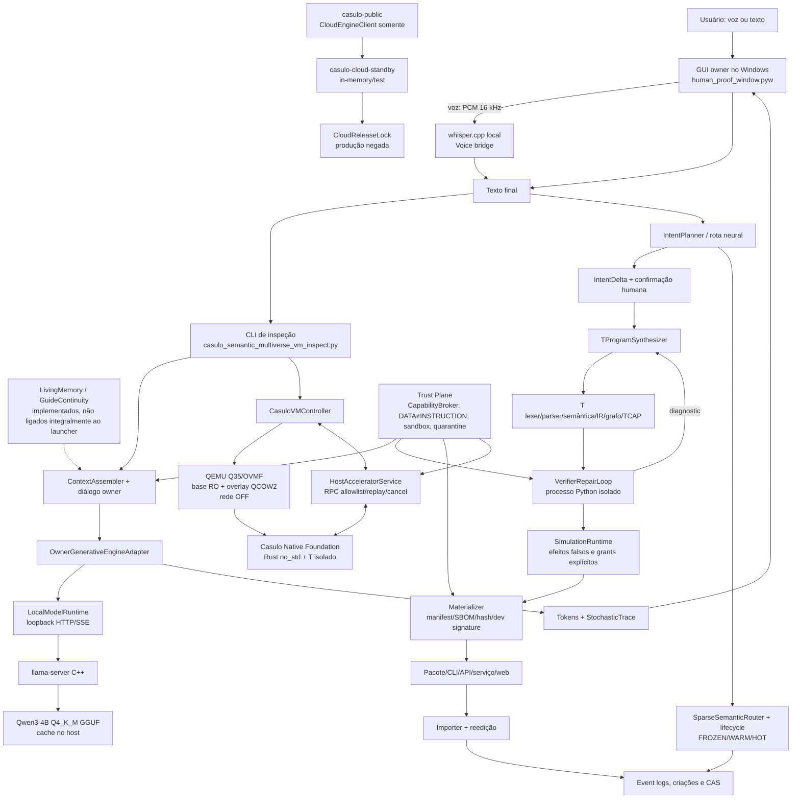

# Radiografia integral do motor Casulo atual

**Data da inspeção:** 2026-08-14 19:35:54 -03:00  
**Escopo:** estado local imediatamente posterior a RC0–RC13, antes da prova humana de Guilherme  
**Natureza:** auditoria técnica read-only; não é material promocional, parecer jurídico ou aprovação humana  
**Legenda de maturidade:** **A** executado e comprovado no caminho owner atual; **B** implementado e testado, ainda não exercido por Guilherme ou não integrado ao launcher atual; **C** parcial, harness, scaffold ou standby; **D** somente arquitetura/contrato/roadmap; **E** ausente, bloqueado ou proibido  
**Legenda de evidência:** `[CODE]`, `[TEST]`, `[RUNTIME_EVIDENCE]`, `[ARTIFACT]`, `[DOC_ONLY]`, `[INFERENCE]`, `[NOT_VERIFIED]`

---

## 1. Identificação e integridade

### Baseline observado

| Item | Valor observado | Fonte e classificação |
| --- | --- | --- |
| Raiz do repositório | raiz que contém `AGENTS.md`, `README.md`, `src/`, `private/`, `os/` e `release/` | `[CODE]` inspeção local; caminhos neste relatório são relativos a essa raiz |
| Branch | `product/semantic-multiverse` | `[RUNTIME_EVIDENCE]` `git branch --show-current` |
| Commit | `df12e916c90d9bd2b966326275dc191573f38abd` | `[RUNTIME_EVIDENCE]` `git rev-parse HEAD` |
| Worktree | substancialmente modificado e não rastreado; 19.801 entradas no snapshot porcelain | `[RUNTIME_EVIDENCE]` o estado foi preservado, não limpo nem normalizado |
| SHA-256 do snapshot textual do status | `7741325dd62bdd7dce595436a18091a1c4886fe6d1a3106bf18731fef9e96c92` | `[RUNTIME_EVIDENCE]` linhas de `git status --porcelain=v1 -uall`, unidas por LF |
| Estado durável | `READY_FOR_GUILHERME_CASULO_BETA_HUMAN_PROOF` | `[ARTIFACT]` `docs/product/RC_EXECUTION_STATE.md`; ainda requer a prova humana |
| Espaço livre observado | 83.475.750.912 bytes, 77,74 GiB | `[RUNTIME_EVIDENCE]` unidade C: durante esta inspeção; o resumo narrado de 77,83 GiB é temporalmente plausível, mas não é o valor atual exato |
| Arquivos auditados | 398 arquivos, 5.435.057 bytes no corpus focal | `[RUNTIME_EVIDENCE]` código, testes, documentos, gates, ferramentas e release; SHA do corpus `61aafd00c72745a3b2a0d4ee4205c6b6d2bb4ebf67f5c6cca39a9b0b5001a58a` |

O worktree sujo é anterior a este relatório e contém a linha evolutiva efetiva do produto. Por isso, o commit sozinho não identifica o motor analisado. O baseline útil é a combinação commit + status + manifests selados. Nenhum `reset`, `checkout`, `clean`, stash, instalação, download, rede, microfone, alto-falante, VM interativa, geração neural ou benchmark foi executado nesta radiografia.

### Release owner analisado

O release corrente é `release/human-proof/`. Seu `MANIFEST.json` tem SHA-256 `b6bfaa8166b0b2174392be64c1936a266e8a8cd119c9c7a8ab5e38017c2c4196`. O arquivo de assinatura é `release/human-proof/MANIFEST.json.sig`, SHA-256 `bd4f0309bfec4c210a27b3a9a1f0255df86f87e2329ebd268ec66fed05e3e782`; a assinatura é Ed25519/SSH com namespace de desenvolvimento e rótulo **`DEVELOPMENT_NOT_COMMERCIAL`**. A chave privada não está no repositório. `[ARTIFACT]`

O manifest ainda carrega internamente `RC12_CANDIDATE_PENDING_GATE`, embora os estados externos e o recibo de RC13 registrem o reseal. É uma divergência de metadado, não prova de corrupção, e deve ser corrigida em um futuro ciclo controlado, não nesta inspeção. `[ARTIFACT]`

Hashes principais confirmados em artefatos existentes:

- imagem Native: `74fe4b1130b40f5090c9944acdd4da0b86c122ab99be5a6b314f61a7e22b810b`, 2.162.688 bytes;
- pacote owner: `547cc4047b5d7523dae28960dbaa67971bdf952ece4a9e7b2a9f14a9104f6a9a` conforme o selo corrente;
- wheel owner: `f4c6b14f06c3985883d9a093b162fe4ce649d342d6fcde334d8d8b899fe58484`;
- wheel public: `ec6d03fb0f93bab38ad07f3f891599d58e4dde1245af18278fe4cf4e3a0ead08`;
- wheel cloud-standby: `21cc6f8e5abba593c4a85d8b9e58695b960a821956cbf8c6fa9e07aefa2a0ee9`;
- launcher VBS atual: `bb5d0759ce664b812e3dd66dcc50c984d02273789040a868eb4b8a1419c5ceea`;
- `release/human-proof/SHA256SUMS`: `b5c820b66b24b30a07265b7182f1c5f684233c0f9cbb86d2ba511239c01ad42c`;
- árvore de 65 arquivos de `release/human-proof/`: SHA agregado desta auditoria `0f035c8aeeb958b07270d8eec7c88300ee3d29bc2f070af513986de7cfcd973e`.

Os hashes abreviados são identificadores de leitura; os valores integrais permanecem em `release/human-proof/MANIFEST.json`, `release/human-proof/SHA256SUMS` e recibos RC. Não se reproduzem chaves ou material privado aqui.

### Estado das edições

- **Owner — A/B:** pacote privado mutuamente exclusivo, sem fake engine ou API externa detectados; usa o runtime local e os pesos em cache. O fluxo selado atual ainda depende do checkout completo e do Python do host, portanto não é um appliance autônomo. `[CODE][TEST][ARTIFACT]`
- **Public — C:** cliente `CloudEngineClient` e artefato redistribuível sem motor/pesos privados; falha honestamente sem transporte. Não há serviço público utilizável. `[CODE][TEST][ARTIFACT]`
- **Cloud — C/E para produção:** gateway, auth abstrata, fila e política in-memory existem, mas `RELEASE_LOCKED` impede bind de produção; DNS, credenciais e deploy real não existem. `[CODE][TEST]`
- **QPU/USB/block devices — E:** indisponíveis ou proibidos por contrato e testes. `[CODE][TEST]`

### Ferramentas e Machine Profile

`docs/product/RC_MACHINE_PROFILE.json` e `docs/product/RC_DEPENDENCY_INVENTORY.json` registram Windows 11 bare-metal, Python 3.13.2, Git 2.54, Rust/Cargo 1.93 e toolchain nightly 2026-02-01 com rustc/cargo 1.95, Clang 22.1.8, QEMU/qemu-img 11.0.50, Node 22.14, CMake 4.3.2, Ninja 1.13.2, GCC 16.1 e NASM 2.16.03. `[ARTIFACT]` Esta inspeção não reinstalou nem atualizou esses executáveis.

### Método e limitações

Foram cruzados: documentação, código de produção, entrypoints, testes, XMLs/recibos existentes, manifests, pacotes selados e hashes. Os gates não foram reexecutados porque o Goal é estritamente de inspeção e a execução poderia alterar caches/artefatos; portanto, “PASS” abaixo significa **evidência existente conferida**, não uma nova execução. Não houve teste subjetivo, áudio físico, inferência nova, boot interativo, execução externa nova, verificação jurídica de licenças ou medição de RAM/energia. Caminhos pessoais foram omitidos.

---

## 2. Resumo executivo brutalmente honesto

### Respostas diretas

1. **O que é o motor hoje?** Um produto híbrido hosted/VM, majoritariamente Python first-party, que põe um modelo Qwen local atrás de contratos de contexto, intenção, capabilities, verificação, T, materialização e proveniência. A VM Native fornece isolamento/boot e uma ponte delimitada; a inferência e quase toda a experiência cognitiva continuam no host Windows. `[CODE][ARTIFACT]`
2. **O que é genuinamente first-party?** Os contratos de edição e engine, contexto, diálogo, intenção, T frontend/IR/grafo/TCAP, capability broker, verificador/reparo, memória, Semantic Multiverse, materialização, ponte host/guest, launcher, Native Foundation e ferramentas de evidência. O peso linguístico e o runtime tensorial não são first-party. `[CODE]`
3. **Dependências externas?** Qwen3-4B fornece capacidade linguística; `llama.cpp` executa GGUF; Python coordena o produto; C/C++ sustenta inferência/ASR e toolchains; Windows fornece host, DPAPI, voz opcional e QEMU; QEMU hospeda o guest; Rust/x86-64 implementa a fundação Native. `[CODE][ARTIFACT]`
4. **O que T controla de verdade?** T compila contratos pequenos de decisão, effects/capabilities e artefatos auditáveis. O pipeline existe. Porém o caminho generativo corrente produz unidades T estreitas que emitem texto; a computação científica Einstein é Python, o modelo é C++/GGUF e o launcher é Python/VBS. `[CODE][TEST]`
5. **Gera algo inédito?** Sim, o Qwen local gera conversa, intenção, rotas, nomes e literais/código T não pré-roteirizados, com sampling estocástico. Mas o executável de agente gerado hoje é limitado: a principal semântica é um literal textual verificado por contains; não equivale a síntese geral de software. `[RUNTIME_EVIDENCE][CODE]`
6. **O que foi comprovado automaticamente?** Gates RC, inferência local sem API, T real em contratos delimitados, reparo por diagnostic, materialização e round-trip, isolamento owner/public/cloud, ataques especificados, boot/restore/crash e voz sintética. `[TEST][RUNTIME_EVIDENCE]`
7. **O que falta a Guilherme?** Qualidade da conversa, química, utilidade em tarefas livres, fidelidade da criação, qualidade ASR/TTS, estética, tolerância a interrupções e comportamento do fluxo one-click. `[NOT_VERIFIED]`
8. **Maior conquista?** Uma cadeia coerente e verificável que conecta inferência local estocástica a intenção confirmada, artefatos T, diagnósticos, sandbox, materialização e retomada, preservando limites de edição. `[CODE][RUNTIME_EVIDENCE]`
9. **Maior fragilidade?** A integração é menor que a soma dos subsistemas: o launcher atual não conecta toda a memória/Guide/voz de saída, o T generativo é semanticamente estreito, e o Semantic Multiverse contabiliza universos mais do que carregar módulos neurais físicos distintos. `[CODE][INFERENCE]`
10. **Claim comercial honesto?** “Beta owner local, executável no host Windows com VM isolada, que usa um modelo local bootstrap para conversar e materializar protótipos auditáveis sob contratos first-party; aguarda validação humana e não é um SO Native completo nem um foundation model próprio.”

### Matriz de alegações

| Alegação | Estado A–E | Evidência | Ressalva |
| --- | ---: | --- | --- |
| Qwen local real, sem API externa | A | `[CODE][RUNTIME_EVIDENCE][ARTIFACT]` runtime, trace e hashes | inferência no host; modelo third-party |
| Geração neural estocástica | A | `[CODE][RUNTIME_EVIDENCE]` sampling sem seed fixa em modo normal | não prova qualidade geral |
| Criação inédita chega a pacote executável | A | `[RUNTIME_EVIDENCE][ARTIFACT]` RC11/RC9 | lógica executável atual é estreita e textual |
| Linguagem T completa e soberana sobre todo o motor | E | `[CODE]` fronteiras e caminhos Python/C++ | score 1,0 é de um audit delimitado de contratos |
| Memória viva cifrada e retomável | B | `[CODE][TEST][RUNTIME_EVIDENCE]` DPAPI/reopen | não conectada ao launcher humano corrente |
| Semantic Multiverse reduz working set neural físico | C | `[CODE][TEST]` estados e bytes declarados | não mede RSS nem troca pesos/módulos reais |
| VM owner one-click pronta para inspeção | B | `[TEST][ARTIFACT]` launchers, boots, reseal | Guilherme ainda não aprovou o fluxo; depende do repo/host |
| Voz primária com barge-in | B/C | `[CODE][TEST][RUNTIME_EVIDENCE]` captura física anterior e testes | resposta TTS não integrada ao GUI atual; qualidade não aprovada |
| Cinco targets materializados e round-trip | A | `[TEST][RUNTIME_EVIDENCE][ARTIFACT]` RC9/RC11 | requerem Python/loopback conforme target; assinatura dev |
| Casulo Native é um SO completo | E | `[CODE][DOC_ONLY]` Native Foundation | drivers e workloads hosted permanecem no Windows |
| Public não contém motor privado | A para artefato atual | `[TEST][ARTIFACT]` auditorias source/wheel | não há Cloud disponível para produto público |
| Cloud de produção disponível | E | `[CODE][TEST]` fail-closed | somente harness/in-memory standby |

---

## 3. Diagrama integral da arquitetura



Fallback textual:

```text
[HOST WINDOWS]
  pessoa -> GUI -> (microfone -> whisper.cpp -> texto) -> shell de inspeção
       -> contexto/prompt -> OwnerGenerativeEngineAdapter
       -> llama-server -> Qwen GGUF -> tokens/traces -> GUI
       -> IntentDelta confirmado -> gerador T -> frontend/IR/grafo/TCAP
       -> verificador/reparo -> simulação sem efeitos -> Materializer
       -> pacote externo -> importador/reedição -> CAS/eventos
       -> roteador/lifecycle Semantic Multiverse (estado lógico)
       -> VMController -> [QEMU: base RO + overlay]
                       <-> ponte allowlist <-> [GUEST CASULO NATIVE]

[OUTRAS EDIÇÕES]
  public -> CloudEngineClient -> CloudTestHarness
  cloud-standby -> gateway/job/policy in-memory -> RELEASE_LOCKED
```

### Nascimento, transformação, persistência e descarte dos dados

1. Áudio nasce em buffers PCM no host; por default não é persistido. O ASR emite partial/final e o áudio morre após a sessão, salvo ação explícita. `[CODE]`
2. Texto entra como `EngineRequest`/turno; `ContextAssembler` o separa de memória, constraints e conteúdo importado. Contexto remoto inexiste neste perfil. `[CODE]`
3. Qwen transforma o prompt em tokens; apenas hashes, política de sampling e metadados entram no `StochasticTrace`, não o áudio bruto. `[CODE]`
4. A intenção vira `IntentDelta`/`CreationSpec`; materialidade exige confirmação. Candidatos inválidos morrem antes de commit; materialização válida não é destruída por falha visual. `[CODE][TEST]`
5. T vira AST, IR, grafo e TCAP content-addressed. Diagnósticos retornam ao reparo; resultados tardios de geração cancelada são descartados. `[CODE][TEST]`
6. Memória persistente, quando usada, é evento cifrado + hash chain; Semantic Multiverse usa CAS imutável, manifests e deltas. O launcher corrente não conecta toda essa memória. `[CODE]`
7. A VM usa base read-only e overlay; snapshot/restore atuam no overlay. Nenhum disco físico é anexado. `[CODE][TEST]`

---

## 4. Catálogo completo de componentes

| Componente | Função | Linguagem | Origem | Estado | Entrypoints | Dependências | Efeitos | Trust boundary | Evidências |
| --- | --- | --- | --- | ---: | --- | --- | --- | --- | --- |
| GUI Human Proof | janela e comandos | Python/VBS | first-party | B | `release/human-proof/START_CASULO_OWNER.vbs`, `OWNER_VM/tools/human_proof_window.pyw` | pyw, repo | UI, subprocess | host owner | `[CODE][TEST][ARTIFACT]` |
| Shell SM inspection | conversa/criação/comandos | Python | first-party | A/B | `tools/casulo_semantic_multiverse_vm_inspect.py` | owner/core/QEMU | arquivos, VM | owner host | `[CODE][RUNTIME_EVIDENCE]` |
| CasuloEngine contract | request/events/cancel | Python | first-party | B | `src/casulo/product/engine_contracts.py` | stdlib | eventos | adapter boundary | `[CODE][TEST]` |
| Owner adapter | acesso direto ao motor | Python | first-party | A | `private/casulo-owner/src/casulo_owner/adapter.py` | owner runtime | local inference | private edition | `[CODE][TEST][ARTIFACT]` |
| LocalModelRuntime | processo llama, SSE, limites | Python | first-party wrapper | A | `local_model_runtime.py` | llama.cpp/Qwen | loopback/process | model boundary | `[CODE][RUNTIME_EVIDENCE]` |
| Qwen3-4B Q4_K_M | geração linguística | GGUF | third-party | A | arquivo de cache via registry | llama.cpp | inferência | weight boundary | `[ARTIFACT][RUNTIME_EVIDENCE]` |
| llama.cpp server | execução GGUF | C++ | third-party | A | `llama-server.exe` local | CPU runtime | processo/loopback | foreign ABI | `[ARTIFACT][RUNTIME_EVIDENCE]` |
| Dialogue core | perfil, modos, contexto | Python/prompt | first-party | A/B | `dialogue_core.py` | model runtime | estado em memória | untrusted output | `[CODE][TEST]` |
| GuidePresence | presença independente de job | Python | first-party | B | `guide_presence.py` | engine events | estado | progress receipts | `[CODE][TEST]` |
| GuideContinuity | decisões, conflito, contexto | Python | first-party | B | `guide_continuity.py` | append log | persistência | project scope | `[CODE][TEST][RUNTIME_EVIDENCE]` |
| LivingMemory | memória cifrada/recall | Python | first-party | B | `living_memory.py` | Windows DPAPI | arquivos cifrados | OS user boundary | `[CODE][TEST][RUNTIME_EVIDENCE]` |
| IntentEngine | delta/confirm/reject | Python | first-party | A/B | `intent_engine.py` | domain model | event log | human confirmation | `[CODE][TEST]` |
| IntentPlanner | JSON neural validado | Python/prompt | first-party | A | `generative_forge.py` | Qwen | model.infer | schema/capability | `[CODE][RUNTIME_EVIDENCE]` |
| RequirementGraph | obrigações HARD/SOFT | Python | first-party | B | `revolution_contracts.py` | verifiers | receipts | fulfillment gate | `[CODE][TEST]` |
| Semantic fulfillment | packs e reparo arquitetural | Python | first-party | B | `semantic_fulfillment.py` | graph | validation | independent evidence | `[CODE][TEST][RUNTIME_EVIDENCE]` |
| TProgramSynthesizer | projeto T neural | Python/prompt | first-party | A | `generative_forge.py` | Qwen/T toolchain | files/model infer | bounded schema | `[CODE][RUNTIME_EVIDENCE]` |
| T frontend | léxico, parser, AST, semântica | Python | first-party | A/B | `src/casulo/t/lexer.py`, `parser.py`, `semantic.py` | stdlib | diagnostics | compiler input | `[CODE][TEST]` |
| T IR/grafo | lowering/CFG/Metamorfose | Python | first-party | A/B | `ir.py`, `graph.py`, `lowering.py` | frontend | artifacts | compiler | `[CODE][TEST]` |
| TCAP | cápsula segmentada/manifestada | Python + binário | first-party | A/B | `tcap.py`, `tcap_loader.py` | hashes/ABI | loader | execution boundary | `[CODE][TEST][ARTIFACT]` |
| Python reference backend | executa artefato T | Python | first-party, foreign to T | A | `artifact.py`, `runner.py` | Python | subprocess | sandbox | `[CODE][TEST]` |
| C99/native backend | emite C/ABI | Python/C | first-party | B | `c99_backend.py`, `native_backend.py` | clang/gcc | binary | FFI/native | `[CODE][TEST]` |
| VerifierRepairLoop | diagnóstico, reparo finito | Python | first-party | A | `verifier_repair.py` | T/Qwen/subprocess | rebuild | untrusted code | `[CODE][RUNTIME_EVIDENCE]` |
| SimulationRuntime | doubles sem efeitos reais | Python | first-party | A/B | `simulation.py` | capabilities | simulated | sandbox | `[CODE][TEST]` |
| Materializer | pacotes/targets/manifests | Python | first-party | A | `materializer.py` | zip/hash/signature | writes staged | export boundary | `[CODE][TEST][RUNTIME_EVIDENCE]` |
| Importer/reeditor | valida e reabre pacote | Python | first-party | A | `materializer.py` | zip/hash | read/write new version | quarantine | `[CODE][TEST][RUNTIME_EVIDENCE]` |
| Semantic Multiverse core | CAS/catalog/router/lifecycle | Python | first-party | C/B | `semantic_multiverse.py` | filesystem | CAS/deltas | universe manifests | `[CODE][TEST]` |
| Owner SM planner | rota neural + sessão | Python/prompt | first-party | A/B | owner `semantic_multiverse.py` | Qwen/core | CAS/receipts | owner/private | `[CODE][RUNTIME_EVIDENCE]` |
| Learned router | Naive Bayes de rota | Python/data | first-party | B | `learned_router.py` | modelo JSON | inferência local | narrow dataset | `[CODE][TEST][ARTIFACT]` |
| CapabilityBroker | deny/grants/approval | Python | first-party | B | `capabilities.py` | domain types | decisions | Trust Plane | `[CODE][TEST]` |
| Host accelerator | RPC allowlist | Python | first-party | B | `host_accelerator.py` | VM transport | host calls | guest/host | `[CODE][TEST]` |
| VMController | QEMU/overlay/snapshot | Python | first-party wrapper | A/B | `vm_controller.py`, `tools/casulo_vm.py` | QEMU/OVMF | process/disk overlay | VM boundary | `[CODE][TEST][RUNTIME_EVIDENCE]` |
| Casulo Native Foundation | boot, memória, ring3, TCAP | Rust/asm | first-party | B | `os/src/main.rs`, `os/Cargo.toml` | UEFI/Rust | guest hardware virtual | kernel boundary | `[CODE][TEST][ARTIFACT]` |
| VoiceDuplex | turnos/barge-in | Python | first-party | B | `voice_duplex.py` | ASR/TTS/VAD | audio | device boundary | `[CODE][TEST]` |
| Whisper bridge | ASR local | Python/C++ | wrapper first-party + third-party | B | `voice_bridge.py`, `whisper_worker.py` | whisper.cpp/model | process/audio | ASR boundary | `[CODE][TEST][RUNTIME_EVIDENCE]` |
| TTS first-party | formant fallback | Python | first-party | B | `first_party_tts.py` | audio output | PCM | device boundary | `[CODE][TEST]` |
| System.Speech Maria | TTS hosted opcional | Windows component | third-party/OS | B | `tts_streaming.py` | Windows | playback | OS boundary | `[CODE][TEST]` |
| AudioFrontend | filtro/gate/AGC simples | Python | first-party | C | `audio_frontend.py` | PCM | transforms | audio boundary | `[CODE][TEST]` |
| CreationFieldRenderer | visual derivado de estado | Python/HTML | first-party | A/B | `creation_field.py` | browser local | file render | presentation | `[CODE][TEST][RUNTIME_EVIDENCE]` |
| Public client | CloudEngineClient | Python | first-party | C | `editions/casulo-public/src/casulo_public/client.py` | transport injected | remote request | public boundary | `[CODE][TEST][ARTIFACT]` |
| Cloud standby | gateway/jobs/policy | Python | first-party | C/E prod | `gateway.py` | in-memory adapters | simulated network | release lock | `[CODE][TEST][ARTIFACT]` |
| OfflineABUpdater | staged signed updates | Python | first-party | B | `offline_update.py` | Ed25519/files | inactive slot/current | update boundary | `[CODE][TEST]` |

---

## 5. Motor neural generativo

### Modelo, runtime e artefatos

O modelo-base é **Qwen3-4B**, formato **GGUF**, quantização **Q4_K_M**, Apache-2.0, revisão registrada `bc640…`. O blob local tem 2.497.280.256 bytes e SHA-256 `7485fe6f11af29433bc51cab58009521f205840f5b4ae3a32fa7f92e8534fdf5`. `[ARTIFACT]` Ele foi autorizado como download bootstrap de 2.515.707.139 bytes; não é peso criado por Casulo.

O runtime é `llama.cpp` b10362, commit registrado `4801e3c…`, licença MIT. O archive de runtime registrado tem 18.426.883 bytes, SHA `a9d95d26…`; o `llama-server.exe` cacheado auditado tem 9.216 bytes, SHA `76008a268ba602b0a398a5d7d542a686ac279b662d97abc7eee84536d049264e`. O tamanho muito pequeno do executável merece verificação distributiva futura, embora os receipts existentes mostrem o endpoint local em funcionamento. `[ARTIFACT][INFERENCE]`

`LocalModelRuntime` em `private/casulo-owner/src/casulo_owner/local_model_runtime.py` inicia `llama-server.exe` sem shell, limitado a `127.0.0.1`, passa modelo, porta, `--ctx-size`, threads e `--reasoning off`, consulta `/health` e consome SSE de `/v1/chat/completions`. Contexto default: 8.192 tokens; prompt/context serializado limitado a 131.072 caracteres; schema a 64 KiB; evento de stream a 16.384 caracteres; geração a até 4.096 tokens; startup a 180 s; idle timeout default 180 s. `[CODE]`

Políticas congeladas:

| Política | temperature | top_p | top_k | min_p | repeat penalty | max tokens |
| --- | ---: | ---: | ---: | ---: | ---: | ---: |
| diálogo | 0,70 | 0,90 | 40 | 0,05 | 1,10 | 512 |
| planejamento | 0,45 | 0,90 | 30 | 0,05 | 1,10 | 768 |
| código | 0,25 | 0,90 | 40 | 0,02 | 1,05 | 1.024; sintetizador pode usar 1.536 |

Seed fixa só é aceita em debug. No modo owner normal não há seed, logo existe variância real. Cada execução emite `StochasticTrace` com política, hashes de contexto/saída, modelo, eventos e tempos. O texto pode streamar token a token; cancelamento fecha a conexão e resultado tardio não é publicado. `[CODE][TEST][RUNTIME_EVIDENCE]`

Não há flag explícita de GPU no comando atual; o perfil exercido é CPU, com quatro threads default. Não existe receipt confiável de RAM pico ou offload GPU para este release. O processo é descarregado por término controlado, não por um gerenciador sofisticado de camadas. `[CODE][NOT_VERIFIED]`

### Relação entre bootstrap e motor

Qwen fornece a distribuição linguística e a capacidade geral de seguir instruções. Casulo fornece: montagem de contexto, política relacional, schemas, confirmação, efeitos, rotas, T, verificação/reparo, materialização, memória, lifecycle e provenance. Portanto “motor Casulo” é uma **arquitetura first-party ao redor de um foundation model bootstrap third-party**, não um novo foundation model. `[CODE][INFERENCE]`

O `OwnerGenerativeEngineAdapter` é real e não usa `DeterministicFakeEngine`; o release owner foi auditado contra indicadores de API externa. O loopback HTTP não é uma API comercial ou rede externa. `[TEST][ARTIFACT]`

### Treinamento e adapters: resposta inequívoca

- **Foi treinado algum peso?** Sim, apenas o roteador Naive Bayes estreito do RC5; não foram treinados pesos do Qwen. `[CODE][ARTIFACT]`
- **Qual peso?** Um modelo de classificação lexical `LearnedRouterModel`, arquivo de aproximadamente 36.330 bytes, SHA de arquivo `1debe8…`, treinado com 36 registros sintéticos first-party: 18 treino, 6 validação e 12 teste, seis classes e 24 famílias de cenário. `[ARTIFACT]`
- **Em qual hardware?** No host local, CPU/Python; o receipt não sustenta GPU/cluster. `[ARTIFACT]`
- **Qual artefato?** JSON/modelo Naive Bayes word + char 4-gram. Obteve 1,0 no holdout sintético contra baseline de nome exato 0,25. `[TEST][ARTIFACT]`
- **Participa do caminho real?** Não do launcher owner atual: não aparece na allowlist/pacote owner e não é importado pelo adapter em produção. É B, não A. `[CODE][ARTIFACT]`
- **O GGUF foi apenas usado para inferência?** Sim. `[CODE][ARTIFACT]`
- **Existe QLoRA real?** Não. Foi corretamente bloqueado/deferido por ausência de capacidade e justificativa; não há adapter QLoRA, dataset, checkpoint ou model card de fine-tune integrado. `[DOC_ONLY][NOT_VERIFIED]`
- **Datasets/checkpoints próprios do modelo conversacional?** Ausentes. O dataset sintético do router não transforma Qwen em modelo Casulo. `[ARTIFACT]`

O maior limite aqui não é a autenticidade da inferência — ela é real —, mas a diferença entre “modelo generativo inserido em um sistema first-party” e “modelo generativo first-party”. A primeira formulação é sustentada; a segunda não.

---

## 6. Guia e experiência cognitiva

### Presença, diálogo e turnos

`GuidePresence` (`src/casulo/product/guide_presence.py`) é uma máquina de estados determinística que separa a presença conversacional da execução de jobs. Ela mantém estados como disponível, ouvindo, pensando e falando; recebe somente eventos de job validados e nunca fabrica porcentagem. Cancelamento carrega geração/identidade para que um resultado antigo não reapareça. É **B**: código e testes existem, mas o launcher humano corrente não a usa como seu controlador completo. `[CODE][TEST]`

O caminho owner efetivo usa `GenerativeDialogueCore` e `ContextAssembler` em `private/casulo-owner/src/casulo_owner/dialogue_core.py`. O prompt do sistema define um colega caloroso, intelectualmente exigente, não bajulador, sem alegação de consciência. Um perfil relacional inicial congela aproximadamente calor 6, desafio 7, humor 3, iniciativa 7 e brevidade 6. Mudanças materiais nesse perfil exigem aprovação humana. `[CODE]`

Os modos reais são **EXPLORATION/EXPANSION** e **CRYSTALLIZATION**: o primeiro amplia possibilidades; o segundo converge intenção em requisitos e criação. A mudança de modo é parte de estado/contrato, não um “estado mental” aprendido. `[CODE][TEST]`

`ContextAssembler` ordena itens por prioridade, separa constraints obrigatórias, limita itens e caracteres e marca conteúdo importado como `DATA`, não `INSTRUCTION`. Constraints obrigatórias não podem ser truncadas silenciosamente. O contexto owner é consumido por digest/one-shot para reduzir replay. `[CODE][TEST]`

### Continuidade e memória de projeto

`GuideContinuityKernel` em `src/casulo/product/guide_continuity.py` mantém por projeto um event log encadeado, decisões aceitas, decisões rejeitadas, constraints e provenance. Quando duas constraints duras conflitam, ele não escolhe em nome do usuário. `DialogueDirector` ranqueia perguntas pelo ganho de informação menos custo/pressão. A seleção de contexto é lexical com prioridade de criticalidade/privacidade. É **B**. `[CODE][TEST][RUNTIME_EVIDENCE]`

O launcher `tools/casulo_semantic_multiverse_vm_inspect.py`, entretanto, mantém a conversa corrente em uma lista Python limitada aos últimos turnos. Seu comando `:memoria` inspeciona catálogo/GC do Semantic Multiverse, não a `LivingMemory` pessoal. A GUI `human_proof_window.pyw` inicia esse shell e injeta o checkout no `PYTHONPATH`. Assim, a promessa de retomada orgânica existe em subsistemas e probes, mas **não está integralmente presente no caminho humano atual**. `[CODE]`

### Contradição, clarificação, contestação e pressão

- contradições de constraints duras: detectadas por `GuideContinuityKernel`, resolução humana obrigatória — B;
- perguntas de clarificação: `DialogueDirector` e prompt owner — B/A parcialmente;
- contestação útil: sobretudo instrução no prompt do sistema, não classificador aprendido — A como comportamento solicitado, qualidade não verificada;
- pressão: variável/configuração que não pode aumentar sem consentimento — B;
- preferência relacional: perfil explícito e proposta de adaptação — B;
- conversa enquanto jobs rodam: arquitetura/eventos existem; experiência contínua completa não foi humanamente provada — B;
- progresso: só nasce de `EngineEvent`/receipt validado; texto do modelo não autoriza estado “pronto” — B/A nos probes.

### O que sustenta “science bros com química de trabalho”

Tecnicamente, a sensação pretendida nasce de três mecanismos: prompt relacional explícito, perfil determinístico de colaboração e memória/provenance por projeto. Não existe um “modelo de química” treinado, recompensa online, fine-tune relacional ou adaptação silenciosa. A qualidade social efetiva ainda é **prova humana pendente**. `[CODE][DOC_ONLY][NOT_VERIFIED]`

---

## 7. Memória viva

### Implementação

`LivingMemory` (`src/casulo/product/living_memory.py`) implementa um log append-only por eventos, com um arquivo cifrado por evento, representação canônica e hash chain. Cada evento exige `source_ids`; projeções são derivadas em memória para quatro vistas: episódica, semântica, criação e colaboração. Em Windows, o backend produtivo é DPAPI vinculado ao usuário; `TestSecretBox` é recusado salvo modo de teste explícito. `[CODE][TEST]`

O recall combina 65% de Jaccard lexical com 35% de cosseno sobre vetores hashed de 64 dimensões. Se os dois melhores scores estiverem dentro de 0,05, o retorno é ambíguo e deve provocar clarificação. Isso não é embedding neural nem busca semântica profunda. `[CODE]`

| Aspecto | Estado | Funcionamento real |
| --- | ---: | --- |
| schema/evento | B | evento canônico, projeto/subject, tipo, payload, source IDs, hash anterior/atual |
| cifragem | B | DPAPI por usuário no Windows; teste de reopen preservado |
| hash chain | B | detecção de adulteração/reordenação |
| provenance | B | obrigatória por `source_ids` e hashes |
| projeções | B | episódica, semântica, criação, colaboração |
| supersession | C | “último evento” projeta estado, mas não há protocolo rico de supersession/merge |
| recall | B | lexical + hash vector, ambiguidade explícita |
| exportação | B | plaintext somente por ação explícita |
| exclusão | B | exige frase exata/consentimento; remove o escopo solicitado |
| isolamento de projeto | C | subject/project IDs, porém sem ACL forte interna ou lock multiprocesso |
| reboot | B | reopen DPAPI e reconstrução testados |
| limite de crescimento | C | append-only; ausência de compactação produtiva agressiva |
| integração ao launcher | E/Ausente | shell atual não instancia `LivingMemory` |

Possíveis perdas/riscos: evento gravado e não projetado após crash exige rebuild; corrupção é detectável mas recuperação automática é limitada; não há sincronização remota; não há file lock robusto para dois escritores; export plaintext transfere a responsabilidade ao usuário; seleção lexical pode perder uma lembrança semanticamente equivalente; project IDs não substituem isolamento de segurança. `[CODE][INFERENCE]`

### Fluxo “Lembra daquilo?”

Fluxo implementável no subsistema, mas não conectado de ponta a ponta ao launcher:

```text
“Lembra daquilo?”
 -> GuideContinuity identifica ou pergunta o project_id
 -> LivingMemory.recall normaliza consulta
 -> restringe eventos/projeções ao subject/project
 -> calcula Jaccard + hashed-cosine
 -> se scores próximos: retorna ambiguidade, não inventa
 -> valida chain/provenance e constraint de privacidade
 -> ContextAssembler seleciona trechos sob orçamento
 -> Qwen formula resposta com memória marcada como contexto/dado
```

Arquivos: `guide_continuity.py`, `living_memory.py`, `dialogue_core.py`. Failure modes: projeto ambíguo, chain adulterada, DPAPI indisponível, orçamento insuficiente, recall fraco. Testes: `tests/product/test_living_memory.py` e testes de continuidade. Receipt: eventos encadeados e probes de reopen/recall. Classificação final: **B**, com integração humana **C/E**. `[CODE][TEST]`

---

## 8. Semantic Multiverse

### O que existe

O core em `src/casulo/product/semantic_multiverse.py` contém:

- `SemanticUniverseManifest` com identidade, capacidades, vizinhos, memória e wake cost declarados;
- `ContentAddressedUniverseStore` com blobs imutáveis, manifests, deltas e quarentena;
- `GlobalSemanticCatalog` para catálogo persistente;
- `SparseSemanticRouter` lexical que combina relevância, custo de despertar, memória e risco;
- `UniverseLifecycleManager` com estados `FROZEN`, `WARMING`, `WARM`, `ACTIVATING`, `HOT` e leases;
- `SemanticTransitionRuntime` que projeta estado suficiente e impede ampliação de capabilities;
- `MemoryThermostat`, `SemanticPrefetcher`, `WormholeRegistry` e `OperationalEquivalenceHarness`.

O owner em `private/casulo-owner/src/casulo_owner/semantic_multiverse.py` acrescenta planejamento de rota pelo Qwen, geração de IR/TCAP semântico, sessão, receipts e visualização. Os seis universos instalados são `intencao`, `sinais`, `engenharia`, `diagnostico`, `interface` e `materializacao`. `[CODE][ARTIFACT]`

### Lifecycle real e working set

Ativação muda estado lógico e emite receipts; a pressão pode hibernar o universo menos recentemente usado sem lease. Uma sessão canônica de seis universos produziu 28 lifecycle receipts, cinco transition receipts, apenas `materializacao` HOT ao final e HOT vazio após reboot. Rotas menores podem legitimamente produzir outras contagens. `[RUNTIME_EVIDENCE]`

O ponto crítico: `activation_memory_bytes`, `warm_memory_bytes` e `wake_cost_ms` são **valores declarados em manifest**. O lifecycle não carrega/descarrega camadas do Qwen, bibliotecas científicas ou processos reais por universo. “Peak HOT bytes” soma valores declarados; não é RSS medido. Logo, FROZEN/WARM/HOT já governa catálogo/estado/receipts, mas não demonstra miniaturização física da IA. `[CODE][INFERENCE]`

### Métricas e equações

| Métrica/equação | Status | Mapeamento ao código |
| --- | --- | --- |
| score de rota = relevância − custo − memória − risco | `IMPLEMENTED_IN_CODE`, `USED_IN_RUNTIME`, `TESTED_ONLY` quanto à eficácia ampla | `SparseSemanticRouter.route` e campos de manifest |
| subconjunto HOT estrito | `IMPLEMENTED_IN_CODE`, `USED_IN_RUNTIME` | `UniverseLifecycleManager.hot_universes`, quotas/eviction |
| memória HOT declarada | `IMPLEMENTED_IN_CODE`, `USED_IN_RUNTIME`, não medição física | soma de `activation_memory_bytes` |
| wake cost | `DOCUMENTED/DECLARED`, usado como custo de seleção | `wake_cost_ms`, sem sleep ou medida de carregamento real |
| projeção de estado suficiente | `IMPLEMENTED_IN_CODE`, `USED_IN_RUNTIME`, `TESTED_ONLY` em domínios | `SufficientProjection`/transition runtime |
| equivalência operacional | `IMPLEMENTED_IN_CODE`, `TESTED_ONLY` | `OperationalEquivalenceHarness`, hard fields exatos, generativo exige review |
| pressão/thrashing | `IMPLEMENTED_IN_CODE`, `TESTED_ONLY` | `MemoryThermostat`, leases e contadores |
| deduplicação | `IMPLEMENTED_IN_CODE`, `USED_IN_RUNTIME` | SHA-256/CAS de blobs/manifests/deltas |
| compactação/esquecimento | `PARTIAL` | GC calcula dry-run; não apaga neste Goal |
| prefetch | `IMPLEMENTED_IN_CODE`, `TESTED_ONLY` | `SemanticPrefetcher`, custos declarados |
| wormhole | `IMPLEMENTED_IN_CODE`, `TESTED_ONLY` | `WormholeRegistry`, exige equivalência/provenance e rollback |

### Evidência RC6

O gate preserva 20 sessões, seis universos, sete blobs, 20 deltas, pico de dois HOT, 18 eventos de pressão, 15 testes, `sparse_peak_declared_bytes=50.331.648` contra `all_hot_declared_bytes=91.226.112`. Não houve GC destrutivo. Essa comparação sustenta a correção do **modelo de gerenciamento**, não redução de RAM física. `[TEST][ARTIFACT]`

### Project bleed e segurança

Manifests/deltas são content-addressed, importação inválida vai à quarentena, transições não ampliam permissions e estado suficiente inclui constraints/provenance. O isolamento entre projetos é lógico por IDs/CAS; não há processo ou modelo separado por projeto. Prompt injection é tratado como dado não confiável pelo ContextAssembler e por schemas. `[CODE][TEST]`

### Veredito da tese “IA como jogo pesado”

**Parcialmente sustentada como arquitetura, não demonstrada fisicamente.** Está demonstrado que um catálogo pode manter poucos universos HOT, preservar deltas e transicionar com receipts. Não está demonstrado que pesos/modelos/capacidades grandes sejam paginados ou que o working set real de RAM/VRAM caia na mesma proporção. Classificação **C**. `[CODE][TEST][INFERENCE]`

---

## 9. RequirementGraph e cumprimento semântico

### “Compilou” versus “é o que foi pedido”

`RequirementGraph` em `src/casulo/product/revolution_contracts.py` representa requisitos HARD/SOFT, dependências, ambiguidades, lacunas epistêmicas e verificadores exigidos. `FulfillmentEngine` não transforma compile success em fulfillment: uma evidência independente `FAIL` vence, falta de evidência vira `UNKNOWN`, e requisito HARD diferente de PASS bloqueia publicação. Segurança e claims não suportados também bloqueiam. `[CODE][TEST]`

`semantic_fulfillment.py` fornece domain packs para scientific, administrative, stream, creative e service. Os verificadores atuais são majoritariamente regras estruturais: presença de caminhos, operadores e invariantes declarados. Há múltiplos tipos de verificador, mas a configuração default frequentemente usa um verificador de invariantes por requisito; não foi localizada uma classe produtiva chamada `EvidencePlanner`. Esta ideia aparece na arquitetura, mas a implementação é distribuída por graph/evaluator/packs. `[CODE][DOC_ONLY]`

Estados:

- `PASS`: evidência exigida independente satisfeita;
- `FAIL`: verificador reprovou; para HARD, bloqueia;
- `UNKNOWN`: evidência ausente ou incapaz de decidir; não é promovido a PASS;
- `BLOCKED`: constraint/capability/epistemic gap impede execução responsável.

`ArchitectureRepairLoop` tem orçamento finito, detecta repetição e só publica candidato após reavaliação. Requisitos aprovados e constraints permanecem no contexto/graph. `[CODE][TEST]`

### Limite de integração

O probe owner corrente `generative_agent_probe.py` não usa todo o RequirementGraph para sua materialização principal. Ele adiciona um holdout externo, compila, executa um Python-reference artifact e verifica substring. Portanto o fulfillment robusto está **B**, enquanto o caminho de criação atual é **A com oráculo estreito**. `[CODE][RUNTIME_EVIDENCE]`

`CreationFieldRenderer` não deve decidir fulfillment. Após a terceira inspeção, `CreationPresentation.from_creation` em `src/casulo/product/creation_field.py` passou a validar/projetar a criação antes do render. `creation_id` é a identidade canônica; `content.identity.name` é opcional e pode ser texto ou objeto com `value` textual. Ausência usa `creation_id` e registra diagnostic; tipo incorreto falha antes do renderer. Schemas legados conhecidos podem usar `content.name`; schema futuro incompatível falha honestamente. Essa separação impede que um `KeyError` visual destrua uma materialização já concluída. `[CODE][TEST][RUNTIME_EVIDENCE]`

### Caso Einstein como regressão conceitual

A primeira criação Einstein chegou a materialização e falhou apenas no renderer por `identity.name` opcional. O archive foi preservado. A revalidação posterior criou um **avaliador tensorial local 4D**, não um solver geral. O kernel Python em `private/casulo-owner/src/casulo_owner/einstein_solver_kernel.py` valida métrica 4×4 simétrica, coordenadas, passo, tolerâncias e tensor energia-momento; calcula inversa, Christoffel, Ricci, escalar, Einstein, termo cosmológico, acoplamento `8πG/c⁴` e resíduo. Minkowski/vácuo/Lambda=0 resultou em zero. `[CODE][TEST][RUNTIME_EVIDENCE]`

Condições iniciais/de contorno são preservadas como provenance, não evoluídas como PDE. Assinatura `-+++`, unidades SI e convenção Wald são declaradas. Não há estabilidade geral, solução global ou validação científica ampla. A matemática está em Python; o T associado é um contrato textual pequeno. `[CODE][ARTIFACT]`

### Rastreabilidade representativa

| Pedido | Requirement | Artefato | Verificador | Receipt | Resultado |
| --- | --- | --- | --- | --- | --- |
| métrica 4×4 | dimensão e simetria HARD | spec + kernel Python | validação estrutural/kernel tests | evidence Einstein | PASS para casos testados |
| coordenadas | quatro símbolos/ponto HARD | CreationSpec/input | shape/finite checks | diagnostics | PASS/rejeição correta |
| Einstein local | construir Γ, Ricci, R, G, resíduo | `einstein_solver_kernel.py` | Minkowski e casos inválidos | `einstein-solver-evidence.json` | PASS delimitado |
| solver global | PDE/evolução/estabilidade | nenhum | claim guard | limitações/recusa | BLOCKED/UNSUPPORTED |
| pacote executável | materialização + hashes | `.casulo.zip` | clean process/import | manifest/round-trip | PASS |

O pacote Einstein materializado tem SHA `554da5a1341f84077c0434f79b9dacd00ba6d5dd96869a91deb92b93002c7860`; o evidence integrado, `003f5644e8f12a57478f795b799405fede46b23c6b18c4ca6e99000a60d678d5`; o TCAP, `fadf8a19c7d0923fb8c35b57994695a0982ebebf1bd528efb50ec0ea5545475d`. `[ARTIFACT]`

---

## 10. Linguagem T e soberania

### Radiografia do toolchain

O toolchain em `src/casulo/t/` contém lexer, parser, AST, diagnóstico, análise semântica, tipos, lowering, CFG/IR, grafo Metamorfose, workspace/linker, artifact builder, TCAP, loader, runner Python-reference e backends C99/native. A gramática T/1.1 aceita módulos, capabilities, fields, records, enums, `learn`, `condense`, transitions, effects, statements e expressões. Existe `Result`/modelagem de falha tipada em partes do contrato. `[CODE][TEST]`

Effects e capabilities são verificados no frontend e reaparecem em manifests. O CFG é real, porém não se deve descrevê-lo como um compilador SSA maduro com otimizações industriais; a estrutura de phi/otimização ampla não existe. FFI/ABI é estreita e manifestada. `[CODE]`

O Casulo Native carrega TCAP e executa um canário T isolado em ring3; o backend Python-reference continua sendo a rota de maior cobertura semântica. T não substitui o Qwen, `llama.cpp`, PyTorch histórico, drivers, kernels numéricos ou Windows. `[CODE][TEST]`

### O maior programa T e a rota generativa

O maior arquivo T de exemplo corrente encontrado é `examples/t/revolution/materialization.t`, cerca de 518 bytes, com decisões booleanas e `PUBLISH`/`DENY`. Os nove contratos do audit RC4 são igualmente pequenos. O T gerado por `TProgramSynthesizer` contém de duas a quatro unidades; cada unidade declara um field, um `trace` textual, um `condense`, effects `[manifest]` e um `emit_literal` de até 200 caracteres. Testes gerados checam substrings. `[CODE][ARTIFACT]`

Embora fonte, IR e grafo sejam reais, o segmento de código TCAP nessa rota produtiva é um único `RET` (`0xC3`); o comportamento executável usado pelo verificador é o artifact Python-reference gerado. Reparos mudam o literal emitido, não arquitetura arbitrária. Portanto T hoje governa **contratos e decisões delimitados**, mas a criação generativa não produz software geral na linguagem. `[CODE]`

### Cálculo de soberania observado

O código executado em `src/casulo/t/sovereignty.py` usa:

\[
S_T=\frac{\sum_j w_j d_j}{\sum_j w_j}
\]

No audit RC4, cada uma das nove superfícies teve receipt T, portanto `d_j=1` e `S_T=27/27=1,0`.

| Superfície | Peso | T controla decisão? | Implementação estrangeira | Evidência | d_j |
| --- | ---: | --- | --- | --- | ---: |
| intent_requirements | 3 | sim, contrato de exemplo | runtime Python | receipt `EvaluateRequirement` | 1 |
| agent_logic | 3 | sim, decisão pequena | runtime Python | `AdvanceAgent` | 1 |
| tools_composition | 3 | sim, autorização simulada | runtime Python/tools reais externos | `AuthorizeTool` | 1 |
| memory | 3 | sim, aceitar/negar | armazenamento Python/DPAPI | `AcceptMemory` | 1 |
| jobs_concurrency | 3 | sim, publicar/drop stale | scheduler Python/Native distinto | `PublishJob` | 1 |
| effects_capabilities | 4 | sim, crítica/fail-closed | broker Python | `DecidePermit` | 1 |
| interfaces | 2 | sim, render decision | renderer Python/HTML | `RenderState` | 1 |
| tests_simulation | 3 | sim, accept simulation | harness Python | `AcceptSimulation` | 1 |
| materialization | 3 | sim, crítica/fail-closed | zip/Python/OS | `PublishArtifact` | 1 |

`product-demos/revolution-closure/rc04-t-sovereignty/t-sovereignty-audit.json` confirma score 1,0 e as três fronteiras: Python reference backend, llama.cpp e Casulo Native. `[ARTIFACT]`

### Divergência de preregistro

`docs/product/RC_T_SOVEREIGNTY_MATRIX.json` congela **onze** superfícies com pesos totalizando 36: capability 5, material intent 5, publish 5, agent 3, tool 3, memory 3, job 2, interface 2, test 2, simulation 3, materialization 3. Seus degrees permanecem `null`. O código posterior usa nove superfícies/27 pontos e agrupa algumas decisões. Não se pode projetar 1,0 do audit de nove superfícies sobre a matriz de onze sem uma migração formal. `[ARTIFACT][CODE]`

### Soberania real, além do score

- **Python restante:** engine, UI, contexto, intenção, memory, verifier, materializer, Semantic Multiverse, VM control e quase todos os probes.
- **C/C++ restante:** llama.cpp, whisper.cpp, compiladores/runtimes e partes de áudio.
- **Rust/x86-64:** Casulo Native Foundation.
- **T orquestra, não implementa numericamente:** Einstein, modelo neural, ASR/TTS, QEMU e a maioria dos effects.
- **Onde T é soberana:** os nove contratos auditados, seus manifests/effects e decisões de exemplo fail-closed.
- **Ressalva obrigatória para “feito com minha linguagem”:** partes essenciais têm representação/contrato T e um toolchain first-party, mas o produto atual é majoritariamente Python e utiliza C++/Rust/Windows; o comportamento generativo executável é mais estreito que a linguagem imaginada.

Classificação: toolchain **B/A em contratos exercidos**; soberania de todo o motor **C**; “100% T” **E**.

---

## 11. Três rastreamentos end-to-end

### Fluxo A — conversa

| Seta | Arquivo/símbolo | Entrada → saída | Efeito/failure mode | Teste/receipt |
| --- | --- | --- | --- | --- |
| voz → PCM | `src/casulo/product/voice_duplex.py::VoiceDuplex`, captura em `voice_cli.py` | frames PCM16 mono 16 kHz → buffers | device consent; ausência de device vira fallback | voice synthetic + physical receipt antigo |
| PCM → texto | `voice_bridge.py::WhisperBridgeAsr`, `whisper_worker.py` | JSONL/frame → partial/final | processo pode falhar/timeout; linha limitada | RC8/RC12 synthetic; captura física anterior |
| texto → shell | `release/human-proof/OWNER_VM/tools/human_proof_window.pyw` → `tools/casulo_semantic_multiverse_vm_inspect.py` | string UTF-8 → comando ou turno | processo filho/encoding; UI recupera erro | launcher focused tests, WSH parse |
| turno → contexto | owner `dialogue_core.py::ContextAssembler` | mensagem, history, constraints → prompt envelope | overflow/obrigatórios impedem truncamento | testes de contexto/injection |
| contexto → inferência | `generative_engine.py::OwnerGenerativeEngineAdapter` → `local_model_runtime.py::LocalModelRuntime.stream` | request → tokens/eventos | startup, HTTP local, cancel, limite | stochastic traces RC2/RC3/RC11 |
| tokens → resposta | `GenerativeDialogueCore` e engine events | stream → texto final | terminal inválido falha; late result drop | engine/generative tests |
| resposta → fala | `tts_streaming.py`/`first_party_tts.py` | texto → PCM/playback | cancel/barge-in | testes isolados; **não ligado à GUI atual** |

O caminho humano atual termina visualmente em texto. O botão de voz captura até cerca de oito segundos, transcreve e envia o texto; a resposta não passa automaticamente por TTS. Assim, “voice input disponível” é B; “conversa duplex por voz no launcher” é C. `[CODE]`

### Fluxo B — criação

| Seta | Arquivo/símbolo | Formato | Efeito/failure | Evidência |
| --- | --- | --- | --- | --- |
| ideia → rota | owner `semantic_multiverse.py::OwnerSemanticPlanner` | texto → lista de universe IDs | JSON inválido/rota proibida rejeita | neural route receipts |
| ideia → intenção | `generative_forge.py::IntentPlanner` | texto/contexto → JSON schema | model output não confiável | RC3/RC11 traces |
| intenção → confirmação | `intent_engine.py::IntentEngine` | `IntentDelta` → confirmed aggregate | materialidade exige humano/scenario explícito | tests/receipts |
| confirmação → projeto T | `generative_forge.py::TProgramSynthesizer` | CreationSpec → project JSON + `.t` | schema 2–4 units/emit literal | generated artifacts |
| T → AST/IR/grafo/TCAP | `src/casulo/t/{lexer,parser,semantic,ir,graph,artifact}.py` | source → manifests/binários | diagnostic tipado | T tests + build receipts |
| diagnostics → repair | `verifier_repair.py::VerifierRepairLoop` | diagnostic/test fail → novo literal | budget finito/repetição bloqueia | RC11 um repair; Einstein quatro diagnostics |
| artefato → simulação | `simulation.py::SimulationRuntime` | capability doubles → receipt | efeitos reais recusados | simulation tests/probe |
| simulação → pacote | `materializer.py::Materializer` | spec/receipts/TCAP → target package | secret/path/hash gate | RC9 targets |
| pacote → externo | artifact `agent.py`/`api.py`/HTML | input JSON/HTTP → output | Python ausente/limite request | clean-process receipt |
| externo → reedição | `materializer.py` importer/reeditor | ZIP → validated aggregate/v2 | quarantine em schema/hash/path | round-trip RC9/RC11 |

O dado crítico é que o fluxo é real, mas o artefato gerado pelo forge corrente emite texto. O Einstein é uma exceção vertical com kernel Python first-party, não evidência de síntese geral de matemática em T.

### Fluxo C — sobrevivência

| Seta | Arquivo/símbolo | Formato | Efeito/failure | Evidência |
| --- | --- | --- | --- | --- |
| sessão → memória | `LivingMemory.append`, `GuideContinuityKernel` | eventos → blobs DPAPI/hash chain | chain/DPAPI/write | reopen/tamper tests |
| sessão → SM | owner session + `ContentAddressedUniverseStore` | route/state → blobs/manifests/deltas | quarantine/immutable | SM receipts |
| shutdown → reboot | `CasuloVMController`, lifecycle reboot | overlay/catalog → novo boot/HOT vazio | timeout/crash | three boots, crash recovery |
| reboot → recall | `LivingMemory.open`/catalog restore | encrypted events/CAS → projections | launcher integration ausente | subsystem tests |
| criação → export | `Materializer` | aggregate → `.casulo.zip` | staging/atomic/hash | RC9 |
| export → execução externa | generated CLI/API | package → output | runtime Python necessário | clean-room receipt |
| pacote → reimport | importer | zip → safe tree/spec | traversal/hash/schema denied | tests/round-trip |
| reimport → edição | reeditor | v1 aggregate + delta → v2 | preserves provenance | RC9 |

Há duas sobrevivências diferentes: **artefato/SM/VM**, integrada e exercitada; e **conversa pessoal LivingMemory**, implementada mas ainda fora do launcher. O relatório não as funde.

---

## 12. VM e Casulo OS

### O que Casulo OS é hoje

`os/src/main.rs` e os módulos Rust formam a **Casulo Native Foundation**, um kernel/protótipo `no_std` x86-64 UEFI com inicialização de memória/paging/heap, GDT/IDT/timer/watchdog, isolamento ring3 por CR3 e permissões RX/NX, syscall/sysret, IPC/yield/fault/preempção limitada, loader TCAP fail-closed e um artefato T isolado. Compila e boota em QEMU. Isso é uma fundação de SO, não um desktop/driver stack completo. `[CODE][TEST][ARTIFACT]`

### Host versus guest

| No host Windows | No guest Native |
| --- | --- |
| GUI, Python, Qwen, llama.cpp, whisper.cpp, TTS, DPAPI, materialização, visual renderer, QEMU controller | boot UEFI, memória, scheduler limitado, ring3, loader/artefato T, serial/framebuffer e receipts de kernel |

A inferência roda **no host**. O guest envia/recebe frames por uma ponte delimitada; o provider host executa a função e devolve resposta. Não há Qwen dentro da imagem. No launcher atual, o bridge/boot pode ocorrer por turno/job, em vez de um sistema cognitivo guest persistente. `[CODE]`

### QEMU e storage

`src/casulo/product/vm_controller.py::CasuloVMController` monta Q35 + OVMF, base raw read-only e overlay QCOW2 esparso. O `VMProfile` corrente usa 4 GiB e quatro vCPUs; documentos antigos citam dois vCPUs em smoke nativo, então números devem ser ligados ao profile/receipt específico. Rede guest é `none`; clipboard, shared folders e disco físico não são anexados. Overlay tem quota declarada de 12 GiB. `[CODE][ARTIFACT]`

Snapshots são internos ao QCOW2 via `qemu-img`, com nomes validados/confinados. `restore` verifica a existência e recusa de modo recuperável quando não há snapshot; a base permanece imutável. Crash recovery reinicia sobre overlay preservado. Se `qemu-img` falta, retorna diagnostic sem traceback. `[CODE][TEST]`

### Ponte/RPC

`src/casulo/product/host_accelerator.py::HostAcceleratorService` aceita somente tipos como `guide.turn`, `job.cancel` e `presence.ping`, com tamanho máximo, nonce, hashes, deadline, generation e replay protection. Não aceita path, shell ou device. A confiança vem do confinamento local/VM e validação; não há uma autenticação criptográfica remota completa por frame. `[CODE][TEST]`

### Launcher e doctor

`release/human-proof/START_CASULO_OWNER.vbs` chama `pyw.exe` sobre `OWNER_VM/tools/human_proof_window.pyw`. O reseal RC13 removeu o BOM UTF-8 que quebrava VBScript e validou os quatro launchers com o `cscript` real. A GUI chama `tools/casulo_semantic_multiverse_vm_inspect.py` no checkout e injeta `src`/private no `PYTHONPATH`. Portanto o “one click” é verdadeiro no ambiente preparado, mas o release não é independente do repositório. `[CODE][TEST][ARTIFACT]`

O doctor é read-only, detecta QEMU/QMP/accelerator, modelo/runtime e recursos; não instala nem altera firmware. O launcher corrente força TCG em parte do fluxo, mesmo que o doctor prefira WHPX quando disponível. `[CODE]`

### Hosted Shell, produto VM e Native

- **Hosted Shell — A/B:** produto Python no Windows, maior cobertura funcional.
- **Produto VM — B:** shell host + guest Native isolado; bridge e snapshots exercitados; prova humana pendente.
- **Native — B/C:** boot/kernel/TCAP real, sem áudio/modelo/materializer nativos.

Faltam para Live USB: drivers próprios de áudio, GPU e storage amplo; fluxo de modelo/memória/materialização no Native; instalador/boot em hardware real; recovery/update físico; testes de compatibilidade e segurança. USB permanece proibido. Distância: substancial. `[CODE][DOC_ONLY]`

---

## 13. Voz

### Pipeline implementado

`VoiceDuplex` usa PCM signed 16-bit mono a 16 kHz. `EnergyVad` calcula energia/RMS; endpointing default usa cerca de 500 ms de silêncio. O ASR pode emitir partial e final. Quando VAD detecta nova fala enquanto TTS toca, o token de fala é cancelado (barge-in). `[CODE][TEST]`

`WhisperBridgeAsr` conversa via JSONL com processo separado, limita tamanho de linha, aplica backpressure e não usa `shell=True`. O modelo principal registrado é whisper.cpp v1.9.2 commit `306c88f…`, MIT, `small-q5_1` de 190.085.487 bytes, SHA `ae85e4…`; um `base-q5_1` rápido de 59.707.625 bytes, SHA `422f1a…`, foi perfilado como alternativa. `[ARTIFACT]`

`first_party_tts.py` sintetiza formantes de modo streaming/cancelável e redistribuível, mas com qualidade robótica. `tts_streaming.py` pode usar Microsoft Maria/System.Speech como componente do Windows não redistribuído. Piper não foi adotado por risco/licença/manutenção; cadeias sherpa/eSpeak não foram silenciosamente incorporadas. `[CODE][ARTIFACT]`

`AudioFrontend` aplica uma subtração simples de eco de referência, filtro passa-altas, noise gate e AGC. Isso não é AEC de produção nem supressão neural de ruído. Não há device-specific beamforming. `[CODE]`

### Evidência separada corretamente

| Categoria | Evidência | Conclusão permitida |
| --- | --- | --- |
| teste sintético | RC8 48 testes; RC12 silêncio de 1 s | processo, formatos, cancelamento e fluxos funcionam sob dados controlados |
| teste físico anterior | captura de ~15 s, transcript “Olá, casulos. Vamos continuar.” | microfone/ASR funcionaram naquele host/sessão |
| barge-in físico | cancelamento ~15,8 ms, mas “Pare, Casulo” virou “Vai cadupe.” | interrupção técnica ocorreu; sentinela/qualidade falhou |
| TTS físico | cancelamento ~12,1 ms | cancelamento exercitado; naturalidade não aprovada |
| implementação disponível | VAD, ASR bridge, TTS, frontend, fallback texto | B |
| qualidade aprovada por Guilherme | nenhuma | `NOT_VERIFIED` |

O smoke RC12 transcreveu silêncio como marcador de música de fundo; isso valida retorno do processo, não precisão. O profile fast base finalizou mais rapidamente em evidência sintética, mas não autoriza claim geral de latência ou qualidade. Áudio bruto não é persistido por default. `[RUNTIME_EVIDENCE]`

### Rota owner versus redistribuível

Owner pode usar Qwen/whisper cache local e System.Speech do Windows. Uma edição redistribuível deve levar somente componentes/licenças autorizados; não pode embutir pesos owner ou depender de voz do sistema sem declarar. O GUI atual integra captura/ASR e fallback textual, mas não sintetiza cada resposta do Guia. Classificação da voz primária no beta: **C/B**, não A.

---

## 14. Materialização

### Cinco targets aprovados

`Materializer` em `src/casulo/product/materializer.py` usa staging confinado, verifica secrets, cria manifest, SBOM e SHA256SUMS, e publica atomicamente sem overwrite silencioso. Assinaturas são Ed25519 de desenvolvimento. `[CODE][TEST]`

| Target | Gera | Executa sem repo | Reimporta | Reedita | Segurança | Limitações |
| --- | --- | --- | --- | --- | --- | --- |
| `casulo-package` | `.casulo.zip` com spec/receipts/API/HTML e bundle opcional | sim como arquivo; execução depende do conteúdo/runtime | sim | sim | hashes, paths, schema, secret scan | não é binário autônomo |
| `cli` | `agent.py` + manifest/bundle | sim, com Python ≥3.11 | sim | sim | input bounded, capabilities declaradas | lógica gerada atual textual |
| `api-loopback` | `api.py` HTTP | sim, com Python | sim | sim | bind 127.0.0.1, request ~1 KiB | não é serviço internet/produção |
| `local-service` | serviço local baseado em `api.py` | sim, com Python | sim | sim | sem secrets/network externo | lifecycle/installer limitados |
| `desktop-web-local` | `index.html`/API local | sim, browser + Python se backend | sim | sim | sem CDN/rede; conteúdo escapado | UI provisória, não app nativo |

O gate RC9 executou os cinco em ambiente limpo com `python -X utf8 -I`, fora do checkout, sem `PYTHONPATH`, rede, secrets ou motor owner. Export v1 → import → edição → export v2 passou. Isso prova portabilidade relativa ao runtime Python, não independência de todo runtime. `[RUNTIME_EVIDENCE]`

### Contratos e efeitos

Cada target recebe CreationSpec, receipts de forge/simulação, hashes e capabilities. Nenhum efeito real é concedido por output do modelo. APIs locais não embutem secrets; pacote importado é dado e não executado durante inspeção. O importador rejeita path traversal, tamanho excessivo, hash divergente, arquivo extra/ausente e schema incompatível; schemas v1 conhecidos podem migrar. `[CODE][TEST]`

Round-trip preserva provenance e permite nova versão, não mutação silenciosa. Rollback significa manter artefato anterior e escolher versão, não desfazer automaticamente efeitos externos. A assinatura atual é de desenvolvimento e não estabelece identidade comercial/cadeia de release pública. `[ARTIFACT]`

---

## 15. Segurança e Trust Plane

### Autoridade e consentimento

`CapabilityBroker` (`src/casulo/product/capabilities.py`) é deny-by-default. Grants ligam criação/efeito; ações sensíveis como rede, filesystem write, processo e secret requerem grant e `ApprovalToken` one-shot correspondente. QPU é negada invariavelmente. O modelo pode solicitar capability, nunca criá-la. `[CODE][TEST]`

Limites: o broker atual não oferece um sistema geral de scopes por recurso, expiração temporal persistente e revogação distribuída. Há consumo/revogação local, mas não IAM completo. `[CODE]`

### DATA versus INSTRUCTION

`ContextAssembler` encapsula conteúdo importado como dado não confiável e inclui regra explícita para ignorar instruções internas. Schemas validam tool/model output. Prompt injection não atravessa automaticamente para grant, confirmação ou shell. Isso reduz risco, não constitui prova contra todas as injeções semânticas. `[CODE][TEST]`

### Sandbox, paths, secrets e publicação

- simulação usa doubles declarados e não recebe callbacks de I/O real;
- bridge guest/host aceita allowlist fechada e recusa shell/path/device;
- materialização usa staging confinado, limite de arquivo/zip, secret scanner, hashes e publicação atômica;
- importação vai à quarentena quando inválida;
- scanners usam `rg` apenas como otimização e fallback Python bounded, sem shell;
- replay, nonce, generation e cancelamento descartam frames/resultados tardios;
- `OfflineABUpdater` verifica assinatura/hash/channel/from-version/rollback floor, escreve slot inativo e troca `current` atomicamente; health check é callback/contrato do chamador.

`LivingMemory` usa DPAPI; o modelo não recebe secret store. Não há E2EE porque não há Cloud ativa e, em uma Cloud futura que processe conteúdo, TLS não seria E2EE. `[CODE]`

### Separação de edições

O owner é build privado e contém adapter direto. O public contém somente o cliente e contratos; auditorias do wheel atual examinaram oito arquivos e do source atual, 14, sem componentes privados. Documentos mais antigos citam seis/12 arquivos e estão desatualizados. Cloud-standby possui release lock que lança erro/falha ao tentar produção. `[TEST][ARTIFACT]`

### Ataques realmente testados

| Ataque | Resultado existente |
| --- | --- |
| prompt/importado tentando virar INSTRUCTION | tratado como DATA/negado |
| model output tentando criar grant | negado |
| materialização sem confirmação | negada |
| QPU | negada |
| bridge com comando/path/device | negada |
| replay/stale generation | negado/drop stale |
| ZIP traversal/arquivo extra/hash inválido | quarentena/rejeição |
| codegen com effect não declarado | diagnostic/fail |
| update adulterado/downgrade/canal errado | rejeitado |
| pacote public com marcador privado | auditoria falha |
| Cloud production bind | fail-closed |
| guest network/block device | profile rejeita |

RC10 registra 128 casos de fuzz bounded e zero P0/P1 nos caminhos suportados. Isso não é pentest externo, fuzz contínuo ou certificação. `[TEST][ARTIFACT]`

### Riscos residuais

Dependência do checkout aumenta superfície; subprocessos Python/C++ ainda são TCB; prompts podem induzir lógica ruim sem quebrar schema; o secret scanner não prova ausência semântica de segredo; DPAPI liga dados à conta/máquina e complica portabilidade; bridge local não é protocolo remoto autenticado; UI/renderer pode introduzir falha após materialização; assinaturas são somente dev; não houve auditoria independente. Estado geral: **B**, robusto para um beta fechado, não para exposição hostil pública.

---

## 16. Dependências e licenças

Esta é uma consolidação técnica, não parecer jurídico. Hashes integrais ficam nos ledgers/manifests; reticências indicam referência abreviada deliberada.

| Dependência | Versão/commit | Função | Licença declarada | Hash/lock | Redistribuída? | Perfil | Risco |
| --- | --- | --- | --- | --- | --- | --- | --- |
| Qwen3-4B GGUF Q4_K_M | revisão `bc640…` | modelo-base | Apache-2.0 | `7485fe6f…`, 2.497.280.256 B | não no release; cache owner | owner | termos/model card e distribuição dos pesos |
| llama.cpp | b10362 / `4801e3c…` | inferência GGUF | MIT | archive `a9d95d26…`; exe `76008a…` | runtime local owner | owner | provenance do binário de 9 KiB precisa revisão |
| whisper.cpp | v1.9.2 / `306c88f…` | ASR | MIT | ledger/model cards | runtime owner | owner | qualidade/distribuição do modelo |
| whisper small q5_1 | ledger corrente | peso ASR | conforme model card | `ae85e4…`, 190.085.487 B | cache | owner | licença/model attribution |
| whisper base q5_1 | candidato fast | peso ASR | conforme model card | `422f1a…`, 59.707.625 B | cache opcional | owner | qualidade menor não aprovada |
| Python | 3.13.2 | runtime principal | PSF | Machine Profile | requisito, não embutido integralmente | owner/public/cloud | TCB amplo; release depende dele |
| Rust/Cargo | stable 1.93; nightly 2026-02-01/1.95 | Native | Apache-2.0/MIT toolchain | lock/toolchain | build only | owner/native | nightly pinned |
| bootloader crate | 0.11.15 | imagem UEFI | MIT/Apache-2.0 conforme crate | `os/Cargo.lock` | linkada na imagem | native | supply chain crate |
| x86_64 crate | 0.15.2 | arquitetura | MIT/Apache-2.0 | Cargo lock | linkada | native | baixo, revisar notices |
| sha2 | 0.10.9 | hashes | MIT/Apache-2.0 | Cargo lock | linkada | native | baixo |
| serde / serde_json | 1.0.229 / 1.0.145 | contratos JSON | MIT/Apache-2.0 | Cargo lock | build/runtime | native | baixo |
| uuid | 1.24 | IDs | MIT/Apache-2.0 | Cargo lock | linkada | native | baixo |
| fatfs | 0.3.6 | imagem/FS | MIT/Apache-2.0 | Cargo lock | build/native | native | parser de formato |
| gpt crate | 3.1 | partição build | MIT | Cargo lock | build | native | somente build |
| QEMU/qemu-img | 11.0.50 | virtualização/snapshot | GPL family | Machine Profile | instalado, não necessariamente redistribuído | owner | obrigações se distribuído |
| OVMF/UEFI | profile local | firmware VM | projeto edk2/licença aplicável | Machine Profile | ambiente | owner | redistribuição/notice |
| Clang | 22.1.8 | C/native build | Apache-2.0 with exceptions | profile | build only | dev | toolchain provenance |
| GCC | 16.1 | C build alternativo | GPL | profile | build only | dev | não embutir indevidamente |
| NASM | 2.16.03 | assembly | BSD-style | profile | build only | dev | baixo |
| CMake/Ninja | 4.3.2 / 1.13.2 | build | BSD/Apache-style | profile | build only | dev | baixo |
| System.Speech/Maria | Windows | TTS hosted | licença Microsoft/OS | device profile | não redistribuída | owner | só Windows; termos do SO |
| TTS formant Casulo | atual | fallback TTS | MIT/projeto | source manifest | sim | owner/public possível | qualidade robótica |
| NumPy | 2.3.5 | opcional ciência/teste | BSD | requirements lock | não core default | dev/R&D | não apresentar como motor |
| Torch | 2.12.1 | legado/parity | BSD-style | requirements lock | não caminho produto | R&D | grande; benchmark aposentado |
| pytest | 9.1.1 | testes | MIT | lock | dev only | dev | nenhum runtime claim |
| hypothesis | 6.165.2 | property/fuzz tests | MPL-2.0 | lock | dev only | dev | notices |
| psutil | 7.2.2 | observabilidade/testes | BSD | lock | dev/host | dev | dados do processo |
| pyperf | 2.10 | microperformance legado | MIT | lock | R&D | R&D | campanha científica proibida default |
| build/twine/pytest-cov/ruff | 1.5/7.0/7.1/.15.16 | build/release/QA | licenças próprias permissivas | lock | dev | dev | supply chain |
| Windows DPAPI | Windows 11 | memória cifrada | componente OS | API do sistema | não redistribuído | owner | vinculação usuário/máquina |
| VBScript/WSH | Windows | launcher | componente OS | parse RC13 | não redistribuído | owner | encoding/WSH policy |

`pyproject.toml` mantém dependências core vazias e extras para science/ml/parity/dev; isso reduz o runtime default, mas o produto owner preparado depende dos binários/modelos fora do wheel. QDK/Q# não estão instalados, não há Azure/QPU e nada disso participa do motor. Piper foi recusado; sherpa/eSpeak não foram adotados silenciosamente. `[CODE][ARTIFACT]`

O lock Native contém 63 entradas, incluindo pacotes do próprio workspace. Lista completa nome@versão, para não ocultar transitivas: `anyhow@1.0.104`, `bit_field@0.10.3`, `bitflags@1.3.2`, `bitflags@2.13.1`, `block-buffer@0.10.4`, `bootloader@0.11.15`, `bootloader-boot-config@0.11.17`, `bootloader_api@0.11.15`, `bumpalo@3.20.3`, `byteorder@1.5.0`, `casulo-kernel@0.1.0`, `casulo-os-image@0.1.0`, `cfg-if@1.0.4`, `cpufeatures@0.2.17`, `crc@3.4.0`, `crc-catalog@2.5.0`, `crypto-common@0.1.7`, `digest@0.10.7`, `errno@0.3.14`, `fastrand@2.5.0`, `fatfs@0.3.6`, `futures-core@0.3.33`, `futures-task@0.3.33`, `futures-util@0.3.33`, `generic-array@0.14.7`, `getrandom@0.4.3`, `gpt@3.1.0`, `itoa@1.0.18`, `js-sys@0.3.103`, `libc@0.2.189`, `linux-raw-sys@0.12.1`, `llvm-tools@0.1.1`, `log@0.4.33`, `memchr@2.8.3`, `once_cell@1.21.4`, `pin-project-lite@0.2.17`, `proc-macro2@1.0.107`, `quote@1.0.47`, `r-efi@6.0.0`, `rustix@1.1.4`, `rustversion@1.0.23`, `ryu@1.0.23`, `serde@1.0.229`, `serde_core@1.0.229`, `serde_derive@1.0.229`, `serde_json@1.0.145`, `sha2@0.10.9`, `slab@0.4.12`, `syn@2.0.119`, `syn@3.0.3`, `tempfile@3.27.0`, `typenum@1.20.1`, `unicode-ident@1.0.24`, `uuid@1.24.0`, `version_check@0.9.5`, `volatile@0.4.6`, `wasm-bindgen@0.2.126`, `wasm-bindgen-macro@0.2.126`, `wasm-bindgen-macro-support@0.2.126`, `wasm-bindgen-shared@0.2.126`, `windows-link@0.2.1`, `windows-sys@0.61.2` e `x86_64@0.15.2`. `[ARTIFACT]` A presença no lock não significa que todo pacote entra na imagem final; licença e notice devem ser derivados do SBOM de build.

Revisão jurídica profissional continua necessária antes de redistribuir modelo, runtime, QEMU/OVMF, voz ou bundle comercial.

---

## 17. Recursos e desempenho observado

Nenhum benchmark novo foi iniciado. Os números a seguir são consolidação de receipts anteriores e não autorizam claim energético ou superioridade geral.

| Recurso/tempo | Evidência | Interpretação |
| --- | --- | --- |
| GGUF Qwen | 2.497.280.256 bytes | maior blob funcional; cache owner, não no release |
| ASR small/base | 190.085.487 / 59.707.625 bytes | candidatos de voz |
| imagem Native | 2.162.688 bytes | kernel/foundation, não contém modelo |
| overlay VM | quota 12 GiB, esparso | limite, não alocação total |
| VM profile | 4 GiB, 4 vCPU no profile atual | não é consumo medido |
| espaço livre nesta inspeção | 77,74 GiB | snapshot temporal |
| runtime neural | startup timeout 180 s, ctx 8192, quatro threads | limites de código, não latência típica |
| geração RC11 | build attempts ~0,76–0,77 s; testes ~84–174 ms | artifacts/holdout, não toda inferência; narrow case |
| bridge Native | ~61,5–62,6 ms provider window em três ciclos TCG | resposta fixa de 23 bytes, não boot/modelo completo |
| ASR small sintético | finalize ~4,13 s | silêncio/fixture, qualidade não medida |
| ASR base sintético | finalize ~1,29 s | profile rápido, comparação estreita |
| captura física | 15 s, elapsed ~16,39 s | sessão antiga; um transcript aceitável |
| cancel TTS/barge-in | ~12,1 / 15,8 ms | cancelamento técnico; sentinela ASR falhou |
| SM “memory” | 50.331.648 sparse vs 91.226.112 all-hot | bytes declarados, não RSS |
| learned router | arquivo ~36 KiB, 1,0 vs 0,25 holdout | dataset sintético minúsculo |

Não há medição atual confiável de RAM pico do Qwen, tokens/s consolidado, GPU/VRAM, energia, temperatura, boot wall-clock completo, latência end-to-end de voz conversacional ou crescimento prolongado de produção. Históricos de energia/TCAP foram aposentados, incluindo resultados invalidados, e não são usados para este beta. `[NOT_VERIFIED]`

Gargalos prováveis: carregamento/inferência CPU do Qwen, ASR CPU, repetidos boots/bridge, subprocessos Python, T forge com reparos neurais e dependência do checkout. São inferências arquiteturais, não ranking medido. `[INFERENCE]`

---

## 18. Testes, gates e evidências

### RC0–RC13

| RC | Objetivo | Gate observado | Testes/evidência | Hash do gate/receipt | Limitação |
| --- | --- | --- | --- | --- | --- |
| RC0 | freeze/inventário | PASS após tentativa preservada | baseline, locks, disco | `6e3a741006fe6fd1586d3376661d95d9b4f4722321b6d05353b18b4c8f79bb0d` | readiness local, não produto |
| RC1 | contratos/presença | PASS | 33 testes | `2913e0848f0159b1a20f4c29d1300042e51ae0d83b7d526851028ff290910dc3` | majoritariamente componentes |
| RC2 | continuidade neural | PASS | 23 testes + synthetic 2 h/3 projects + neural attempt3 | `b88c8d6447b7cb94bf5c628207905eb9abca8f7c793b7936d088b1ae70e16fe4` | tentativas1–2 falharam/preservadas; não humano |
| RC3 | fulfillment multidepartamental | PASS | 45 testes, cinco domínios | `764a3554bf0d3c74ff20a100fb4f3bb91f8939549c651dfba91361d96a4baab3` | packs estruturais; attempts falhos preservados |
| RC4 | soberania T | PASS delimitado | 29 testes, nove receipts, score1,0 | `5adb26d698c879e7b2b7188cb2d07b903a920d83cbe4d42dc6abb18de9448c94` | divergência matriz 11 vs código 9 |
| RC5 | learned router | PASS piloto | 13 testes, NB1,0 vs baseline0,25 | `d6c261961f68302b30473afdb6d650953ec4618a10abbf7a4af808cb687a6a93` | sintético; fora do launcher owner |
| RC6 | Semantic Multiverse | PASS lógico | 15 testes, 20 sessões | `6bfdb57f8b1e89439942a38b1ac2d5fde18493895f529bd1b974657de2d0dd31` | memória/custos declarados, não RSS |
| RC7 | VM | PASS | 14 pass, 1 skip, três ciclos | `d3d551d2dc99b579b9ed5d18b599c15cf73ba4f2e2be8a332773482385a5430b` | TCG/host; sem hardware real |
| RC8 | voz | PASS técnico | 48 testes sintéticos | `0fb746218edf8dc1d81012b1422d88aa384ae1b1d9c40aadd3c9e7297263caf3` | sem mic/speaker no gate |
| RC9 | materialização | PASS attempt3 | 46 testes, cinco targets/clean room | `bb2237f5505ef4c099c1a4fad38bf9fe971b6c6c4f542eef3b281ed6ab6724a7` | attempts1–2 tinham path de teste errado |
| RC10 | Trust Plane | PASS | 339 pass,1 skip;128 fuzz bounded | `bb200475283558555f3a0900d210b4d038e2712fc73e1077b9847de658f669cd` | não auditoria externa |
| RC11 | rehearsal integrada | PASS | 56 pass,1 skip;16 passos; Qwen real;1 repair | `9a193acdc08722a67a07bb785a1d16638763c72ee30aff3e45c9b167a7158f28` | criação textual/holdout estreito |
| RC12 | gate integral | PASS | produto 343 pass+1 skip; compilador/sistema73 pass+1 skip; Cargo PASS | `c93e4109415c3282d81f24940b6f8283f1c0d5cecc9be1f7864cbd918c0f5d77` | skips Windows symlink privilege |
| RC13 | handoff/reseal | PASS | launchers, WSH real, hashes; selo antigo preservado | `2d2de97b0d0d574a18d99274b9080d212dd159930dc552d821eba98332273c79` | não repetiu suíte integral após mudança só de launcher/metadata |

### Reconciliação das contagens

O XML de produto RC12 contém 344 casos: 343 passaram e um foi skipped. O skip é `tests.product.test_vm_controller::test_profile_rejects_physical_devices_and_symlinks`, porque o Windows recusou criar symlink com WinError 1314. O XML compilador/sistema contém 74 casos: 73 passaram e um skip em `tests.test_os_qemu_safety::test_symbolic_link_image_is_refused`, pela mesma restrição. Esses skips não são PASS e deixam o comportamento de symlink sem execução naquele host, embora checks de path/physical device restantes tenham passado. `[ARTIFACT]`

Cargo/Native passou `cargo +nightly-2026-02-01 -Z bindeps check --manifest-path os/Cargo.toml --locked`. Três boots/ciclos aparecem em RC7/RC12; restore e crash recovery aparecem nos probes VM; cinco targets e round-trip em RC9/RC11. `[RUNTIME_EVIDENCE]`

RC13 ocorreu após RC12 para corrigir exclusivamente launchers VBScript com BOM e resealar release. Há teste focal/parse real de WSH e hashes novos, mas não um novo XML completo de 343+73. Portanto a narrativa “343/73 depois de RC13” deve signific “base integral RC12 + delta de launcher RC13”, não suíte completa novamente executada. `[ARTIFACT]`

### Evidência preservada e falhas

Tentativas falhas não foram apagadas: RC0 primeiro attempt, RC2/RC3 neural, RC9 paths, RC12 intermediárias, falha Einstein visual e VBS com BOM. Isso fortalece provenance. Ao mesmo tempo, muitos gates testam seus próprios contratos/fixtures; um PASS interno não substitui usuário real, terceiros ou ambientes heterogêneos.

---

## 19. O que o Casulo consegue fazer hoje

### COMPROVADO AUTOMATICAMENTE

- carregar Qwen GGUF local via llama.cpp e streamar saída estocástica sem API externa;
- validar output neural por schema e separar DATA de INSTRUCTION;
- propor IntentDelta e exigir confirmação material;
- compilar contratos T em AST/IR/grafo/TCAP e executar via backend de referência;
- produzir diagnostic, reparar literal gerado dentro de budget e voltar a testar;
- simular capabilities com doubles sem efeito real;
- gerar cinco targets, executá-los fora do repo com Python e fazer round-trip/reedição;
- bootar Native Foundation em QEMU, usar base read-only/overlay, snapshot/restore/crash path;
- emitir receipts Semantic Multiverse e manter HOT estrito lógico;
- manter owner/public/cloud separados e Cloud fail-closed;
- bloquear ataques catalogados e preservar manifests/hashes.

### PRONTO PARA GUILHERME TESTAR

- conversa livre em pt-BR no launcher owner;
- criação por ideia inédita, confirmação e materialização;
- comandos `:criar`, `:universos`, `:rota`, `:memoria`, `:nota`, `:snapshot`, `:restore`, `:export`, `:sair`;
- restore seguro sem snapshot;
- observação da forma visual e export;
- captura de voz como entrada/fallback textual;
- sensação relacional, qualidade, interrupção e utilidade real.

### PARCIAL

- memória viva integrada ao produto humano;
- voz duplex/TTS no launcher;
- fulfillment heterogêneo no caminho de criação principal;
- T como linguagem de agentes completos;
- Semantic Multiverse como paginação física de IA;
- appliance independente do checkout;
- criação de algoritmos científicos além de kernels first-party predefinidos.

### STANDBY

- casulo-public com `CloudEngineClient`;
- Cloud gateway/job/policy/test harness;
- update A/B offline;
- learned router;
- C99/native backend mais amplo;
- modelos/vozes alternativos sob revisão.

### NÃO EXISTE AINDA

- foundation model Casulo treinado do zero;
- QLoRA/DPO produtivo;
- Cloud real;
- autenticação/conta/billing de produção;
- QPU;
- drivers Native completos de áudio/GPU/network;
- SO desktop independente;
- solução geral de Einstein;
- garantia de qualidade ASR/TTS;
- assinatura comercial/cadeia de supply chain final.

### PROIBIDO NESTE ESTÁGIO

- liberar Cloud, rede guest, USB ou block device;
- alegar benchmark científico/energia/superioridade;
- publicar pesos owner/secrets no public;
- promover output do modelo a grant/approval;
- chamar assinatura dev de release comercial;
- executar prova humana em nome de Guilherme.

---

## 20. Lacunas e dívida técnica

| Severidade | Lacuna | Tipo | Consequência | Evidência | Correção provável | Gate |
| --- | --- | --- | --- | --- | --- | --- |
| P0 | release depende do checkout/PYTHONPATH | implementação/release | pacote não é autônomo nem reprodução hermética | launcher GUI | bundle fechado ou installer content-addressed | clean machine |
| P0 | T gerado executa literal textual; TCAP code é RET | arquitetura/implementação | claim de agentes gerais em T seria falso | forge/verifier | ampliar semântica, native/reference equivalentes, oráculos externos | conformance + holdouts |
| P0 | memória/Guide completo fora do launcher | integração | “lembra daquilo?” pode não sobreviver na prova humana | shell atual | ligar LivingMemory/continuity com migração segura | reboot humano |
| P0 | TTS de resposta não ligado à GUI | integração/UX | voz não é interface duplex real | human proof window | conectar streaming TTS/barge-in | device/human |
| P1 | RequirementGraph fora do probe principal | arquitetura | compilação/contains pode parecer fulfillment | run_probe | unificar EvidencePlanner/evaluator no publish gate | domain holdouts |
| P1 | SM não gerencia memória física | ausência de evidência | tese de miniaturização exagerada | lifecycle code | módulos reais + RSS/latência observáveis | systems experiment futuro |
| P1 | score T 11-superfícies vs 9 | governança | soberania ambígua | matrix/code | ADR de migração e recomputação honesta | audit independente |
| P1 | current manifest ainda `RC12_CANDIDATE` | release metadata | consumidor interpreta estado errado | manifest | reseal futuro sem reescrever história | release gate |
| P1 | dois skips de symlink | ambiente/segurança | uma classe de path attack não exercida no host | XML | CI com privilégio Linux/Windows apropriado | cross-platform CI |
| P1 | launcher hardcodes TCG em rota | desempenho/design | doctor/WHPX e execução divergem | shell/controller | profile único e receipt do accelerator | VM regression |
| P1 | runtime exe de 9 KiB requer provenance | supply chain | dúvida sobre binário/launcher | ledger/hash | SBOM binário e verificação upstream | release/security |
| P1 | ASR sentinela física falhou | hardware/qualidade | barge-in por frase pode ser pouco confiável | physical receipt | device profiles, endpoint/AEC e avaliação humana | human/device |
| P1 | API bridge sem auth criptográfica remota | arquitetura | não reutilizável fora boundary local | host_accelerator | sessão autenticada se boundary ampliar | threat model |
| P2 | LivingMemory sem lock/compactação robusta | implementação | concorrência/crescimento/corrupção operacional | code | single-writer service, journal, backup/repair | soak/crash |
| P2 | recall lexical estreito | produto | perde equivalência semântica | living_memory | retriever local avaliado, provenance preserved | recall dataset |
| P2 | learned router sintético e não integrado | modelo | pouco valor no caminho atual | RC5 | dataset real consentido + abstention + integration | holdout humano |
| P2 | audio frontend não é AEC de produção | hardware | eco/ruído podem degradar voz | code | biblioteca licenciada/profile por device | physical lab |
| P2 | signature somente dev | comercial | não prova publisher/release | manifest | HSM/key policy/revocation/transparency | commercial release |
| P2 | Cloud só in-memory | produto/externa | public inutilizável sem harness | gateway | auth/TLS/storage/deploy com decisão explícita | future Cloud release |
| P2 | dependência Windows/DPAPI | portabilidade | memory/voice não portam diretamente | code | HAL keystore/audio por plataforma | hosted multi-OS |
| P2 | Einstein kernel não sintetizado em T | claim técnico | confusão entre geração e template first-party | package/code | domain compiler/verifiers explícitos | scientific review |
| P3 | design Stark+Jobs provisório | design | qualidade visual desconhecida | docs/renderer | revisão Guilherme | human proof |
| P3 | métricas sem RAM/tokens/s E2E | ausência de evidência | dimensionamento comercial fraco | receipts | telemetria curta de produto, sem benchmark claim | performance budget |
| P3 | documentação histórica conflita | dívida documental | leitores confundem estados | README/old states | índice de supersession | docs audit |

Nenhuma lacuna autoriza correção automática nesta auditoria. As P0 são bloqueadores de claim, não necessariamente de uma inspeção beta local.

---

## 21. Claims seguros

### Podemos dizer agora

- Existe um beta owner local que usa Qwen3-4B GGUF real via llama.cpp no host, sem API externa.
- O sistema first-party valida contexto, intenção, confirmação, capabilities, diagnostics, materialização e provenance.
- Há um compilador T real com frontend, semântica, IR, grafo, artifacts/TCAP e backends delimitados.
- Cinco targets foram materializados, executados em processo limpo com Python e reimportados/editados.
- A Native Foundation boota em QEMU sem rede e executa um artefato T isolado.
- Owner, public e cloud-standby são builds separados; o Cloud está `RELEASE_LOCKED`.
- Falhas e tentativas históricas relevantes foram preservadas.

### Podemos dizer com ressalva

- “O Casulo gera agentes inéditos”: gera intenções/rotas/T/pacotes novos, mas a lógica executável corrente é textual e estreita.
- “T é soberana”: nove contratos auditados alcançaram score 1,0; isso não cobre todo o motor e diverge do preregistro de onze superfícies.
- “Semantic Multiverse reduz working set”: reduz o conjunto HOT **declarado/lógico**; não há prova de RSS/pesos físicos.
- “Voice-first”: subsistemas existem e houve uma captura física; o launcher atual não fecha TTS duplex e qualidade falhou em uma sentinela.
- “Casulo OS”: é uma Native Foundation + produto hosted/VM, não SO completo.
- “Memória viva”: é cifrada/testada como subsistema, mas ainda não é a memória do launcher humano atual.
- “Solver Einstein”: avaliador tensorial local 4D validado para Minkowski/vácuo, não solver PDE geral.

### Ainda não podemos dizer

- foundation model próprio ou LLM treinado do zero;
- QLoRA/DPO Casulo real no caminho owner;
- ASR perfeito, conversa duplex aprovada ou química humana comprovada;
- Cloud disponível ou public funcional em produção;
- Native completo, Live USB pronto ou independência do Windows;
- release comercial/assinatura comercial;
- vantagem energética, desempenho superior geral ou vitória sobre PyTorch/Inductor;
- solução geral de Einstein ou validação científica ampla;
- datacenter substituído, compressão universal, vantagem quântica ou QPU;
- “100% feito em T” ou “todo o motor roda dentro da VM”.

---

## 22. Perguntas para análise externa

1. A combinação de modelo bootstrap com contracts/verification first-party constitui diferenciação defensável sem um foundation model próprio?
2. Quais componentes first-party são arquitetura substantiva e quais são wrappers convencionais?
3. O schema estreito de `TProgramSynthesizer` é suficiente para chamar a saída de “agente”?
4. Que teste independente demonstraria que T controla semântica, não só políticas de exemplo?
5. Como reconciliar rigorosamente a matriz de soberania de onze superfícies com o audit de nove?
6. Qual seria um score de soberania que ponderasse o caminho owner real, e não somente receipts presentes?
7. A cadeia de repair baseada em substring pode distinguir adequação semântica de compilação?
8. Como integrar RequirementGraph ao publish gate sem tornar o sistema incapaz de criar?
9. O caso Einstein demonstra geração, adaptação de componente first-party ou somente empacotamento?
10. Quais holdouts de domínio falsificariam melhor claims de fulfillment?
11. O Semantic Multiverse oferece valor antes de controlar memória física?
12. Que instrumentação provaria redução real de RAM/latência por universo sem reabrir claims científicos universais?
13. Os manifests FROZEN/WARM/HOT modelam capabilities de modo suficientemente independente do Qwen?
14. A CAS/delta chain evita project bleed ou precisa de isolamento por processo/ACL?
15. A memória lexical+hashed é suficiente para retomada criativa de longo prazo?
16. Como migrar LivingMemory para o launcher sem arriscar perda, duplicação ou mistura de projeto?
17. A separação Guide Presence/workers é observável para um usuário sob jobs longos?
18. Quais sinais humanos distinguiriam “química de trabalho” de um prompt bem escrito?
19. O boundary host/guest atual agrega isolamento suficiente para justificar a VM?
20. Quais componentes precisam migrar ao guest para Casulo OS deixar de ser Hosted Shell com kernel auxiliar?
21. O bridge local precisa de autenticação criptográfica antes de qualquer ampliação?
22. A voz deve priorizar ASR melhor, TTS natural, AEC ou integração duplex?
23. Os cinco targets resolvem um problema comercial ou fragmentam suporte prematuramente?
24. Qual é o maior risco de supply chain/licença antes de distribuição owner/public?
25. Qual próximo salto gera mais evidência: integração humana completa, T expressiva, memória no launcher ou working set físico?

---

## 23. Veredito técnico final

```text
CURRENT_ENGINE_STATE
Beta owner híbrido, local e inspecionável: Python/Windows coordena Qwen via
llama.cpp, contratos first-party, toolchain T, materialização e uma Native
Foundation em QEMU. RC0–RC13 possuem evidência automática; prova humana falta.

WHAT_IS_TRULY_FIRST_PARTY
Contratos de engine/edição, contexto e intenção, confirmação, capabilities,
T frontend/IR/grafo/TCAP, verificação/reparo delimitado, memória, Semantic
Multiverse, materialização, VM bridge/controller, Native Foundation e Trust Plane.

WHAT_IS_BOOTSTRAP
Qwen3-4B GGUF, llama.cpp, whisper.cpp/modelos ASR, Windows/DPAPI/System.Speech,
QEMU/OVMF, Python, toolchains C/C++/Rust e bibliotecas licenciadas.

STRONGEST_PROOF
Uma execução local neural real atravessou contexto, rota, intenção confirmada,
T real, diagnostic/reparo, simulação, materialização, processo limpo, round-trip,
VM/receipts e fronteiras de edição sem API externa.

WEAKEST_LINK
A integração e a profundidade semântica: memória/Guide/TTS não estão fechados no
launcher, T generativo emite lógica textual estreita e os universos não paginam
pesos ou memória física real.

HUMAN_PROOF_PENDING
Conversa, química, voz, estética, utilidade livre, tolerância a falhas e valor
de criação ainda pertencem exclusivamente à inspeção de Guilherme.

SAFE_PUBLIC_CLAIM
Protótipo beta owner local que envolve um modelo bootstrap com uma cadeia
first-party auditável para intenção, T, verificação, segurança e materialização,
executado em ambiente hosted com Native Foundation isolada.

FORBIDDEN_CLAIMS
Foundation model próprio; 100% T; SO Native completo; Cloud pronta; voz perfeita;
solver geral; working-set neural fisicamente miniaturizado; vantagem energética,
quântica ou superioridade geral; datacenter substituído; release comercial.

NEXT_DECISION_BELONGS_TO_GUILHERME
Executar a prova humana do launcher e decidir, com base no uso real, se o próximo
salto deve priorizar integração de memória/voz, expressividade T, fulfillment
semântico ou materialização de um caso de mercado.
```

---

## Apêndice de rastreabilidade mínima

Fontes canônicas principais conferidas: `AGENTS.md`; `README.md`; `docs/product/RC_EXECUTION_STATE.md`; `docs/product/RC_EVIDENCE_INDEX.md`; `docs/product/RC_MACHINE_PROFILE.json`; `docs/product/RC_DEPENDENCY_INVENTORY.json`; `docs/product/MODEL_LEDGER.md`; `docs/product/RC_T_SOVEREIGNTY.md`; `docs/product/RC_T_SOVEREIGNTY_MATRIX.json`; `docs/product/SEMANTIC_MULTIVERSE_EXECUTION_STATE.md`; `release/human-proof/MANIFEST.json`; `release/human-proof/SHA256SUMS`; gates e receipts em `product-demos/revolution-closure/rc00-*` a `rc13-*`; código em `src/casulo/product/`, `src/casulo/t/`, `private/casulo-owner/src/casulo_owner/`, `editions/casulo-public/src/`, `services/casulo-cloud-standby/src/` e `os/src/`; testes em `tests/product/` e `tests/test_{t,os,native,casulo_os}*.py`.

Esta radiografia não altera nem substitui os manifests, receipts, evidências negativas ou estados duráveis existentes. Em conflito entre uma frase deste relatório e bytes selados, o artefato content-addressed e seu contrato prevalecem; a divergência deve ser investigada, não apagada.
