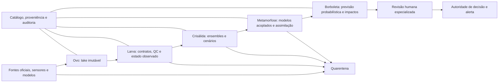

# Casulo FLOOD-RS

## Blueprint técnico e roadmap do gêmeo digital probabilístico de enchentes

**Autoria e origem:** Teloscorp  
**Invento-base:** Casulo — Otimização de Tráfego de Informação  
**Versão deste blueprint:** 0.1  
**Data de referência:** 29 de julho de 2026  
**Status:** arquitetura proposta; não é previsão, alerta ou sistema operacional

---

## 1. Decisão executiva

O Casulo FLOOD-RS deve nascer como um **pacote de domínio separado**, construído
sobre o Casulo genérico. Ele não será um novo modelo meteorológico nem um
substituto de SGB, ANA, INMET, CEMADEN, Defesa Civil ou IPH/UFRGS.

Sua função será conservar, sincronizar e transformar o trânsito de informação
entre:

```text
observações
→ estados físicos
→ cenários meteorológicos
→ modelos hidrológicos
→ modelos hidrodinâmicos
→ infraestrutura crítica
→ exposição territorial
→ decisão humana autorizada
```

O produto terá três estágios distintos:

1. **Gêmeo científico:** hindcasts e experimentos reproduzíveis.
2. **Gêmeo em modo sombra:** atualização contínua sem emitir alertas.
3. **Apoio operacional:** previsões revisadas por especialistas e entregues às
   autoridades competentes.

Não haverá “modo oráculo”. Toda Borboleta deverá apresentar hipótese, emissão,
validade, estação, datum, incerteza, proveniência, versão dos modelos e fatores
que podem invalidar o resultado.

A Organização Meteorológica Mundial estrutura sistemas de alerta ponta a ponta
em quatro pilares: conhecimento de risco; observação, análise e previsão;
disseminação e comunicação; preparação e resposta. O Casulo FLOOD-RS cobre
diretamente os dois primeiros e pode estruturar a passagem para os dois últimos,
mas não consegue substituir autoridades, comunicação pública e capacidade de
resposta.

### Prazo e ordem de grandeza

| Marco | Prazo realista | Equipe | Faixa ROM acumulada |
|---|---:|---:|---:|
| Demonstração científica | 6–9 meses | 8–12 FTE | R$ 1,5–4 milhões |
| Gêmeo regional em modo sombra | 18–24 meses | 15–25 FTE | R$ 8–22 milhões |
| Piloto pré-operacional | 24–36 meses | 22–35 FTE | R$ 20–55 milhões |
| Rede de campo, SCADA e batimetria | projeto separado | variável | R$ 10–50+ milhões |
| Operação e manutenção 24×7 | anual | 18–30 FTE | R$ 8–18 milhões/ano |

As faixas são estimativas de classe inicial, com incerteza aproximada de
`-30%/+50%`, sem obras civis, desapropriações, radares meteorológicos completos
ou substituição de sistemas municipais. Uma análise de lacunas pode reduzir ou
elevar bastante o custo de instrumentação.

### Estado atual e lacuna

O Casulo 0.1.0 existente é um alpha local, orientado a arquivos. Ele já oferece:

- fases Ovo, Larva, Crisálida, Metamorfose e Borboleta;
- preservação física da fonte;
- hashes e prova de conservação;
- Quarentena;
- manifesto e atribuição Teloscorp.

Ele ainda não oferece:

- ingestão contínua;
- processamento em streaming;
- armazenamento de objetos;
- banco temporal/espacial;
- contratos hidrometeorológicos;
- execução distribuída;
- modelos físicos;
- ensemble;
- assimilação;
- operação de alta disponibilidade.

Como a implementação atual lê a fonte completa em memória, ela não deve ser
usada diretamente para grades meteorológicas ou simulações extensas. O FLOOD-RS
reutiliza a semântica e a lei de conservação, mas exige uma nova camada
distribuída.

---

## 2. Limites de segurança e autoridade

### O Casulo FLOOD-RS poderá

- integrar dados observados e previstos;
- detectar inconsistências e atrasos;
- executar ensembles e assimilação;
- estimar probabilidades, faixas, horários e duração;
- produzir mapas de exposição e cenários de falha;
- calcular latências institucionais verificáveis;
- entregar informação estruturada para especialistas;
- preparar uma mensagem CAP em estado de rascunho.

### O Casulo FLOOD-RS não poderá

- declarar sozinho uma situação de emergência;
- publicar alerta sem assinatura da autoridade competente;
- alterar dados brutos recebidos;
- misturar estações ou data verticais silenciosamente;
- transformar anúncio orçamentário em capacidade operacional;
- usar saída de LLM como dado hidrológico;
- esconder divergência entre modelos;
- extrapolar fora do domínio calibrado sem marcação explícita;
- controlar bomba, comporta ou infraestrutura física pelo mesmo plano de dados.

O caminho de previsão será separado do caminho de controle industrial. Dados de
SCADA poderão ser lidos em interface somente de leitura; qualquer comando sobre
equipamentos deverá permanecer em sistema operacional próprio, com governança,
engenharia e segurança específicas.

---

## 3. Arquitetura funcional



### 3.1 Ovo — preservação integral

O Ovo é um armazenamento de objetos append-only. Cada item recebido preserva:

- bytes originais;
- horário observado, publicado, recebido e ingerido;
- URL ou canal de origem;
- licença e obrigação de atribuição;
- `SHA-256`;
- `Content-Type`;
- versão do conector;
- status HTTP ou protocolo;
- tamanho;
- CRS horizontal;
- datum vertical, quando aplicável;
- estação e versão cadastral;
- ponteiro para credencial, nunca a credencial;
- manifesto de proveniência.

Correções da fonte geram novos objetos. Nada é sobrescrito.

### 3.2 Larva — estado observado e qualidade

A Larva converte fontes heterogêneas para contratos canônicos, executa controle
de qualidade e produz o melhor estado observado disponível.

Estados mínimos:

```text
OBSERVED_VALIDATED
OBSERVED_SUSPECT
OBSERVED_STALE
CORRECTED
IMPUTED
REJECTED
```

Cada mudança de estado precisa de regra, versão, evidência e responsável.

### 3.3 Crisálida — cenários

A Crisálida cria uma matriz versionada de cenários:

- membro meteorológico;
- chuva corrigida ou não corrigida;
- estado antecedente do solo;
- parâmetros hidrológicos;
- condição de vento e pressão;
- nível da Lagoa dos Patos e oceano;
- disponibilidade de bombas;
- energia disponível;
- barreiras e comportas;
- hipótese de intervenção;
- versão da malha e batimetria.

Nenhum cenário pode existir sem `scenario_id` determinístico e manifesto.

### 3.4 Metamorfose — simulação acoplada

Fluxo recomendado:

```text
fusão de precipitação
→ chuva–vazão em grandes bacias
→ propagação fluvial
→ Guaíba/Lagoa dos Patos/barra
→ drenagem urbana
→ infraestrutura crítica
→ exposição e consequências
→ assimilação de novas observações
```

O acoplamento começa por arquivos e contratos explícitos. Acoplamento em
memória só deve ser adotado depois que versões independentes estiverem
validadas.

### 3.5 Borboleta — produto probabilístico

Uma Borboleta operacional contém:

- `forecast_id`;
- emissão e horizonte;
- estação e datum;
- probabilidades de cruzamento por cota;
- distribuição do primeiro cruzamento;
- pico mediano e quantis;
- duração acima das cotas;
- velocidade de elevação;
- mapas e população potencialmente exposta;
- estado da infraestrutura;
- fatores dominantes de incerteza;
- modelos e membros utilizados;
- observações utilizadas e rejeitadas;
- comparação com persistência e referências externas;
- ações compatíveis aprovadas em protocolo;
- fatores que invalidariam a previsão;
- assinatura humana de revisão;
- hashes de todos os artefatos.

### 3.6 Quarentena

Entram em Quarentena:

- estação sem datum;
- datum incompatível;
- sensor congelado ou atrasado;
- salto fisicamente improvável;
- produto sem licença conhecida;
- dado sem horário inequívoco;
- notícia não confirmada;
- anúncio sem execução verificável;
- simulação que não convergiu;
- membro incompleto;
- previsão fora do domínio validado;
- saída produzida apenas por modelo de linguagem.

Quarentena não significa exclusão. Significa conteúdo preservado, não apto a
alterar o estado operacional.

---

## 4. Estratégia de repositórios Teloscorp

### 4.1 Repositórios públicos

```text
teloscorp/casulo
    motor generalista, contratos de conservação e fases de evolução

teloscorp/casulo-flood-rs
    conectores abertos, schemas, QC, acopladores, API e demonstração

teloscorp/casulo-flood-rs-benchmarks
    geradores sintéticos, hindcasts publicáveis e resultados brutos

teloscorp/casulo-flood-rs-infra
    IaC sem segredos, imagens, manifests e observabilidade
```

### 4.2 Repositório restrito

```text
teloscorp/casulo-flood-rs-ops
    inventário real de endpoints
    configuração de produção
    mapas restritos de infraestrutura
    runbooks
    escalas de plantão
    matrizes de responsabilidade
    referências a segredos
```

Credenciais não entram em Git. Segredos ficam em cofre dedicado. Dados com
restrições contratuais ficam em buckets e schemas separados.

### 4.3 Estrutura do repositório de domínio

```text
casulo-flood-rs/
├─ README.md
├─ LICENSE
├─ NOTICE.md
├─ CITATION.cff
├─ GOVERNANCE.md
├─ SAFETY.md
├─ SECURITY.md
├─ DATA_SOURCES.md
├─ MODEL_CARDS.md
├─ pyproject.toml
├─ uv.lock
├─ schemas/
│  ├─ observation.schema.json
│  ├─ station.schema.json
│  ├─ forecast.schema.json
│  ├─ scenario.schema.json
│  ├─ infrastructure.schema.json
│  └─ cap-draft.schema.json
├─ src/flood_rs/
│  ├─ ovo/
│  │  ├─ ana/
│  │  ├─ sgb/
│  │  ├─ cemaden/
│  │  ├─ inmet/
│  │  ├─ ecmwf/
│  │  ├─ glofas/
│  │  ├─ nasa/
│  │  ├─ copernicus/
│  │  └─ municipal/
│  ├─ larva/
│  │  ├─ contracts/
│  │  ├─ quality/
│  │  ├─ datum/
│  │  ├─ precipitation/
│  │  └─ state_estimation/
│  ├─ crisalida/
│  │  ├─ ensembles/
│  │  ├─ scenario_matrix/
│  │  └─ perturbations/
│  ├─ metamorfose/
│  │  ├─ hydrology/
│  │  ├─ hydraulics/
│  │  ├─ urban_drainage/
│  │  ├─ assimilation/
│  │  ├─ infrastructure/
│  │  └─ impacts/
│  ├─ borboleta/
│  │  ├─ probabilities/
│  │  ├─ products/
│  │  ├─ explanation/
│  │  └─ cap_draft/
│  ├─ quarentena/
│  ├─ api/
│  └─ cli/
├─ models/
│  ├─ adapters/
│  ├─ manifests/
│  ├─ calibration/
│  └─ validation/
├─ workflows/
├─ migrations/
├─ dashboards/
├─ tests/
│  ├─ unit/
│  ├─ contract/
│  ├─ integration/
│  ├─ conservation/
│  ├─ metamorphic/
│  ├─ hindcast/
│  ├─ load/
│  └─ chaos/
├─ benchmarks/
├─ synthetic_data/
└─ docs/
```

---

## 5. Contratos de dados obrigatórios

### 5.1 Observação

```text
observation_id
phenomenon
value
unit
station_id
station_version
source_id
observed_at
published_at
received_at
ingested_at
horizontal_crs
vertical_datum
quality_state
quality_score
quality_reasons[]
raw_object_uri
raw_sha256
lineage_run_id
```

O invariante é:

```text
valor + unidade + estação + datum + tempo + qualidade + origem
```

### 5.2 Previsão meteorológica

```text
provider
model
model_cycle
issue_time
valid_time
lead_time
ensemble_member
variable
level
unit
grid_id
processing_level
bias_correction_version
license_id
raw_object_uri
```

### 5.3 Estação

O cadastro precisa ser bitemporal: válido no mundo físico e conhecido pelo
sistema. Mudanças de localização, régua, datum, sensor ou curva-chave nunca
alteram silenciosamente o passado.

### 5.4 Infraestrutura

```text
asset_id
asset_type
operator
location
protection_area
design_capacity
observed_capacity
operational_state
state_observed_at
power_feed_state
backup_power_state
last_tested_at
evidence_uri
confidence
```

Estados administrativos e operacionais permanecem separados.

---

## 6. Bancos e armazenamento

### 6.1 Namespaces lógicos

```text
ovo_raw
larva_qc
crisalida_scenarios
metamorfose_runs
borboleta_products
quarentena
catalogo
auditoria
```

### 6.2 Componentes

| Componente | Tecnologia recomendada | Conteúdo |
|---|---|---|
| Object lake | S3 compatível com versionamento/WORM | GRIB, NetCDF, HDF5, radar, rasters, modelos, originais |
| Banco operacional | PostgreSQL | usuários, runs, filas, decisões, auditoria |
| Banco espacial | PostGIS | bacias, estações, ativos, manchas, exposição |
| Séries temporais | PostgreSQL particionado inicialmente | observações e estados |
| Event bus | Apache Kafka | ingestão, mudanças de estado, disparo de workflows |
| Catálogo geoespacial | STAC API | descoberta de grids, rasters e cubos |
| Catálogo de sensores | OGC SensorThings 1.1 | estações, sensores e observações |
| Cache | Redis | resultados transitórios, nunca fonte de verdade |
| Registro de modelos | MLflow + manifests próprios | versões, parâmetros, métricas e artefatos |
| Proveniência | OpenLineage | relação fonte → execução → produto |
| Busca documental | OpenSearch separado | boletins e documentos, fora do caminho numérico |
| Cofre | Vault ou serviço gerenciado | tokens, certificados e chaves |

STAC é apropriado para descrever ativos espaço-temporais; SensorThings fornece
um modelo aberto para sensores e observações heterogêneas.

### 6.3 Formatos

- tabelas: Parquet/GeoParquet;
- arrays: Zarr ou NetCDF4;
- meteorologia: GRIB2 preservado e subconjuntos normalizados;
- rasters: Cloud Optimized GeoTIFF;
- vetores: GeoPackage e GeoParquet;
- eventos: Avro ou JSON validado;
- alertas: CAP 1.2;
- relatórios: JSON assinado, HTML e PDF derivado.

### 6.4 Retenção

| Classe | Hot | Warm | Archive |
|---|---:|---:|---:|
| Telemetria canônica | 24 meses | 10 anos | permanente |
| Originais de sensores | 12 meses | 10 anos | permanente |
| NWP operacional | 30–90 dias | 2 anos | ciclos/eventos selecionados |
| Hindcasts e reforecasts | projeto | projeto | permanente |
| Saídas hidráulicas completas | 14–30 dias | eventos relevantes | manifestos permanentes |
| Borboletas assinadas | permanente | permanente | cópia externa |
| Logs de segurança | 12 meses | 5 anos | conforme política |

Não é necessário preservar para sempre todas as matrizes intermediárias de
todos os membros, desde que os insumos, código, ambiente, parâmetros e sementes
permitam reprodução.

---

## 7. Registro de fontes

Cada fonte precisa de `source_id`, responsável, licença, método, autenticação,
latência esperada, SLA conhecido, política de retry e fallback.

| Fonte | Papel | Acesso/ação necessária | Classe |
|---|---|---|---|
| ANA HidroWebService | nível, chuva, vazão, inventário | solicitar acesso formal e autenticação | primária |
| SGB/SACE | monitoramento, boletins, cotas | acordo e conector; respeitar publicação oficial | primária |
| CEMADEN PED | PCDs e acumulados | cliente para API documentada | primária complementar |
| INMET | estações e previsão | confirmar canal automatizado e termos | primária meteorológica |
| Defesa Civil/SEMA-RS | radar e rede estadual | convênio de dados operacional | primária regional |
| IPH/UFRGS | previsões e modelos locais | cooperação científica e licença de artefatos | referência |
| ECMWF ENS | ensemble meteorológico | validar catálogo, licença e custo do subconjunto | previsão |
| GloFAS | vazão e inundação global | conector para dados abertos | referência externa |
| GPM IMERG | precipitação por satélite | Earthdata, correção com superfície | complementar |
| SMAP L4 | umidade superficial e radicular | Earthdata e versão vigente | complementar |
| ERA5-Land | reconstrução e estado histórico | CDS API, CC-BY | histórico |
| MapBiomas/Sentinel | uso e cobertura | licença, versão e recorte | estática |
| DEM/LiDAR | terreno e drenagem | inventário e controle vertical | estática crítica |
| Batimetria/ADCP | geometria e vazão | campanha e parceria técnica | estática/dinâmica crítica |
| Lagoa/barra/oceano | contorno hidrodinâmico | novas estações e acordos | crítica |
| EBAP/SCADA | bombas, energia e falhas | interface read-only e acordo municipal | restrita |
| Orçamento e contratos | latência preventiva | APIs oficiais e evidências documentais | governança |

A API HidroWebService atual requer solicitação de acesso à ANA com identificação
do usuário ou instituição. O SACE informa que seus sistemas recebem e processam
telemetria da RHN e publicam dados e boletins para apoiar decisões. Esses canais
devem ser tratados como integrações institucionais, não como scraping oportunista.

---

## 8. Software que precisa ser instalado

### 8.1 Base de desenvolvimento

- Git e Git LFS apenas para pequenos artefatos apropriados;
- Python 3.12;
- Rust para conectores/streaming de alto desempenho quando necessário;
- C/C++ e Fortran para modelos nativos;
- `uv` para ambiente Python;
- CMake, GNU Fortran e toolchain MPI;
- GDAL, PROJ, GEOS;
- ecCodes, CDO e NCO;
- Docker ou Podman;
- Apptainer para HPC;
- QGIS para inspeção e edição técnica.

### 8.2 Bibliotecas científicas

- NumPy, SciPy e pandas/Polars;
- PyArrow;
- xarray e Dask;
- cfgrib, netCDF4, h5py e Zarr;
- GeoPandas, Shapely, Rasterio e rioxarray;
- pyproj;
- scikit-learn;
- statsmodels;
- PyMC ou equivalente para componentes bayesianos;
- Numba/JAX apenas quando benchmark justificar;
- properscoring/xskillscore ou implementação validada para métricas.

### 8.3 Modelos

| Domínio | Primário proposto | Papel |
|---|---|---|
| Grandes bacias | MGB ou modelo equivalente validado | chuva–vazão e propagação |
| Rios/planícies | TELEMAC-MASCARET ou HEC-RAS sidecar | 1D/2D |
| Guaíba/Lagoa/barra | TELEMAC ou Delft3D validado | hidrodinâmica e vento |
| Drenagem urbana | EPA SWMM | condutos, reservatórios e bombas |
| Inundação rápida | surrogate validado | resposta operacional de baixa latência |

O EPA SWMM é open-source. TELEMAC é distribuído sob GPL/LGPL. HEC-RAS é
gratuito, mas não é open-source: seus termos proíbem modificação e engenharia
reversa. Portanto, HEC-RAS pode ser um executor/benchmark externo, mas não deve
ser embutido como parte open-source do Casulo.

O acesso ao código, às configurações calibradas e aos direitos de redistribuição
do modelo hidrológico local precisa ser formalmente verificado com IPH/UFRGS.
Não se deve presumir que todo artefato acadêmico é redistribuível.

### 8.4 Plataforma

- PostgreSQL/PostGIS;
- Kafka;
- armazenamento S3;
- Airflow;
- MLflow;
- OpenLineage;
- FastAPI;
- Keycloak ou identidade gerenciada;
- Nginx/Envoy;
- TiTiler e/ou GeoServer;
- MapLibre;
- Prometheus;
- Grafana;
- Loki;
- OpenTelemetry;
- Alertmanager;
- Vault/SOPS;
- Trivy;
- Syft/Grype;
- Cosign;
- GitHub Actions e runners próprios.

### 8.5 Ambientes

```text
local
integration
scientific-validation
shadow
preproduction
production
disaster-recovery
```

Dados e credenciais de produção nunca são copiados integralmente para ambiente
de desenvolvimento.

---

## 9. Infraestrutura computacional

### 9.1 Demonstração científica

| Item | Quantidade/faixa |
|---|---:|
| Workstation/servidor | 1–2 |
| CPU | 32–64 núcleos por servidor |
| RAM | 128–256 GB |
| NVMe local | 4–8 TB |
| GPU | 1 × 24–48 GB, opcional |
| Object storage | 10–30 TB úteis |
| Rede | 10 GbE |
| Potência de TI | 2–6 kW |

Serve para conectores, hindcasts limitados e protótipos. Não é produção.

### 9.2 Modo sombra regional

| Camada | Dimensionamento inicial |
|---|---|
| Controle/serviços | 3 nós, 16–32 CPU, 64–128 GB |
| Ingestão | 2–3 nós, 16–32 CPU, 64 GB |
| Banco HA | 3 nós, 16–32 CPU, 128 GB, NVMe |
| Kafka | 3 brokers, 8–16 CPU, 32–64 GB |
| Storage | 4 nós, 30–60 TB brutos cada |
| HPC | 256–768 núcleos CPU disponíveis |
| GPU | 1–2 GPUs de 24–80 GB |
| Rede interna | 25 GbE recomendada |
| Backup externo | 50–150 TB |
| Potência de TI | 15–50 kW |

Armazenamento útil esperado: 50–150 TB. Com replicação 3×, a capacidade bruta
precisa ser aproximadamente três vezes maior, antes de folgas e erasure coding.

### 9.3 Pré-operação

- dois domínios de falha;
- banco e object store replicados;
- 512–2.048 núcleos de CPU próprios ou sob demanda;
- capacidade de burst em nuvem/HPC;
- 200–500 TB entre hot, warm e archive;
- duas rotas de internet;
- UPS, gerador e combustível testado;
- relógio redundante e NTP monitorado;
- sala de operação;
- estações de trabalho redundantes;
- backup desconectado;
- RPO de telemetria menor que 5 minutos;
- RTO de serviços críticos entre 15 e 60 minutos;
- exercícios regulares de desastre.

O maior consumo não virá das tabelas de sensores, mas dos ensembles
meteorológicos, grades intermediárias e saídas hidráulicas 2D. O recorte espacial,
a retenção seletiva e os surrogates são requisitos econômicos, não otimizações
opcionais.

---

## 10. Instrumentação física e infraestrutura de campo

Antes de comprar equipamentos, executar uma análise de observabilidade:

1. mapear sensores existentes;
2. medir disponibilidade e atraso;
3. verificar datum e histórico de calibração;
4. identificar sub-bacias sem redundância;
5. calcular onde uma nova observação mais reduz a incerteza.

### Envelope inicial para estudo

| Instrumentação | Quantidade de planejamento | Objetivo |
|---|---:|---|
| Estações hidrológicas prioritárias redundantes | 20–40 | níveis/vazões a montante e metro |
| Pluviômetros de preenchimento | 50–100 | reduzir vazios espaciais |
| Estações de umidade do solo/piezômetros | 20–40 locais | estado antecedente |
| Estações meteorológicas sobre corredor hídrico | 8–15 | vento, pressão, evaporação |
| Nível em Lagoa/barra/oceano | 6–12 | condição de contorno |
| Campanhas ADCP | 4–8 equipes/instrumentos | vazão e curva-chave |
| Levantamento batimétrico | Guaíba, delta, lagoa e canais críticos | malha atualizada |
| Telemetria de EBAPs/barreiras | 100% dos ativos críticos | capacidade real |

Essas quantidades não são especificação de compra. Devem ser substituídas pelo
resultado da análise de lacunas.

### Cada estação crítica deve prever

- sensor principal e, onde necessário, redundante;
- marco geodésico e datum documentado;
- registrador local;
- alimentação solar/rede;
- bateria;
- telemetria por dois meios quando viável;
- armazenamento local para store-and-forward;
- gabinete e proteção contra vandalismo;
- plano de calibração;
- peças sobressalentes;
- equipe e SLA de manutenção;
- teste de continuidade durante evento extremo.

### Infraestrutura urbana

Integrar, em leitura:

- estado de cada bomba;
- vazão ou potência estimada;
- nível de poço;
- comporta/barreira;
- alimentação elétrica principal;
- gerador;
- autonomia de combustível;
- falha e tempo de reparo;
- teste operacional mais recente;
- capacidade nominal e capacidade observada.

---

## 11. Disponibilidade, segurança e auditoria

### 11.1 Princípios

- zero trust para acesso;
- menor privilégio;
- MFA;
- separação entre ciência, operação e administração;
- imagens assinadas;
- SBOM;
- dependências fixadas;
- logs imutáveis;
- dupla aprovação para publicação operacional;
- relógio auditado;
- chaves rotacionadas;
- simulações de comprometimento;
- plano de resposta a incidentes.

### 11.2 Fail-safe

Se uma fonte crítica estiver atrasada, a interface deve mostrar:

```text
PREVISÃO NÃO ATUALIZADA
última observação válida
idade do dado
fontes ausentes
impacto esperado na confiança
```

O sistema não reutiliza silenciosamente uma previsão antiga como se fosse nova.

### 11.3 LLM

Modelos de linguagem podem:

- resumir uma Borboleta já calculada;
- adaptar linguagem para públicos;
- recuperar documentação com citação;
- comparar boletins;
- explicar incertezas previamente estruturadas.

Não podem:

- inventar observações;
- calcular o nível oficial;
- substituir modelos físicos;
- escolher datum;
- alterar probabilidade;
- emitir alerta;
- preencher lacuna sem marca `IMPUTED`;
- participar da aprovação final.

Toda frase gerada deve apontar para campos estruturados e fontes.

---

## 12. Equipe necessária

### 12.1 Demonstração

| Papel | FTE |
|---|---:|
| Liderança técnica/produto | 1 |
| Hidrologia | 2 |
| Meteorologia | 1 |
| Hidráulica | 1 |
| Engenharia de dados | 2 |
| Plataforma/SRE | 1 |
| GIS/front-end | 1 |
| Validação/QA | 1 |
| **Total com sobreposição** | **8–12** |

### 12.2 Modo sombra e pré-operação

| Disciplina | FTE |
|---|---:|
| Direção de programa e arquitetura | 2 |
| Meteorologia | 2–3 |
| Hidrologia | 3–4 |
| Hidráulica/hidrodinâmica | 3–4 |
| Drenagem urbana/infraestrutura | 2–3 |
| Geotecnia/solos/geodésia | 1–2 |
| Engenharia de dados | 3–5 |
| Plataforma, SRE e segurança | 3–5 |
| Estatística, assimilação e ML | 2–3 |
| GIS, API e experiência operacional | 2–4 |
| Validação independente e QA | 2–3 |
| Governança de dados/institucional | 2 |
| Defesa Civil/comunicação de risco | 1–2 |
| **Total** | **26–42** |

Para operação 24×7, acrescentar escala de plantão sem depender dos mesmos
pesquisadores que desenvolvem os modelos.

### 12.3 Autoridades

Definir formalmente:

- proprietário de cada fonte;
- responsável por cada modelo;
- responsável pela qualidade;
- revisor hidrológico;
- revisor meteorológico;
- aprovador operacional;
- autoridade emissora;
- operador de plantão;
- responsável por cibersegurança;
- responsável por comunicação pública.

---

## 13. Roadmap de implementação

### Fase 0 — Constituição e segurança

**Prazo:** 0–2 meses

Entregáveis:

- termo de escopo e limites;
- conselho técnico-científico;
- matriz RACI;
- política de segurança;
- política de dados;
- registro de riscos;
- classificação de fontes;
- pedidos de acesso à ANA e parceiros;
- memorandos com SGB, IPH/UFRGS, Estado e município;
- decisão sobre titularidade e marcas;
- repositórios criados;
- contratos de dados v0.

Gate:

- nenhuma fonte crítica sem responsável;
- nenhuma promessa pública de previsão;
- aprovação jurídica e institucional do modo sombra.

### Fase 1 — Ovo regional e catálogo

**Prazo:** 2–5 meses

Entregáveis:

- object lake imutável;
- PostgreSQL/PostGIS;
- STAC;
- conectores ANA, SGB, CEMADEN, GloFAS, IMERG e ERA5-Land;
- manifesto e checksum de cada ingestão;
- inventário de estações;
- cadastro bitemporal;
- dashboard de atualidade e disponibilidade;
- Quarentena;
- datasets sintéticos.

Gate:

- 30 dias de ingestão contínua;
- completude maior que 99% para fontes contratadas;
- nenhuma sobrescrita;
- recuperação integral de um dia a partir do Ovo;
- alerta de stale data testado.

### Fase 2 — Larva: qualidade e estado observado

**Prazo:** 4–8 meses

Entregáveis:

- conversão de unidades;
- registro de datum;
- Hampel, congelamento, saltos e drift;
- coerência espacial;
- versionamento de curvas-chave;
- fusão inicial de chuva;
- estado do solo;
- painel de qualidade;
- revisão humana de suspeitas.

Gate:

- conjunto rotulado por especialistas;
- precisão/recall por classe de falha definidos;
- zero mistura silenciosa de datum;
- 100% dos valores rastreáveis ao original.

### Fase 3 — Baseline hidrológico

**Prazo:** 6–12 meses

Entregáveis:

- persistência e climatologia;
- modelo chuva–vazão calibrado por sub-bacia;
- membros meteorológicos;
- hindcasts de eventos selecionados;
- vazões afluentes;
- comparação com SGB/IPH/GloFAS;
- Brier, CRPS, confiabilidade e erros de pico/tempo.

Gate:

- teste fora da amostra;
- modelo supera ou caracteriza claramente onde não supera persistência;
- parâmetros e domínio documentados;
- reexecução bit-a-bit ou numericamente tolerante.

### Fase 4 — Hidrodinâmica e drenagem

**Prazo:** 9–18 meses

Entregáveis:

- malha 1D/2D;
- batimetria versionada;
- condições Lagoa/barra/vento;
- SWMM urbano;
- bombas e barreiras;
- acopladores;
- mapas de inundação;
- cenários de falha.

Gate:

- balanço de massa;
- testes de conservação;
- validação contra manchas e níveis históricos;
- análise de sensibilidade de malha;
- tempo de execução compatível com horizonte operacional.

### Fase 5 — Crisálida e Metamorfose probabilísticas

**Prazo:** 12–20 meses

Entregáveis:

- matriz de cenários;
- perturbação de parâmetros;
- assimilação EnKF inicialmente;
- calibração probabilística;
- probabilidades de cruzamento;
- distribuição do pico e primeiro cruzamento;
- decomposição de incerteza;
- surrogate para 2D, se necessário.

Gate:

- confiabilidade probabilística;
- cobertura observada dos intervalos;
- ausência de colapso do ensemble;
- guardas de extrapolação;
- surrogate nunca melhor avaliado apenas no treino.

### Fase 6 — Infraestrutura e latência preventiva

**Prazo:** 14–22 meses

Entregáveis:

- cadastro de ativos;
- leitura de estado de bombas/energia;
- pipeline de obras e contratos;
- estados `ANNOUNCED` a `OPERATIONAL`;
- latências verificáveis;
- cenários com falhas compostas;
- separação entre evidência e inferência.

Gate:

- cada estado ligado a evidência;
- nenhuma acusação automática;
- revisão institucional;
- dados pessoais e críticos protegidos.

### Fase 7 — Modo sombra

**Prazo:** mínimo 12 meses, incluindo estação úmida

Entregáveis:

- ciclos 24×7;
- boletim interno diário;
- registro de todas as previsões antes dos fatos;
- incidentes e postmortems;
- exercícios com especialistas;
- comparação contínua com referências;
- dashboards de confiabilidade;
- relatório independente.

Gate:

- disponibilidade e latência cumpridas;
- falsos alarmes/eventos perdidos dentro de limites acordados;
- calibração aceitável por horizonte;
- equipe consegue operar sem desenvolvedor presente;
- auditoria externa aprova a rastreabilidade.

### Fase 8 — Piloto pré-operacional

**Prazo:** 6–12 meses

Entregáveis:

- sala de situação parceira;
- revisão e assinatura humanas;
- rascunho CAP;
- exercícios de mesa;
- redundância e DR;
- treinamento;
- manual de limitações;
- comunicação inclusiva e acessível.

Gate:

- autoridade define se e como usar o produto;
- nenhum alerta autônomo;
- drill de indisponibilidade total;
- aprovação jurídica, técnica e de segurança.

### Fase 9 — Operação controlada

**Prazo:** após 24–36 meses e gates anteriores

Entregáveis:

- SLA;
- plantão;
- manutenção de sensores;
- recalibração;
- auditoria anual;
- release train;
- revalidação após qualquer mudança material;
- comunicação pública de desempenho.

---

## 14. Validação

### 14.1 Conjuntos

- calibração;
- validação temporal fora da amostra;
- validação espacial;
- eventos extremos preservados;
- anos sem evento;
- falhas simuladas;
- eventos compostos.

Nenhum evento usado para ajustar parâmetros pode ser apresentado como evidência
independente de desempenho.

### 14.2 Métricas

#### Hidrológicas/hidráulicas

- erro do pico em centímetros;
- erro no horário do pico;
- erro de volume;
- NSE/KGE com limitações explicitadas;
- RMSE/MAE;
- CSI/POD/FAR para manchas;
- balanço de massa.

#### Probabilísticas

- Brier Score;
- CRPS;
- reliability diagram;
- rank histogram;
- cobertura e largura de intervalos;
- ROC/PR quando aplicável;
- skill contra persistência e climatologia.

#### Operacionais

- antecedência útil;
- latência fonte → Ovo;
- Ovo → Borboleta;
- disponibilidade;
- taxa de stale data;
- tempo de revisão humana;
- RTO/RPO;
- falso alerta;
- evento perdido;
- tempo de comunicação.

#### Conservação Casulo

- 100% dos objetos contabilizados;
- zero descarte silencioso;
- hashes preservados;
- linhagem completa;
- número de observações rejeitadas e motivo;
- reprodução a partir de insumos fixados.

### 14.3 Testes

- unitários;
- contratos;
- integração;
- propriedades;
- metamórficos;
- massa/energia;
- hindcast;
- carga;
- falha de fonte;
- perda de nó;
- corrupção de objeto;
- atraso de relógio;
- troca de datum;
- regressão científica;
- segurança;
- acessibilidade;
- exercícios humanos.

---

## 15. Performance, energia e capacidade

### Unidades funcionais

```text
segundos por ciclo de previsão
joules por membro-dia simulado
joules por Borboleta válida
GB lidos e gravados por ciclo
CO₂e por ciclo operacional
```

Registrar:

- tempo total e por fase;
- CPU-hora;
- GPU-hora;
- pico de RAM;
- leitura/gravação;
- energia de CPU via RAPL quando disponível;
- energia total por medidor da instalação;
- intensidade de carbono regional;
- forecast útil produzido ou execução descartada.

Metas iniciais:

- ingestão e QC em menos de 5 minutos após disponibilidade;
- atualização hidrológica em menos de 20 minutos;
- surrogate operacional em menos de 10 minutos;
- ensemble regional completo dentro da janela acordada;
- interface e API disponíveis mesmo durante execução pesada;
- nenhuma economia de tempo obtida removendo membros sem análise de skill.

O consumo deve ser comparado por unidade funcional idêntica. Uma simulação
rápida e errada não é energeticamente eficiente.

---

## 16. Orçamento por bloco

### Demonstração de 6–9 meses

| Bloco | Faixa |
|---|---:|
| Equipe | R$ 1,0–2,5 mi |
| Compute/storage | R$ 200–700 mil |
| Dados, viagens e cooperação | R$ 100–400 mil |
| Segurança, jurídico e auditoria | R$ 100–300 mil |
| Contingência | R$ 200–600 mil |
| **Total** | **R$ 1,5–4,0 mi** |

### Modo sombra acumulado em 18–24 meses

| Bloco | Faixa |
|---|---:|
| Equipe multidisciplinar | R$ 6–14 mi |
| HPC, plataforma e storage | R$ 1,5–5 mi |
| Campanhas e dados técnicos | R$ 0,5–4 mi |
| Segurança, DR e auditoria | R$ 0,5–2 mi |
| **Total** | **R$ 8–22 mi** |

### Pré-operação acumulada

| Bloco | Faixa |
|---|---:|
| Produto e ciência | R$ 12–28 mi |
| Infraestrutura HA/HPC | R$ 4–12 mi |
| Integrações e sala operacional | R$ 2–6 mi |
| Validação independente e treinamento | R$ 2–5 mi |
| Contingência | R$ 3–8 mi |
| **Total** | **R$ 20–55 mi** |

Instrumentação, SCADA, batimetria e obras são orçados separadamente. Não se deve
usar o orçamento de software para encobrir lacunas físicas da rede.

---

## 17. Primeiros 90 dias

### Dias 1–30

- criar conselho técnico;
- aprovar limites de segurança;
- criar os repositórios;
- protocolar acessos e parcerias;
- inventariar estações, datas e licenças;
- definir schemas v0;
- subir object lake, PostGIS e catálogo;
- selecionar três eventos de hindcast;
- produzir gerador de dados sintéticos.

### Dias 31–60

- implementar ANA, SGB, CEMADEN, GloFAS e IMERG;
- preservar originais e hashes;
- dashboard de disponibilidade;
- cadastro bitemporal de estações;
- regras iniciais de QC;
- baseline de persistência;
- CI, SBOM e imagens assinadas;
- teste de recuperação.

### Dias 61–90

- primeiro Ovo regional reprodutível;
- primeira Larva com qualidade;
- hindcast mínimo de uma sub-bacia;
- relatório de lacunas de sensores/datum;
- benchmark de ingestão;
- revisão com hidrólogos externos;
- plano de calibração;
- decisão `go/no-go` para a fase hidrológica completa.

### Demonstração dos 90 dias

A demonstração correta não será uma previsão pública. Será:

```text
1. escolher uma data histórica;
2. bloquear todos os dados posteriores à emissão;
3. ingerir somente o que existia naquele instante;
4. preservar e qualificar;
5. executar baseline e primeiro modelo;
6. gerar uma Borboleta probabilística;
7. revelar o observado;
8. medir erro, confiança e rastreabilidade;
9. permitir reprodução por terceiro.
```

---

## 18. Definição de completo

O Casulo FLOOD-RS só poderá ser chamado de gêmeo digital pré-operacional quando:

- representar estado observado, modelos, infraestrutura e incerteza;
- executar continuamente;
- assimilar novas observações;
- preservar todos os insumos;
- reproduzir uma previsão antiga;
- identificar datum e estação em toda medida;
- separar observação, correção, imputação e previsão;
- validar fora da amostra;
- comparar com baselines;
- operar pelo menos uma estação úmida em modo sombra;
- sobreviver a falhas de dados e infraestrutura;
- possuir equipe e plantão;
- ser auditado externamente;
- produzir mensagem acionável e compreensível;
- manter revisão e autoridade humanas;
- divulgar limitações e desempenho real.

---

## 19. Riscos principais

| Risco | Consequência | Mitigação |
|---|---|---|
| Datum incorreto | previsão fisicamente falsa | cadastro bitemporal e bloqueio |
| Fonte pública instável | buraco operacional | acordo, cache e redundância |
| Batimetria antiga | erro de propagação | nova campanha e sensibilidade |
| Modelo calibrado no evento-teste | skill ilusório | fora da amostra |
| Ensemble subdispersivo | confiança excessiva | calibração e perturbação |
| 2D lento | previsão chega tarde | recortes, HPC e surrogate |
| SCADA inacessível | capacidade presumida | acordo read-only e testes |
| Marca confundida com autoridade | alerta indevido | rotulagem e governança |
| LLM inventar explicação | desinformação | geração ancorada e revisão |
| Dependência de uma pessoa | indisponibilidade | runbooks, pares e plantão |
| Código aberto expor segredo | incidente | repos separados e cofre |
| Pressão política | alteração de resultado | trilha imutável e conselho |

---

## 20. Fontes técnicas verificadas

- [ANA — HidroWebService e documentação](https://www.gov.br/ana/pt-br/assuntos/monitoramento-e-eventos-criticos/monitoramento-hidrologico/orientacoes-manuais/manuais-de-sistemas-e-servicos-de-disponibilizacao-de-dados-hidrologicos)
- [SGB — Sistema de Alerta de Eventos Críticos](https://www.sgb.gov.br/sace/)
- [CEMADEN — Plataforma de Entrega de Dados](https://sws.cemaden.gov.br/)
- [ECMWF — ensemble de médio prazo](https://www.ecmwf.int/en/forecasts/documentation-and-support/medium-range-forecasts)
- [Copernicus — dados e serviços GloFAS](https://global-flood.emergency.copernicus.eu/react/general-information/data-and-services/)
- [Copernicus — ERA5-Land](https://cds.climate.copernicus.eu/datasets/reanalysis-era5-land)
- [NASA — GPM IMERG](https://cmr.earthdata.nasa.gov/search/site/collections/directory/GES_DISC/gov.nasa.eosdis)
- [NSIDC/NASA — SMAP](https://nsidc.org/data/smap/data)
- [EPA — SWMM](https://www.epa.gov/water-research/storm-water-management-model-swmm)
- [USACE — termos do HEC-RAS](https://www.hec.usace.army.mil/confluence/rasdocs/rasum/6.6/terms-and-conditions-of-use)
- [openTELEMAC — licença e módulos](https://www.opentelemac.org/index.php/component/jdownloads/summary/13-telemac-2d/1058-telemac-2d-user-manual-en-v7p0?Itemid=0)
- [OGC — SensorThings API](https://www.ogc.org/standards/sensorthings/)
- [STAC — SpatioTemporal Asset Catalog](https://stacspec.org/)
- [OASIS — Common Alerting Protocol 1.2](https://docs.oasis-open.org/emergency/cap/v1.2/CAP-v1.2-os.html)
- [WMO — Early Warnings for All](https://wmo.int/activities/early-warnings-all)

---

## 21. Recomendação final

O primeiro investimento não deve ser em uma tela pública nem em IA generativa.
Deve ser no **Ovo regional imutável**, no cadastro de estações/data e nos acordos
de dados.

Sem isso, qualquer modelo sofisticado continuará vulnerável a uma observação
antiga, uma régua deslocada ou uma fonte incompleta.

A sequência correta é:

```text
proveniência
→ qualidade
→ baseline
→ física
→ ensemble
→ assimilação
→ impactos
→ decisão humana
→ comunicação
```

Essa é a forma de o Casulo FLOOD-RS se tornar extraordinário sem se tornar
irresponsável: uma infraestrutura de confiança que conserva toda a informação,
mede o que não sabe e acelera a passagem entre dado, compreensão e ação.
