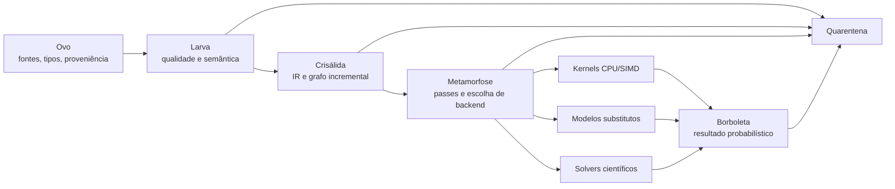

# Teloscorp — Parecer técnico sobre a linguagem T como motor do Casulo

**Data da análise:** 29 de julho de 2026  
**Código analisado:** `C:\Users\guimo\Downloads\telencefalus_desktop_v0_4_0`  
**Objetivo:** avaliar se a linguagem e seu protótipo de compilador podem transformar um laptop Core i5 com 16 GB de RAM em uma plataforma operacional útil para o Casulo FLOOD-RS.

---

## 1. Veredito

A hipótese central é **tecnicamente válida**, mas precisa ser formulada com precisão:

> Uma “instrução perfeita” não cria a energia nem a capacidade física de 256 processadores. Ela pode, entretanto, eliminar centenas de vezes mais trabalho do que uma implementação ingênua, ao representar o problema como operações vetoriais compiladas, recomputação incremental, seleção adaptativa de cenários e modelos substitutos validados.

O protótipo atual ainda **não faz isso**. Ele possui:

- uma sintaxe semântica promissora;
- um núcleo pequeno e observável;
- estados explícitos de estabilidade e bloqueio;
- AST, verificação semântica e IR;
- geração de Python legível;
- um conceito útil de núcleo imutável, delta contextual e metadados.

Mas o caminho executável atual termina em **Python comum**, sem:

- backend nativo;
- SIMD;
- vetorização automática;
- fusão de operações;
- paralelismo;
- planejamento de memória;
- execução incremental;
- cache de resultados;
- arrays tipados por forma e unidade;
- redução automática de ensemble;
- modelos multi-fidelidade;
- geração de código para CPU, GPU ou solvers científicos.

Portanto:

| Pergunta | Resposta |
|---|---|
| A linguagem atual substitui 256 processadores? | **Não.** |
| A sintaxe atual contém uma boa semente para um compilador especializado? | **Sim.** |
| É possível obter ganhos locais de 256× ou mais no laptop? | **Sim, em kernels adequados. Foi medido.** |
| Isso torna o gêmeo digital completo executável localmente em alta fidelidade? | **Não.** |
| Pode tornar uma versão operacional, incremental e probabilística executável localmente? | **Sim, se houver mudança de arquitetura.** |

O salto verdadeiro não será:

```text
uma linguagem mais curta
→ o mesmo algoritmo em Python
```

Será:

```text
uma especificação precisa
→ grafo estático do problema
→ eliminação de trabalho desnecessário
→ kernels nativos especializados
→ execução incremental e multi-fidelidade
→ resultado probabilístico auditável
```

---

## 2. O computador disponível é melhor do que a estimativa inicial

O inventário local detectou:

| Recurso | Detectado |
|---|---:|
| CPU | Intel Core i5-1235U |
| Núcleos físicos | 10 |
| Arquitetura | 2 núcleos de desempenho + 8 eficientes |
| Processadores lógicos | 12 |
| RAM física | 15,73 GiB |
| GPU integrada | Intel Iris Xe |
| SSD | NVMe SK Hynix, 476,9 GiB |
| Espaço livre atual | **24,8 GiB** |
| Sistema | Windows 11, 64 bits |

A especificação oficial da Intel confirma 10 núcleos, 12 threads, turbo máximo de 4,40 GHz, AVX2, potência-base de 15 W e potência turbo máxima de 55 W. [Intel — Core i5-1235U](https://www.intel.com/content/www/us/en/products/sku/226261/intel-core-i51235u-processor-12m-cache-up-to-4-40-ghz/specifications.html)

Consequências:

1. A conta baseada em apenas quatro núcleos subestima a máquina.
2. Os 12 processadores lógicos não equivalem a 12 núcleos idênticos: há dois tipos de núcleo.
3. O recurso mais imediatamente crítico para o FLOOD-RS é o armazenamento livre de somente 24,8 GiB.
4. AVX2 permite que um kernel nativo processe vários valores por instrução.
5. A Iris Xe pode ser explorada no futuro, mas usa memória compartilhada; não deve ser a primeira dependência crítica.

### Sobre “rotação” e geração de energia

Não existe rotação física do processador nem geração de energia computacional. O processador **consome** energia elétrica.

Os fatores centrais são:

- frequência de clock;
- instruções concluídas por ciclo;
- número e tipo de núcleos;
- vetorização;
- acessos à memória e cache;
- tensão;
- limites de potência;
- dissipação térmica.

Uma aproximação da potência dinâmica é:

```text
P ≈ α · C · V² · f
```

Subir a frequência `f` costuma exigir também elevação da tensão `V`; por isso, potência e temperatura podem crescer mais rápido do que o desempenho.

O processador já administra turbo automaticamente. Tentar duplicar manualmente seu clock não é um caminho realista ou seguro em um laptop e não duplicaria o desempenho integral do sistema.

---

## 3. A aritmética dos “512 processadores”

A equivalência só existe se:

- o trabalho for perfeitamente paralelizável;
- não houver custo de coordenação;
- não houver contenção de memória;
- não houver comunicação entre processadores;
- todos os processadores forem idênticos;
- a carga ficar perfeitamente equilibrada.

Nenhuma simulação hidrometeorológica completa satisfaz tudo isso.

Pela Lei de Amdahl:

```text
S(N) = 1 / ((1 - p) + p/N)
```

onde:

- `N` é o número de processadores;
- `p` é a fração paralelizável;
- `S` é o ganho total.

Com 512 processadores:

| Fração paralelizável | Ganho máximo teórico |
|---:|---:|
| 90% | 9,8× |
| 99% | 83,8× |
| 99,9% | 338,9× |

Para chegar a 256× com 512 processadores, aproximadamente **99,804%** do tempo teria de ser perfeitamente paralelizável. O trabalho original de Gene Amdahl já destacava que elevar o paralelismo sem elevar o desempenho sequencial deixa de produzir os ganhos imaginados. [Amdahl, 1967 — ACM](https://doi.org/10.1145/1465482.1465560)

O ponto forte da ideia da “instrução perfeita” está justamente em outra direção:

> Não dividir o mesmo desperdício entre 512 processadores, mas remover o desperdício antes de executar.

---

## 4. O que o projeto realmente contém

Há três sistemas conceitualmente diferentes dentro do diretório.

### 4.1 Telencefalus: ambiente e casca operacional

O README é explícito: o repositório não contém o compilador-fonte completo da linguagem. Ele fornece:

- IDE;
- CLI;
- terminal;
- editor;
- diagnósticos;
- inspeção de AST, IR, símbolos e resíduos;
- ponte para um pacote externo de runtime/compilação.

O compilador externo exigido pelo checkout não está instalado no ambiente atual. Seu código compilado está empacotado dentro do executável distribuído, mas seu fonte não está presente no repositório.

### 4.2 Linguagem T executável

O núcleo congelado da especificação suporta:

- `module`;
- `use`;
- `field`;
- `trace`;
- `condense`;
- `transition`;
- `judge`;
- `restrict`;
- `let`;
- `project`;
- `bind`;
- `stabilize`;
- `emit`;
- `if / else`.

Seus estados semânticos são:

- `unknown`;
- `partial`;
- `stable`;
- `blocked`.

E seus resíduos incluem ambiguidade, falta de fundamento, restrição não atendida, deriva, binding incompleto, emissão ausente, aviso e bloqueio.

Essa parte é uma base intelectualmente boa para o Casulo porque torna explícitos:

- o que entrou;
- quais condições devem ser verdadeiras;
- o que foi estabilizado;
- o que foi emitido;
- o que precisa ser bloqueado ou colocado em quarentena.

### 4.3 Linguagem de especificação e geração de projetos

Outros exemplos usam construções mais ricas, como projetos, invariantes, transformações, loops, interfaces e requisitos. Essa camada alimenta:

- decomposição semântica;
- planejamento de sprints;
- geração de prompts;
- geração de esqueletos Python.

Ela aumenta a **produtividade de desenvolvimento**, mas não deve ser confundida com aceleração de CPU.

O documento de “eficiência temporal” compara cinco minutos de geração assistida com horas estimadas de programação humana. Seus fatores variam internamente entre 270×, 384×, 408× e 1.152×. Isso não é um benchmark computacional e não possui um grupo de controle suficiente para demonstrar desempenho de runtime.

---

## 5. Reconstrução do compilador executável

O backend empacotado foi inspecionado diretamente no executável.

Seu caminho real é:

```text
fonte T
→ lexer de indentação
→ parser
→ AST
→ verificador semântico
→ IR
→ verificador do IR
→ emissão de código Python
→ compile/exec do Python
→ função Python
```

Um balanço hídrico T como:

```text
condense WaterBalance in HydroCell
  judge precipitation >= 0
  let storage_change = precipitation - evapotranspiration - surface_flow - base_flow
  stabilize storage_change
  emit storage_change
```

é transformado, essencialmente, em:

```python
def condense_water_balance(ctx):
    if not ctx.precipitation >= 0:
        raise ValueError(...)
    storage_change = (
        ctx.precipitation
        - ctx.evapotranspiration
        - ctx.surface_flow
        - ctx.base_flow
    )
    runtime.stabilize(storage_change)
    return storage_change
```

O runtime de `project`, `bind` e `stabilize` apenas registra valores em listas. Não há agendamento de kernels ou execução distribuída.

### Medição do backend empacotado

Programa de teste:

- 13 linhas T;
- 24 linhas Python geradas;
- um campo com quatro números;
- um balanço hídrico;
- validação semântica e de IR habilitada.

Resultados:

| Etapa | Tempo |
|---|---:|
| Parse | 1,229 ms |
| Lowering para Python | 0,089 ms |
| Compilação com gates semânticos | 4,782 ms |
| Chamada direta da função já compilada, p50 | 0,3 µs |
| Caminho completo que recompila a cada execução, p50 | 1.180,6 µs |
| Caminho completo, p95 | 2.003,4 µs |

Conclusões:

1. A função escalar gerada é pequena e rápida.
2. Recompilar o programa a cada chamada custa aproximadamente quatro mil vezes mais do que chamar a função pronta nesse exemplo.
3. O primeiro ganho obrigatório é **compilar uma vez e executar muitas vezes**.
4. Executar uma função por célula continuaria sendo inadequado para milhões de células.
5. O compilador precisa transformar a expressão inteira em um kernel de array, não chamar a função escalar milhões de vezes.

---

## 6. O experimento que confirmou a intuição dos “256 processadores”

Foi executado um microbenchmark de balanço hídrico:

```text
ΔS = P - ET - Qs - Qb
```

Condições:

- 1.000.000 de células;
- quatro entradas `float32`;
- uma saída `float32`;
- 19,07 MiB de dados;
- nove repetições por modo;
- quatro workers no modo paralelo;
- igualdade numérica exata entre as saídas;
- medição de regime aquecido, não incluindo instalação ou compilação.

### Primeira execução controlada

| Implementação | Mediana | Ganho |
|---|---:|---:|
| Laço escalar Python | 725,578 ms | 1× |
| Operação vetorizada | 2,808 ms | **258,4×** |
| Operação vetorizada, quatro workers | 2,085 ms | **348,1×** |

### Três repetições adicionais do processo

| Repetição | Python | Vetorizado | 4 workers | Ganho vetorizado | Ganho 4 workers |
|---:|---:|---:|---:|---:|---:|
| 1 | 654,431 ms | 1,529 ms | 1,249 ms | 427,9× | 524,1× |
| 2 | 761,358 ms | 1,595 ms | 1,708 ms | 477,5× | 445,7× |
| 3 | 696,906 ms | 1,652 ms | 1,289 ms | 422,0× | 540,7× |

### Interpretação correta

Este experimento prova:

- uma formulação de alto nível pode ser centenas de vezes mais rápida quando o compilador a reconhece como um kernel de dados;
- vetorização e localidade de memória podem valer mais do que adicionar núcleos;
- quatro workers nem sempre vencem por grande margem, pois a operação passa a ser limitada pela largura de banda da memória;
- a ordem de grandeza imaginada de 256× é possível em um **kernel específico**.

Ele não prova:

- aceleração de 256× do gêmeo digital inteiro;
- substituição de 256 CPUs em qualquer algoritmo;
- execução local de meteorologia global;
- execução de 51 simulações hidráulicas 2D de alta resolução em segundos;
- preservação automática da precisão científica.

A linguagem T atual não consegue gerar esse kernel vetorial. O ganho foi obtido por uma biblioteca nativa que recebe arrays inteiros.

---

## 7. Avaliação do protótipo de otimização de tráfego

O conceito implementado é:

```text
payload
→ canonização
→ núcleo reutilizável + delta + metadados
→ adaptação às condições da rede
→ plano de transporte
→ reconstrução
```

Essa direção é coerente com o Casulo. Entretanto, o protótipo atual ainda é um modelo lógico, não um transporte operacional.

### Evidências

- a etapa de trânsito é marcada no próprio código como simulada;
- o “solver” normaliza três prioridades em frações;
- a estratégia declarada como mínima, redundante ou adaptativa não implementa um codec correspondente;
- não há socket, protocolo, fila, retransmissão ou cache remoto;
- o núcleo reutilizável é enviado inteiro;
- os deltas são detectados apenas no primeiro nível do objeto;
- uma alteração dentro de uma lista retransmite a lista inteira;
- o receptor não mantém nem recebe corretamente o contexto-base para todos os casos.

### Benchmark de tamanho e custo

| Caso | JSON integral | Representação atual | Razão de tamanho | JSON | Pipeline atual | Reconstrução completa |
|---|---:|---:|---:|---:|---:|---|
| 2.002 campos, primeiro envio | 42.937 B | 225.193 B | **5,24× maior** | 0,458 ms | 28,649 ms | Sim |
| 2.002 campos, um alterado | 42.938 B | 419 B | 0,98% | 0,446 ms | 12,447 ms | **Não** — retornou 3 campos |
| Lista com 2.000 valores, primeiro envio | 12.950 B | 13.297 B | 1,03× | 0,325 ms | 1,424 ms | Sim |
| Lista com um valor alterado | 12.951 B | 26.185 B | **2,02× maior** | 0,322 ms | 2,543 ms | Sim |

O delta pequeno do segundo caso parece excelente, mas perde 1.999 campos no resultado reconstruído. Portanto, essa redução ainda não é válida.

### Falha crítica de integridade

O hash atual cobre:

```text
conteúdo do núcleo + quantidade de deltas
```

Ele não cobre os valores dos deltas.

No teste adversarial, um delta foi alterado de `original` para `tampered`. O sistema reconstruiu o valor adulterado e marcou a integridade como `passed`.

Antes de utilizar esse pipeline com dados hidrológicos, o hash deve cobrir:

- conteúdo canônico completo ou Merkle root;
- conteúdo e ordem de cada delta;
- versão do esquema;
- base/contexto esperado;
- identificador da estação;
- datum;
- timestamp;
- unidade;
- qualidade;
- algoritmo de transformação.

---

## 8. Estado de engenharia do projeto

### Testes

Resultado da suíte completa:

```text
110 passaram
12 falharam
4 foram ignorados
35 avisos
```

As 12 falhas estão concentradas na ausência do compilador/runtime-fonte no ambiente:

- integração da ponte;
- CLI;
- editor;
- LSP;
- entrada principal.

Também foi detectada a instalação simultânea de duas versões do pacote Telencefalus.

Os testes direcionados ao transporte e aos geradores:

```text
22 passaram
34 avisos
```

Esses testes validam o comportamento nominal, mas não exigem:

- igualdade integral após delta;
- redução real de bytes;
- transporte real;
- resistência a adulteração;
- concorrência;
- reinício;
- perda e reordenação;
- desempenho;
- consumo de energia.

### Ambiente científico local

Foi detectado:

- NumPy instalado;
- SciPy instalado;
- PyTorch instalado;
- Rust e Cargo instalados;
- GCC instalado;
- ONNX Runtime ausente;
- Numba instalado, mas inutilizável no momento por incompatibilidade entre sua versão e o NumPy 2.3.

Isso reforça a necessidade de um ambiente reproduzível com versões fixadas.

---

## 9. Onde a linguagem é genuinamente forte

### 9.1 Sintaxe orientada a invariantes

`judge`, `restrict`, `stabilize` e `emit` são mais úteis para o Casulo do que uma linguagem genérica porque podem expressar:

- datum obrigatório;
- unidade obrigatória;
- validade temporal;
- proveniência;
- estado suspeito;
- bloqueio de extrapolação;
- critério científico de emissão.

### 9.2 Grafo declarativo

`project` e `bind` podem evoluir de simples registros para relações em um grafo:

```text
chuva
→ umidade do solo
→ vazão
→ propagação
→ nível
→ exposição
→ decisão
```

Conhecendo o grafo, o compilador pode descobrir exatamente o que foi invalidado quando chega uma nova observação.

### 9.3 Resíduo como primeira classe

A noção de resíduo é excelente para um sistema preventivo. Um resultado não deve ser apenas número; deve carregar:

- o que está faltando;
- o que diverge;
- o que foi imputado;
- o que está fora do domínio;
- o que impede a emissão.

### 9.4 Pequeno núcleo congelado

Um núcleo pequeno é mais fácil de:

- verificar;
- testar;
- documentar;
- portar;
- transformar em open source;
- compilar para múltiplos backends.

---

## 10. Onde a linguagem precisa mudar

### 10.1 Tipos científicos

Adicionar tipos que expressem significado e layout:

```text
Level<Station, Datum, Meter>
Rain<Millimeter, Interval, Grid>
Flow<CubicMeterPerSecond, RiverSection>
Raster<Float32, Y, X>
Series<Float32, Time>
Ensemble<Member, Time, Basin>
Probability<0..1>
Quality<Validated | Suspect | Stale | Imputed>
```

Sem isso, o compilador não sabe:

- quantos elementos existem;
- onde estão na memória;
- se podem ser vetorizados;
- se duas grandezas podem ser somadas;
- quanto custará o resultado;
- se uma comparação entre estações é válida.

### 10.2 Semântica incremental

Cada operação precisa declarar:

- entradas;
- saída;
- região afetada;
- janela temporal;
- dependências;
- pureza;
- determinismo;
- política de cache;
- tolerância;
- custo estimado.

### 10.3 Backend real

Ordem recomendada:

1. Python como referência e depuração;
2. NumPy/SciPy para vetorização imediata;
3. Rust para runtime, kernels, concorrência e segurança;
4. LLVM/MLIR apenas quando o IR e os kernels estiverem estáveis;
5. ONNX Runtime para modelos substitutos;
6. adaptadores para solvers externos.

MLIR foi criado justamente para representar grafos de dados, construir compiladores de domínio e baixar operações de alto nível para código de alto desempenho e hardware heterogêneo. [Documentação oficial do MLIR](https://mlir.llvm.org/)  

Não é necessário começar por MLIR. Um IR próprio e pequeno será mais rápido para validar a tese; o encaixe com MLIR deve ocorrer após os tipos científicos e passes estarem maduros.

### 10.4 Unificação das duas linguagens

Hoje há:

- uma especificação executável pequena;
- um gerador mais permissivo que reconhece construções adicionais;
- uma DSL de planejamento e prompts.

Elas precisam convergir sob:

- uma gramática versionada;
- um único AST;
- um único verificador;
- um único IR;
- capacidades de backend declaradas;
- erro explícito quando um backend não suporta uma operação.

---

## 11. Nuclearização sob a marca Casulo

O código aberto deve separar Telencefalus como ambiente e Casulo como tecnologia.

### Classes e fases

| Fase da marca | Classe principal | Responsabilidade computacional |
|---|---|---|
| Ovo | `OvoParser` / `OvoFonte` | captura imutável, esquema, hash, tempo e proveniência |
| Larva | `LarvaAnalyzer` | validação, unidades, qualidade, normalização e diagnóstico |
| Crisálida | `CrisalidaIR` / `CrisalidaPlanner` | grafo, cenários, cache, formas, custos e dependências |
| Metamorfose | `MetamorfoseOptimizer` | fusão, vetorização, incrementalidade, seleção de backend |
| Borboleta | `BorboletaRuntime` | execução e manifestação probabilística |
| Quarentena | `QuarentenaGuard` | dado suspeito, extrapolação, divergência e bloqueio |

### Arquitetura



### Estrutura de repositório

```text
casulo/
├── compiler/
│   ├── ovo_frontend/
│   ├── larva_semantics/
│   ├── crisalida_ir/
│   ├── metamorfose_optimizer/
│   ├── borboleta_codegen/
│   └── quarentena_guards/
├── runtime/
│   ├── scheduler/
│   ├── cache/
│   ├── provenance/
│   ├── checkpoints/
│   └── resource_budget/
├── kernels/
│   ├── arrays/
│   ├── hydrology/
│   ├── routing/
│   ├── assimilation/
│   └── geospatial/
├── dialects/
│   └── flood_rs/
├── adapters/
│   ├── observations/
│   ├── forecast_models/
│   ├── hydrology/
│   ├── hydraulics/
│   └── urban_drainage/
├── benchmarks/
│   ├── kernels/
│   ├── incremental/
│   ├── end_to_end/
│   └── energy/
├── conformance/
├── examples/
└── docs/
```

---

## 12. O que seria a “instrução perfeita” do Casulo

Não é uma instrução de CPU. É um contrato compilável com sete conhecimentos.

### 12.1 Conhecimento de forma

```text
precipitation: Raster<Float32, 1000, 1000>
```

Permite gerar um kernel vetorial em vez de um milhão de chamadas.

### 12.2 Conhecimento de dependência

Se apenas o Taquari recebeu nova chuva, não recalcular automaticamente:

- bacias independentes;
- cenários sem alteração;
- mapas que não dependem dessa região;
- períodos anteriores à mudança.

### 12.3 Conhecimento temporal

Uma observação às 12h15 invalida:

- o estado assimilado a partir de 12h15;
- horizontes posteriores;
- somente os produtos que dependem dela.

### 12.4 Conhecimento de fidelidade

Executar:

1. modelo barato em todos os membros;
2. agrupar trajetórias semelhantes;
3. selecionar membros representativos;
4. usar modelo caro apenas nos cenários relevantes;
5. corrigir com modelo substituto;
6. elevar para alta fidelidade quando a incerteza ou o risco cruzar um limite.

### 12.5 Conhecimento de memória

- `float32` quando validado;
- memória reutilizada;
- operações fundidas;
- chunks;
- mmap;
- zero-copy;
- descarte imediato de intermediários;
- compressão por delta no tempo.

### 12.6 Conhecimento de risco

Não gastar o mesmo processamento em todos os lugares.

Uma célula próxima de:

- hospital;
- subestação;
- dique;
- EBAP;
- abrigo;
- rota de evacuação

pode receber resolução maior.

### 12.7 Conhecimento de validade

Um modelo substituto só pode executar dentro de seu domínio treinado. Fora dele:

```text
Quarentena
→ baixa confiança
→ modelo físico
→ revisão
```

---

## 13. Arquitetura executável no i5 com 16 GB

O laptop não deve tentar ser um supercomputador universal. Deve ser um **centro de missão computacional**.

### O que deve rodar localmente

- ingestão e controle de qualidade;
- normalização;
- cache e proveniência;
- fusão vetorizada de observações;
- hidrologia reduzida;
- roteamento 1D;
- assimilação localizada;
- seleção de ensemble;
- inferência de modelos substitutos;
- geração de probabilidades e alertas;
- visualização;
- auditoria.

### O que deve ser consumido pronto

- previsão numérica global;
- reanálises históricas;
- produtos de satélite;
- ensemble meteorológico.

### O que deve ser pré-computado ou executado episodicamente

- hidráulica 2D regional de alta resolução;
- calibração extensa;
- geração de milhares de cenários;
- treinamento de modelos substitutos;
- atualização de batimetria;
- grandes hindcasts.

Pesquisas em previsão de inundação mostram que modelos substitutos podem reduzir o custo operacional em ordens de grandeza, mas exigem dados de treinamento representativos e validação contra o modelo físico. Um estudo de previsão urbana reportou redução de duas a quatro ordens de magnitude no custo em tempo real; trabalhos posteriores reforçam que alta fidelidade pode levar horas ou dias enquanto modelos reduzidos entregam resultados em segundos ou minutos. [Ivanov et al., 2021](https://doi.org/10.1029/2021GL093585), [Wang et al., 2026](https://doi.org/10.1029/2025WR042481)

### Orçamento inicial de RAM

| Componente | Limite sugerido |
|---|---:|
| Windows, IDE e serviços | 4 GiB |
| cache de dados ativos | 2 GiB |
| runtime e arrays | 6 GiB |
| modelo substituto e mapas | 1,5 GiB |
| margem para picos | 2 GiB |

O runtime deve abortar ou reduzir fidelidade antes de iniciar paginação intensa.

### Armazenamento

Com somente 24,8 GiB livres, a máquina não comporta um arquivo histórico relevante de:

- radar;
- ensemble;
- satélite;
- reanálise;
- rasters;
- cenários hidráulicos.

Medidas mínimas:

- cache com expiração;
- Parquet/Zarr em chunks;
- compressão;
- catálogo de conteúdo por hash;
- descarte de produtos derivados reproduzíveis;
- armazenamento externo ou objeto remoto para o histórico.

---

## 14. Sintaxe-alvo ilustrativa

Isto é uma proposta conceitual, não uma gramática final:

```text
casulo flood_rs

ovo ChuvaGrade
  trace chuva: Raster<Float32, Y, X> in Millimeter
  trace instante: Time
  trace qualidade: Quality
  trace origem: Provenance

larva ChuvaValidada in ChuvaGrade
  judge instante.is_fresh(15 min)
  restrict qualidade != rejected
  let chuva_corrigida = fuse(radar, gauges, satellite)
  stabilize chuva_corrigida
  emit chuva_corrigida

crisalida Cenarios in ChuvaValidada
  let membros = ensemble.weather
  let representantes = cluster(membros, preserve=0.99)
  bind representantes to basin_state
  emit representantes

metamorfose Propagacao in Cenarios
  budget ram <= 6 GiB
  budget latency <= 120 s
  prefer incremental
  kernel water_balance as simd
  kernel river_routing as native
  fallback hydraulic_2d when uncertainty > 0.20
  emit level_distribution

borboleta Alerta in Propagacao
  judge station.datum.is_known
  emit probability(level > threshold)
  emit first_crossing_time
  emit invalidation_factors

quarentena
  when datum.unknown
  when observation.stale
  when surrogate.out_of_domain
  when ensemble.disagreement > limit
```

A grande diferença é que `budget`, `prefer`, formas, unidades e pureza viram informação para o compilador.

---

## 15. Passes de otimização necessários

### Metamorfose 1 — Correção

- verificação de unidade;
- verificação de datum;
- verificação de forma;
- verificação temporal;
- hash integral;
- determinismo;
- domínio de validade.

### Metamorfose 2 — Eliminação

- constant folding;
- dead-code elimination;
- remoção de ramos impossíveis;
- common-subexpression elimination;
- reaproveitamento de estado;
- cache por conteúdo;
- propagação somente da região “suja”.

### Metamorfose 3 — Fusão

Em vez de:

```text
temp1 = P - ET
temp2 = temp1 - Qs
result = temp2 - Qb
```

produzir um único kernel e reutilizar a saída, reduzindo arrays temporários.

### Metamorfose 4 — Paralelismo

- paralelismo por membro de ensemble;
- paralelismo por sub-bacia independente;
- paralelismo por chunk espacial;
- prioridade por risco;
- limite de workers por memória;
- backpressure.

### Metamorfose 5 — Multi-fidelidade

- triagem barata;
- agrupamento de ensemble;
- modelo reduzido;
- surrogate;
- promoção seletiva para modelo físico;
- calibração periódica.

### Metamorfose 6 — Escolha de backend

```text
pequeno/escalar      → Python de referência
array regular        → NumPy ou kernel Rust SIMD
grafo esparso        → kernel de roteamento nativo
modelo neural        → ONNX Runtime
hidráulica externa   → adaptador TELEMAC/HEC-RAS/LISFLOOD-FP
```

---

## 16. Roadmap definitivo

### Fase 0 — Verdade executável e reprodutibilidade

**Prazo indicativo:** 1–2 semanas

- restaurar o compilador como código-fonte versionado;
- remover a dependência exclusiva do código embutido no executável;
- fixar uma única versão do pacote;
- fixar Python e dependências;
- unificar a gramática;
- criar corpus de conformidade;
- fazer a suíte passar em checkout limpo;
- publicar benchmark reproduzível.

**Gate:**

```text
checkout limpo
→ instalar
→ compilar exemplo
→ executar
→ inspecionar AST/IR
→ todos os testes passam
```

### Fase 1 — Corrigir o trânsito do Casulo

**Prazo indicativo:** 2–4 semanas

- base imutável identificada por hash;
- cache local e receptor;
- delta estrutural recursivo;
- patch reversível;
- Merkle tree;
- codec real;
- transporte local por arquivo/socket;
- perdas, duplicação, reordenação e retomada;
- reidratação integral obrigatória.

**Gate:**

```text
rehydrate(base, delta) == payload_original
```

para cargas aleatórias, aninhadas e adversariais.

### Fase 2 — Arrays e compilação incremental

**Prazo indicativo:** 3–6 semanas

- arrays com forma e dtype;
- unidades e dimensões;
- grafo de dependência;
- compilação única;
- cache de namespace;
- dirty propagation;
- chunks;
- memória pré-alocada;
- backend NumPy.

**Gate:**

- pelo menos 100× no benchmark vetorial contra laço escalar;
- igualdade numérica;
- recompilação zero entre atualizações compatíveis;
- RAM abaixo do orçamento.

### Fase 3 — Runtime nativo

**Prazo indicativo:** 4–8 semanas

- kernels Rust;
- bindings Python;
- SIMD/AVX2;
- pool de workers;
- scheduler ciente de memória;
- telemetria de tempo, bytes e energia;
- fallback para backend de referência.

**Gate:**

- ganho reproduzível em três máquinas;
- resultado idêntico dentro da tolerância;
- sem crescimento de memória;
- cancelamento e checkpoint funcionais.

### Fase 4 — Dialeto FLOOD-RS

**Prazo indicativo:** 6–12 semanas

- tipos de estação, datum, cota, vazão e precipitação;
- QC e quarentena;
- fusão de chuva;
- estado do solo;
- modelo chuva–vazão reduzido;
- roteamento;
- ensemble;
- probabilidades de cruzamento;
- adaptadores oficiais.

**Gate:**

- hindcast de um evento;
- comparação com persistência;
- comparação com referência;
- proveniência integral.

### Fase 5 — Multi-fidelidade

**Prazo indicativo:** 2–4 meses

- base de simulações físicas;
- redução de ordem;
- surrogate;
- quantificação fora de domínio;
- promoção seletiva para alta fidelidade;
- ensemble clustering;
- correção de viés.

**Gate:**

- erro científico pré-definido;
- aceleração end-to-end;
- cobertura probabilística;
- detecção confiável de extrapolação.

### Fase 6 — Shadow mode

**Prazo indicativo:** mínimo de uma estação chuvosa, com retrospectiva anterior

- execução contínua;
- energia por previsão;
- tempo de antecedência;
- falhas de fonte;
- falsos alarmes;
- eventos perdidos;
- auditoria pública.

---

## 17. Experimento oficial para demonstrar a tese

### Pergunta

> Quanto trabalho o Casulo elimina, por qual transformação, com que energia e sem perder qualidade científica?

### Quatro concorrentes

1. Python escalar;
2. Python vetorizado;
3. Casulo compilado para kernel nativo;
4. Casulo incremental e multi-fidelidade.

### Cargas

#### Carga A — Kernel

- 1 milhão de células;
- balanço hídrico;
- 96 passos;
- `float32` e `float64`;
- 1, 4 e máximo de workers.

#### Carga B — Hidrologia

- sub-bacias reais;
- 51 membros meteorológicos;
- dez dias;
- estado antecedente;
- nova observação a cada 15 minutos.

#### Carga C — Atualização incremental

- alterar 1%, 5%, 20% e 100% da chuva;
- medir quanto do grafo é reexecutado;
- confirmar igualdade contra recomputação integral.

#### Carga D — Multi-fidelidade

- modelo físico de referência;
- modelo reduzido;
- surrogate;
- seleção adaptativa;
- eventos comuns e extremos fora da amostra.

### Métricas computacionais

- tempo p50/p95/p99;
- cell-steps/s;
- cenários/s;
- bytes lidos e gravados;
- pico de RAM;
- cache hit rate;
- percentual do grafo reexecutado;
- tempo de compilação;
- energia total em joules;
- joules por previsão;
- joules por membro;
- joules por milhão de cell-steps.

### Métricas científicas

- erro do pico;
- erro do horário;
- Brier Score;
- CRPS;
- confiabilidade;
- cobertura;
- falso alarme;
- evento perdido;
- resultado fora de domínio;
- erro contra alta fidelidade.

### Medição de energia

Preferência:

1. medidor de tomada ou USB-C PD;
2. contador de energia do pacote da CPU, se disponível;
3. telemetria da bateria apenas como medida auxiliar.

Protocolo:

- mesma fonte de energia;
- mesma carga da bateria;
- mesmo plano de potência;
- cinco aquecimentos;
- pelo menos 30 execuções;
- temperatura inicial controlada;
- entrada fixa;
- rede desativada durante o kernel;
- registrar potência média e tempo;
- calcular `energia = potência média × duração`.

### Critério de sucesso

Não declarar “equivalência a 256 processadores”.

Declarar:

```text
No cenário X, na máquina Y, o Casulo:
- executou Z vezes mais rápido;
- consumiu W vezes menos energia;
- reexecutou apenas R% do grafo;
- permaneceu dentro da tolerância científica T;
- preservou a cobertura probabilística C.
```

---

## 18. Meta operacional realista para o laptop

### Perfil `casulo-edge`

- consumo de ensemble meteorológico pronto;
- ingestão incremental;
- hidrologia reduzida;
- roteamento 1D;
- surrogate de inundação;
- 51 membros;
- atualização a cada 15 minutos;
- p95 inferior a cinco minutos;
- pico de RAM inferior a 8 GiB;
- modo degradado sem rede;
- histórico ativo limitado;
- alta fidelidade somente por exceção.

### Perfil `casulo-lab`

- mais armazenamento;
- hindcasts;
- calibração parcial;
- geração de amostras;
- comparação de modelos.

### Perfil `casulo-hpc`

- treinamento;
- hidráulica 2D em larga escala;
- grandes ensembles;
- calibração;
- produção de artefatos assinados consumidos pelo `casulo-edge`.

O mesmo código aberto deve executar nos três perfis. O laptop não imita fisicamente o cluster; ele consome seus artefatos e usa inteligência de compilação para evitar depender dele em cada atualização.

---

## 19. Decisão recomendada

### Manter

- linguagem pequena;
- sintaxe declarativa;
- `judge`, `restrict`, `stabilize`, `emit`;
- estados semânticos;
- resíduos;
- AST e IR observáveis;
- Python como backend de referência;
- conceito de núcleo, delta e metadados;
- marca evolutiva do Casulo.

### Reescrever ou substituir

- empacotamento do compilador sem fonte;
- recompilação por execução;
- geradores de Python divergentes;
- classificação heurística de núcleo por nome de chave;
- integridade baseada em quantidade de deltas;
- solver de prioridades sem transporte;
- métricas de preservação arbitrárias;
- benchmarks de produtividade apresentados como velocidade computacional.

### Construir

- `CrisalidaIR` tipado;
- `MetamorfoseOptimizer`;
- array kernels;
- runtime Rust;
- cache incremental;
- transporte correto;
- recursos e energia como parte da semântica;
- dialeto FLOOD-RS;
- benchmark científico público.

---

## 20. Conclusão final

O código contém uma ideia real, mas ainda não contém a máquina que a ideia exige.

A parte mais valiosa não é a geração de Python. É a tentativa de expressar:

```text
o que permanece
+ o que mudou
+ o que prova a reconstrução
+ o que está estável
+ o que deve ser bloqueado
```

Isso pode se tornar o compilador operacional do Casulo.

O microbenchmark mostrou algo extraordinariamente alinhado à hipótese original: uma única reformulação correta do kernel atingiu o patamar de 258× a 348× na primeira medição, e até mais em repetições aquecidas, sem erro numérico. Mas essa vitória ocorreu porque a matemática foi convertida de iteração interpretada para operação vetorial nativa.

Logo, a tese defensável da Teloscorp é:

> O Casulo não substitui hardware por retórica. Ele transforma finalidade semântica em um plano mínimo de execução, removendo recomputação, fundindo operações, escolhendo fidelidade e emitindo somente depois de provar validade.

Essa é uma proposta forte, geral e demonstrável. Ela pode servir para enchentes, energia, logística, telecomunicações, trânsito de dados, detecção de risco e qualquer sistema em que a maior economia venha de saber **o que não precisa ser processado novamente**.
