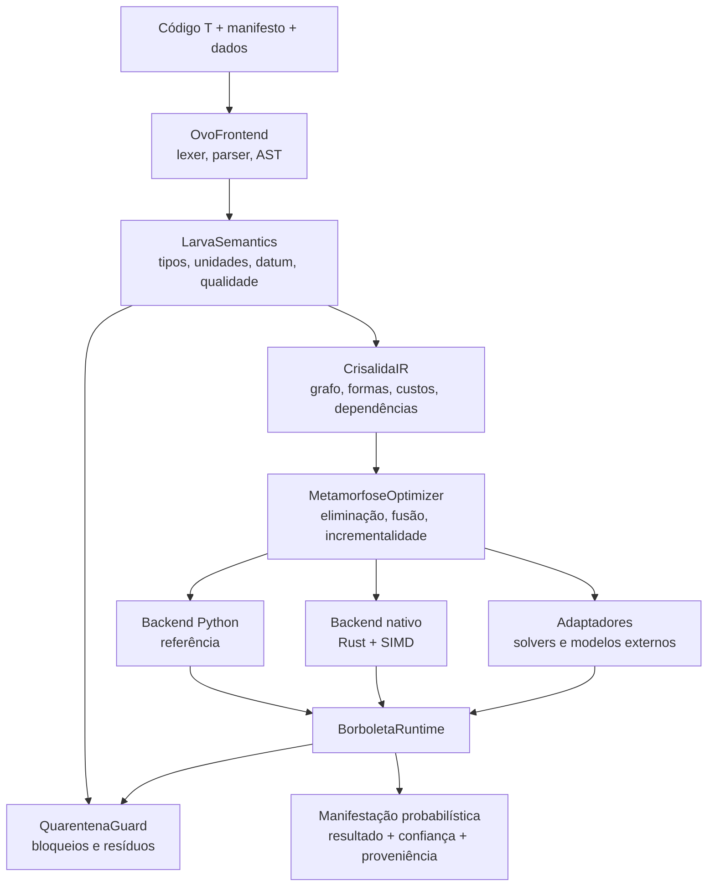

# Teloscorp — Roadmap para tornar a linguagem T operacional no Casulo FLOOD-RS

**Versão:** 1.0  
**Data:** 29 de julho de 2026  
**Horizonte:** compilador reproduzível → runtime eficiente → vertical FLOOD-RS → shadow mode

---

## 1. Objetivo

Transformar T de uma linguagem semântica que atualmente gera Python em uma linguagem de domínio capaz de:

1. compilar a partir de um checkout limpo;
2. verificar significado científico antes da execução;
3. representar arrays, tempo, unidades, estações, datum, qualidade e incerteza;
4. construir um grafo de dependências;
5. recalcular somente o que foi invalidado;
6. gerar kernels vetoriais ou nativos;
7. respeitar limites de memória, tempo e energia;
8. executar o primeiro gêmeo digital reduzido do Casulo FLOOD-RS;
9. produzir resultados probabilísticos com proveniência e possibilidade de auditoria.

O resultado pretendido não é “uma linguagem genérica mais rápida que todas as outras”. É:

> Uma linguagem compilável que conhece o significado, a forma, as dependências e o custo dos dados do Casulo, permitindo eliminar trabalho antes da execução.

---

## 2. Definição objetiva de “operacional”

T será considerada operacional quando, em uma máquina limpa, for possível executar:

```text
t doctor
t check flood_rs.t
t build flood_rs.t --profile edge
t inspect flood_rs.t --ir
t run flood_rs.t --input evento.json
t test
```

e obter:

- compilador instalado pelo repositório;
- gramática versionada;
- diagnósticos com arquivo, linha e coluna;
- AST e IR inspecionáveis;
- artefato reproduzível;
- execução sem recompilar a cada evento;
- resultado determinístico, salvo quando a aleatoriedade for declarada;
- erro explícito para operação não suportada;
- hash de entrada, plano, código e saída;
- testes passando;
- documentação suficiente para uma terceira pessoa reproduzir o processo.

### Condições que impedem declarar operacionalidade

- compilador disponível apenas dentro de um executável;
- dependência externa sem fonte ou versão bloqueada;
- duas gramáticas divergentes;
- geração de código sem verificação;
- recompilação a cada chamada;
- resultado sem unidade, datum, horário ou origem;
- delta que não reidrata o conteúdo completo;
- hash que não cobre todo o conteúdo;
- benchmark sem baseline;
- previsão pública sem validação fora da amostra.

---

## 3. Estado atual

### O que já existe

- IDE e CLI;
- núcleo sintático pequeno;
- lexer e parser por indentação;
- AST;
- verificação semântica;
- IR;
- estados `unknown`, `partial`, `stable` e `blocked`;
- resíduos semânticos;
- emissão de Python;
- inspeção de AST, IR, símbolos e resíduos;
- protótipo de núcleo, delta, metadados e reconstrução;
- analisador de requisitos e gerador de sprints;
- gerador alternativo de runtime Python;
- testes unitários e de integração.

### Bloqueadores atuais

| Bloqueador | Impacto |
|---|---|
| Compilador-fonte ausente do checkout | impede build reproduzível |
| Backend principal empacotado no executável | dificulta manutenção e open source |
| Duas superfícies diferentes da linguagem | semântica divergente |
| Backend Python escalar | não entrega a aceleração pretendida |
| Ausência de arrays tipados | compilador não reconhece kernels vetoriais |
| Ausência de grafo incremental | tudo tende a ser recalculado |
| Transporte apenas simulado | não há trânsito operacional |
| Delta de primeiro nível | alterações aninhadas podem retransmitir tudo |
| Reidratação incorreta em certos deltas | viola preservação integral |
| Hash incompleto | adulteração pode passar como válida |
| Dependências locais incompatíveis | ambiente não reproduzível |
| 12 testes falhando no checkout atual | release não confiável |

---

## 4. Decisões arquiteturais

### 4.1 Um monorepo inicialmente

Manter compilador, runtime, kernels, dialeto FLOOD-RS, testes e documentação no mesmo repositório até as interfaces estabilizarem.

Separar pacotes apenas quando houver:

- versão estável;
- API pública;
- testes de compatibilidade;
- necessidade real de ciclos independentes.

### 4.2 Um único frontend

Parser, AST e verificador devem ser únicos.

Construções experimentais podem existir, mas precisam ser marcadas:

```text
language T 1.0
feature experimental.loops
```

O compilador não pode aceitar silenciosamente uma construção em um caminho e rejeitá-la em outro.

### 4.3 Dois backends com funções diferentes

| Backend | Papel |
|---|---|
| Python de referência | legibilidade, depuração, testes diferenciais |
| Nativo | produção, arrays, SIMD, paralelismo e controle de memória |

O backend Python não será descartado. Ele será o oráculo legível usado para provar o backend nativo.

### 4.4 Runtime nativo em Rust

Razões:

- Rust e Cargo já estão instalados na máquina;
- controle de memória;
- concorrência segura;
- geração de biblioteca e executável;
- integração com Python;
- possibilidade de SIMD;
- boa distribuição para Windows e Linux.

Python permanece na orquestração científica e nos adaptadores enquanto for útil.

### 4.5 IR próprio antes de LLVM/MLIR

Primeiro construir um IR pequeno, estável e específico do Casulo.

Adotar LLVM/MLIR somente quando houver:

- tipos de array maduros;
- operações de domínio estáveis;
- passes demonstrados;
- necessidade comprovada de múltiplos alvos.

### 4.6 LLM fora do caminho de confiança

Modelos de linguagem podem:

- sugerir código;
- explicar resíduo;
- gerar documentação;
- ajudar a criar testes.

Não podem:

- alterar silenciosamente uma previsão;
- validar datum;
- inventar observação;
- aprovar integridade;
- substituir verificador, solver ou teste científico.

---

## 5. Arquitetura-alvo



### Componentes

```text
casulo/
├── compiler/
│   ├── ovo_frontend/
│   ├── larva_semantics/
│   ├── crisalida_ir/
│   ├── metamorfose_optimizer/
│   ├── borboleta_codegen/
│   └── quarentena_guards/
├── runtime/
│   ├── scheduler/
│   ├── cache/
│   ├── checkpoints/
│   ├── provenance/
│   └── resource_budget/
├── kernels/
│   ├── array/
│   ├── hydrology/
│   ├── routing/
│   ├── assimilation/
│   └── geospatial/
├── dialects/
│   └── flood_rs/
├── adapters/
├── conformance/
├── benchmarks/
├── examples/
└── docs/
```

---

## 6. Modelo de compilação

```text
fonte
→ AST
→ AST tipada
→ IR semântico
→ grafo de execução
→ passes de otimização
→ plano de memória
→ seleção de backend
→ artefato
→ runtime
```

### Artefato compilado

Um build deve gerar:

```text
build/flood_rs/
├── manifest.json
├── program.casulo-ir
├── execution-plan.json
├── kernels/
├── schemas/
├── provenance/
└── flood_rs.exe ou flood_rs.py
```

O manifesto precisa registrar:

- versão da linguagem;
- versão do compilador;
- hash do fonte;
- hash do IR;
- backend;
- capacidades de CPU utilizadas;
- dependências;
- parâmetros;
- tolerâncias;
- operações experimentais;
- data do build.

---

## 7. Evolução da linguagem

### 7.1 Núcleo T 1.0

Manter:

- `module`;
- `use`;
- `field`;
- `trace`;
- `condense`;
- `transition`;
- `judge`;
- `restrict`;
- `let`;
- `project`;
- `bind`;
- `stabilize`;
- `emit`;
- `if / else`.

### 7.2 Tipos novos

```text
Scalar<Int32 | Int64 | Float32 | Float64 | Bool>
Array<DType, Shape>
Raster<DType, Y, X>
Series<DType, Time>
Ensemble<DType, Member, Time, Space>
Optional<T>
Quality<State>
Probability
Duration
Timestamp<Timezone>
Unit<T, Dimension>
Station<Identifier, Datum>
Provenance
```

### 7.3 Atributos computacionais

```text
@pure
@incremental
@vectorize
@parallel(axis=member)
@cache(content)
@deterministic
@native
@reference
@surrogate(domain=...)
```

### 7.4 Orçamento como semântica

```text
budget ram <= 6 GiB
budget latency <= 120 s
budget workers <= 4
budget disk_cache <= 10 GiB
```

O compilador deve rejeitar ou degradar explicitamente um plano que exceda o perfil.

### 7.5 Fases Casulo

```text
ovo
larva
crisalida
metamorfose
borboleta
quarentena
```

Essas fases podem começar como anotações sobre as construções existentes. Não é necessário quebrar imediatamente a gramática congelada.

---

## 8. Roadmap por marcos

## Marco 0 — Resgate e baseline

**Duração indicativa:** 1–2 semanas  
**Objetivo:** tornar todo o compilador visível, versionado e testável.

### Entregáveis

- fonte do compilador dentro do repositório;
- inventário de módulos empacotados;
- especificação T 1.0 congelada;
- exemplos canônicos;
- ambiente bloqueado por lockfile;
- comando de instalação limpo;
- remoção de instalações duplicadas do fluxo de CI;
- relatório baseline de testes e desempenho.

### Atividades

1. Usar o backend empacotado apenas como oráculo comportamental.
2. Restaurar ou reimplementar seus módulos a partir da especificação.
3. Criar golden tests:
   - fonte;
   - AST;
   - diagnósticos;
   - IR;
   - Python gerado;
   - resultado.
4. Separar testes que dependem de GUI dos testes do compilador.
5. Fixar versões compatíveis de Python e bibliotecas.

### Gate M0

```text
git clone
→ instalar
→ t doctor
→ t check exemplo.t
→ t run exemplo.t
→ todos os testes do compilador passam
```

---

## Marco 1 — Frontend único e linguagem coerente

**Duração indicativa:** 2–3 semanas  
**Objetivo:** eliminar as gramáticas divergentes.

### Entregáveis

- EBNF oficial;
- lexer único;
- parser único;
- AST única;
- spans de arquivo/linha/coluna;
- versionamento de features;
- formatador mínimo;
- mensagens de erro estáveis;
- suíte de conformidade.

### Regras

- loop não pode existir somente no gerador alternativo;
- função desconhecida não pode virar chamada Python arbitrária;
- feature experimental precisa de flag;
- qualquer construção aceita precisa ter semântica documentada;
- qualquer backend precisa declarar se suporta a operação.

### Gate M1

- 100% do corpus válido compila;
- 100% do corpus inválido falha com diagnóstico previsto;
- AST realiza round-trip sem alterar significado;
- nenhum gerador possui parser próprio.

---

## Marco 2 — Compilador operacional de referência

**Duração indicativa:** 2–3 semanas  
**Objetivo:** fechar o ciclo check → build → run.

### Entregáveis

- `t check`;
- `t build`;
- `t run`;
- `t inspect`;
- `t test`;
- cache de compilação;
- artefato e manifesto;
- backend Python único;
- namespace compilado reutilizável;
- compatibilidade Windows/Linux.

### Correção imediata

O runtime não deve recompilar o programa em toda execução.

Chave de cache:

```text
hash(fonte + versão do compilador + flags + dependências)
```

### Gate M2

- segunda execução não recompila;
- artefatos iguais para entradas e versões iguais;
- alteração de fonte invalida o cache;
- comando `run` não depende da IDE;
- pacote instalável possui todo o compilador-fonte.

### Resultado ao final de M2

T estará **operacional como linguagem interpretada/compilada para Python**, mas ainda não será o acelerador do Casulo.

---

## Marco 3 — Tipos científicos

**Duração indicativa:** 3–5 semanas  
**Objetivo:** dar ao compilador conhecimento suficiente para otimizar corretamente.

### Entregáveis

- `Float32` e `Float64`;
- arrays;
- formas estáticas e parcialmente dinâmicas;
- unidades;
- timestamps e timezone;
- séries;
- rasters;
- ensemble;
- `Station`;
- `Datum`;
- `Quality`;
- `Provenance`;
- valores ausentes;
- tolerância numérica.

### Verificações obrigatórias

O compilador deve rejeitar:

```text
nível do Cais Mauá + nível do Gasômetro sem conversão
milímetros + metros
vazão + precipitação
timestamp sem timezone em dado operacional
observação sem origem
probabilidade fora de 0..1
```

### Gate M3

- testes dimensionais;
- erros de datum detectados;
- shape inference;
- serialização sem perda;
- conversões explícitas;
- Python de referência produz o resultado esperado.

---

## Marco 4 — CrisálidaIR e execução incremental

**Duração indicativa:** 3–5 semanas  
**Objetivo:** fazer o Casulo saber o que não deve recalcular.

### Entregáveis

- IR em SSA ou forma funcional equivalente;
- DAG de dependências;
- pureza;
- regiões de leitura e escrita;
- janelas temporais;
- cache por conteúdo;
- checkpoints;
- dirty propagation;
- invalidação;
- chunks;
- backpressure;
- orçamento de memória.

### Passes iniciais

1. constant folding;
2. dead-code elimination;
3. common-subexpression elimination;
4. operator fusion;
5. cache insertion;
6. incremental slicing;
7. buffer reuse;
8. chunk planning.

### Experimento obrigatório

Em um grafo com 100 nós:

- alterar 1% da entrada;
- recomputar apenas descendentes afetados;
- comparar contra recomputação integral;
- exigir igualdade dentro da tolerância.

### Gate M4

- mudança de 1% não pode causar recomputação de 100% sem justificativa no grafo;
- cache reiniciável;
- resultado incremental igual ao integral;
- pico de RAM respeita o orçamento;
- plano é inspecionável.

---

## Marco 5 — Arrays vetoriais

**Duração indicativa:** 2–4 semanas  
**Objetivo:** reproduzir oficialmente o ganho observado de centenas de vezes.

### Entregáveis

- backend NumPy;
- operações element-wise;
- redução;
- máscaras;
- janela;
- agregação espacial;
- alocação `out=`;
- fusão de expressões simples;
- benchmark padronizado.

### Benchmark de aceitação

```text
ΔS = P - ET - Qs - Qb
```

- 1 milhão de células;
- `float32`;
- 30 repetições;
- resultado igual ao backend de referência;
- p50 e p95 publicados;
- pico de memória publicado.

### Gate M5

- pelo menos 100× sobre o laço Python escalar na máquina de referência;
- nenhum erro numérico fora da tolerância;
- nenhum array temporário desnecessário conhecido;
- benchmark reproduzível por comando.

---

## Marco 6 — Metamorfose nativa

**Duração indicativa:** 4–7 semanas  
**Objetivo:** deixar o desempenho independente de detalhes do interpretador Python.

### Entregáveis

- crate Rust do runtime;
- registro de kernels;
- ABI estável;
- bindings Python;
- kernels AVX2 quando disponíveis;
- fallback portátil;
- pool de workers;
- scheduler ciente de memória;
- cancelamento;
- telemetria;
- build nativo.

### Interface conceitual de kernel

```text
contract:
  inputs
  outputs
  shapes
  units
  purity
  determinism
  memory_cost
  supported_backends

execute:
  input_buffers
  output_buffers
  execution_context
```

### Gate M6

- backend nativo e Python passam em testes diferenciais;
- artefato roda sem IDE;
- AVX2 é usado apenas após detecção;
- fallback funciona em CPU sem AVX2;
- falha de kernel não corrompe checkpoint;
- consumo de memória é limitado.

---

## Marco 7 — Trânsito correto do Casulo

**Duração indicativa:** 3–5 semanas  
**Objetivo:** implementar preservação integral com economia real de bytes.

### Entregáveis

- conteúdo canônico;
- base endereçada por hash;
- delta estrutural recursivo;
- operações de patch explícitas;
- Merkle root;
- codec;
- cache do receptor;
- protocolo local;
- retomada;
- idempotência;
- reordenação;
- deduplicação;
- compressão;
- métricas de bytes e CPU.

### Invariantes

```text
rehydrate(base, delta) == payload
hash(payload) == hash(rehydrated)
apply(delta) duas vezes não corrompe estado
delta sem base correta é rejeitado
alteração de um bit é detectada
```

### Gate M7

- property tests com objetos aninhados;
- fuzzing;
- teste adversarial;
- primeiro envio não pode ser chamado de otimizado se ficar maior;
- delta só é utilizado quando custo total for menor;
- fallback envia o payload integral.

---

## Marco 8 — Dialeto T/FLOOD-RS

**Duração indicativa:** 4–7 semanas  
**Objetivo:** construir a primeira vertical científica do Casulo.

### Tipos de domínio

```text
GaugeObservation
RiverLevel
Discharge
RainGrid
SoilState
BasinState
ForecastMember
PumpState
PowerState
Threshold
CrossingProbability
ForecastManifest
```

### Operações mínimas

- ingestão de snapshot;
- QC;
- datum;
- preenchimento controlado;
- campo de chuva;
- balanço hídrico;
- chuva–vazão reduzido;
- roteamento;
- assimilação simples;
- ensemble;
- probabilidade de cruzamento;
- proveniência;
- quarentena.

### Vertical mínima

```text
observações históricas congeladas
→ QC
→ chuva por sub-bacia
→ estado do solo
→ vazão
→ roteamento
→ nível em estação
→ P(H > cota)
→ relatório auditável
```

### O que fica fora desse marco

- meteorologia global local;
- hidráulica 2D completa;
- drenagem urbana integral;
- previsão pública;
- alerta oficial;
- ingestão de todas as fontes;
- decisão governamental automatizada.

### Gate M8

- hindcast reproduzível;
- baseline de persistência;
- erro de pico;
- erro de horário;
- Brier Score;
- CRPS;
- relatório de dados ausentes;
- cada número possui estação, datum, horário, unidade, qualidade e origem.

---

## Marco 9 — Multi-fidelidade

**Duração indicativa:** 6–12 semanas  
**Objetivo:** substituir grandes volumes de simulação por seleção inteligente, sem esconder incerteza.

### Entregáveis

- modelo reduzido;
- surrogate;
- domínio de validade;
- detector fora de distribuição;
- ensemble clustering;
- seleção de representantes;
- promoção para alta fidelidade;
- correção de resíduos;
- comparação contínua com física.

### Política

```text
baixo risco + dentro do domínio
→ surrogate

incerteza intermediária
→ modelo reduzido + surrogate

alto risco ou fora do domínio
→ modelo físico de maior fidelidade
```

### Gate M9

- validação fora da amostra;
- extremos separados do treinamento;
- cobertura probabilística;
- aceleração end-to-end;
- degradação de precisão quantificada;
- extrapolação colocada em Quarentena.

---

## Marco 10 — Shadow mode

**Duração mínima:** 3–6 meses, além de hindcasts  
**Objetivo:** provar utilidade operacional sem emitir alerta público.

### Operação

- execução automática;
- snapshots imutáveis;
- previsão assinada;
- atualização a cada observação;
- comparação posterior com observado;
- registro de indisponibilidade;
- relatório semanal;
- revisão científica.

### Gate M10

- nenhum datum misturado;
- taxa de falha conhecida;
- falsos alarmes medidos;
- eventos perdidos medidos;
- antecedência medida;
- energia por previsão medida;
- versão de modelo identificável;
- reprodução de uma previsão antiga por hash.

Somente depois desse marco deve ser discutida qualquer comunicação pública operacional.

---

## 9. Cronograma consolidado

Os prazos são estimativas de engenharia, não compromissos.

| Horizonte | Resultado |
|---|---|
| 30 dias | fonte restaurado, gramática única, checkout compilável |
| 60 dias | compilador Python operacional, cache e artefatos |
| 90 dias | tipos científicos iniciais e grafo incremental |
| 120 dias | arrays vetoriais e benchmark oficial |
| 180 dias | runtime nativo e primeira vertical FLOOD-RS |
| 6–9 meses | multi-fidelidade e hindcasts |
| 9–12 meses | shadow mode amadurecido |

### Esforço aproximado

| Formação | Estimativa até vertical FLOOD-RS |
|---|---|
| Uma pessoa em tempo integral, com assistência de IA | 6–9 meses |
| 2 engenheiros + 1 especialista hidrológico parcial | 4–6 meses |
| 3–4 engenheiros + especialistas científicos | 3–5 meses |

Essas estimativas assumem escopo reduzido. Um gêmeo digital público e operacional exige validação institucional e científica adicional.

---

## 10. Plano dos primeiros 30 dias

### Semana 1 — Resgate

1. Criar estrutura `compiler/`, `runtime/`, `conformance/`.
2. Registrar a especificação T 1.0.
3. Exportar inventário comportamental do backend empacotado.
4. Criar 20 programas golden.
5. Fixar ambiente.
6. Criar CI Windows e Linux.

### Semana 2 — Frontend

1. Restaurar lexer.
2. Restaurar parser.
3. Restaurar AST.
4. Implementar spans.
5. Restaurar diagnósticos.
6. Fazer testes golden de parse.

### Semana 3 — Semântica e IR

1. Restaurar símbolos.
2. Restaurar tipos existentes.
3. Restaurar estados e resíduos.
4. Restaurar IR.
5. Restaurar verificação do IR.
6. Criar dump textual estável.

### Semana 4 — Build e run

1. Unificar emissão Python.
2. Implementar cache.
3. Implementar artefato.
4. Implementar `t build`.
5. Implementar `t run`.
6. Fazer suíte completa passar.
7. Publicar release `0.1.0-alpha`.

### Resultado dos 30 dias

```text
T compila e executa de forma reproduzível.
Ainda não é o acelerador nativo.
Mas deixa de depender do executável antigo e vira um projeto open source real.
```

---

## 11. Backlog inicial

### Épico COMPILER-001 — Fonte aberto

- `T-001` Criar pacote do compilador.
- `T-002` Versionar a gramática.
- `T-003` Restaurar lexer.
- `T-004` Restaurar parser.
- `T-005` Restaurar AST.
- `T-006` Restaurar checker.
- `T-007` Restaurar IR.
- `T-008` Restaurar emitter Python.
- `T-009` Criar manifest.
- `T-010` Eliminar dependência do backend empacotado.

### Épico CONFORMANCE-001 — Verdade comportamental

- `T-011` Corpus válido.
- `T-012` Corpus inválido.
- `T-013` Golden AST.
- `T-014` Golden IR.
- `T-015` Golden Python.
- `T-016` Teste diferencial.
- `T-017` Fuzzing do parser.

### Épico RUNTIME-001 — Execução persistente

- `T-018` Cache por hash.
- `T-019` Namespace reutilizável.
- `T-020` Artefato.
- `T-021` Checkpoint.
- `T-022` Cancelamento.
- `T-023` Telemetria.

### Épico SCIENCE-001 — Tipos

- `T-024` Dtypes.
- `T-025` Arrays.
- `T-026` Shapes.
- `T-027` Unidades.
- `T-028` Tempo.
- `T-029` Estação e datum.
- `T-030` Qualidade.
- `T-031` Proveniência.
- `T-032` Ensemble.

### Épico OPTIMIZER-001 — Trabalho mínimo

- `T-033` DAG.
- `T-034` Pureza.
- `T-035` Dirty propagation.
- `T-036` Cache insertion.
- `T-037` Operator fusion.
- `T-038` Buffer reuse.
- `T-039` Chunk planning.
- `T-040` Resource budgets.

### Épico NATIVE-001 — Backend

- `T-041` Runtime Rust.
- `T-042` ABI.
- `T-043` Kernel registry.
- `T-044` Array kernel.
- `T-045` AVX2.
- `T-046` Worker pool.
- `T-047` Bindings Python.

### Épico FLOOD-001 — Vertical

- `T-048` Tipos hidrológicos.
- `T-049` Snapshot de dados.
- `T-050` QC.
- `T-051` Campo de chuva.
- `T-052` Estado do solo.
- `T-053` Chuva–vazão.
- `T-054` Roteamento.
- `T-055` Ensemble.
- `T-056` Cruzamento probabilístico.
- `T-057` Relatório e proveniência.

---

## 12. Estratégia de testes

### Compilador

- unitários;
- golden;
- property-based;
- fuzzing;
- diagnóstico;
- conformance;
- compatibilidade de versão.

### Backend

- Python versus nativo;
- `float32` versus `float64`;
- um versus quatro workers;
- arrays pequenos, médios e grandes;
- shapes irregulares;
- missing values;
- cancelamento.

### Incrementalidade

- atualização de 1%;
- atualização de 10%;
- atualização total;
- cache frio;
- cache quente;
- reinício;
- corrupção de cache;
- dependência cíclica.

### Trânsito

- delta aninhado;
- lista;
- raster;
- perda;
- duplicação;
- reordenação;
- adulteração;
- base ausente;
- versão divergente.

### Científico

- conservação;
- monotonicidade onde aplicável;
- unidade;
- datum;
- eventos históricos;
- fora da amostra;
- extremos;
- confiabilidade probabilística.

---

## 13. Benchmark oficial

O repositório deve conter:

```text
casulo bench compiler
casulo bench kernel
casulo bench incremental
casulo bench transport
casulo bench flood-rs
casulo bench energy
```

### Métricas mínimas

- p50, p95 e p99;
- tempo de compilação;
- tempo de execução;
- pico de RAM;
- bytes;
- cache hit;
- percentual reexecutado;
- energia;
- erro numérico;
- versão de hardware e software.

### Baselines

- Python escalar;
- NumPy;
- backend nativo;
- recomputação integral;
- execução incremental;
- modelo físico;
- modelo reduzido;
- persistência hidrológica.

Nenhum multiplicador de desempenho deve ser publicado sem nomear explicitamente o baseline.

---

## 14. Perfil da máquina de referência

```text
casulo-edge-reference:
  cpu: Intel Core i5-1235U
  physical_cores: 10
  logical_processors: 12
  ram: 15.73 GiB
  vector_extensions: AVX2
  storage: NVMe
  current_free_storage: 24.8 GiB
```

### Limites do perfil

```text
runtime_ram: 6 GiB
total_application_ram: 8 GiB
workers_default: 4
disk_cache: 10 GiB
minimum_free_disk_after_run: 5 GiB
```

O número de workers precisa ser medido. Quatro workers podem ser mais rápidos ou mais lentos que um kernel vetorial único quando a largura de banda de memória já está saturada.

---

## 15. Definição de pronto para o MVP FLOOD-RS

O MVP estará pronto quando:

1. uma terceira pessoa instalar o projeto;
2. baixar ou receber um snapshot documentado;
3. compilar o programa T;
4. executar um hindcast;
5. obter distribuição probabilística;
6. inspecionar as entradas;
7. verificar estação, datum, horário, unidade e origem;
8. reproduzir o resultado por hash;
9. comparar com persistência;
10. executar novamente alterando somente uma observação;
11. comprovar que somente o subgrafo afetado foi recalculado;
12. medir tempo, RAM, bytes e energia;
13. observar Quarentena quando faltar dado crítico.

### Meta computacional inicial

```text
51 membros
atualização a cada 15 minutos
p95 end-to-end < 5 minutos
pico de RAM < 8 GiB
modo degradado documentado
```

### Meta científica inicial

Não fixar valores arbitrários antes do dataset.

Definir após o primeiro baseline:

- erro aceitável de pico;
- erro aceitável de horário;
- Brier Skill Score contra persistência;
- cobertura dos intervalos;
- limite de falso alarme;
- regra de fora de domínio.

---

## 16. Riscos principais

| Risco | Mitigação |
|---|---|
| Tentar construir compilador, modelo e plataforma simultaneamente | marcos com gates |
| Reescrever tudo antes de reproduzir o comportamento atual | backend empacotado como oráculo |
| Otimizar sem tipos e formas | tipos científicos antes do backend nativo |
| Confundir microbenchmark com sistema completo | benchmark end-to-end obrigatório |
| Surrogate falhar em extremo | detector fora de domínio e promoção para física |
| Falta de dados | snapshots e proveniência |
| RAM insuficiente | chunks, orçamento e backpressure |
| Disco insuficiente | cache limitado e armazenamento externo |
| Divergência Python/nativo | testes diferenciais |
| Complexidade do MLIR prematura | IR próprio primeiro |
| Resultado rápido, mas cientificamente errado | gates científicos não negociáveis |

---

## 17. Ordem que não deve ser invertida

```text
1. Reprodutibilidade
2. Correção semântica
3. Tipos científicos
4. Grafo incremental
5. Vetorização
6. Backend nativo
7. Dialeto FLOOD-RS
8. Multi-fidelidade
9. Shadow mode
10. Comunicação operacional
```

Pular diretamente para IA, GPU ou hidráulica 2D criaria um sistema rápido sem uma base confiável.

---

## 18. Próxima ação

Iniciar o **Marco 0** com um repositório Casulo separado e uma primeira sprint:

```text
Sprint: Ovo — Fonte aberto

Objetivo:
  compilar e executar o programa canônico sem depender do executável empacotado

Entregáveis:
  - estrutura do repositório
  - especificação T 1.0
  - lexer
  - parser
  - AST
  - 20 golden tests
  - t check
  - CI

Gate:
  checkout limpo + testes verdes
```

Essa sprint não busca desempenho. Ela cria a fundação verificável sobre a qual o ganho de centenas de vezes poderá ser transformado de experimento em propriedade real do Casulo.
